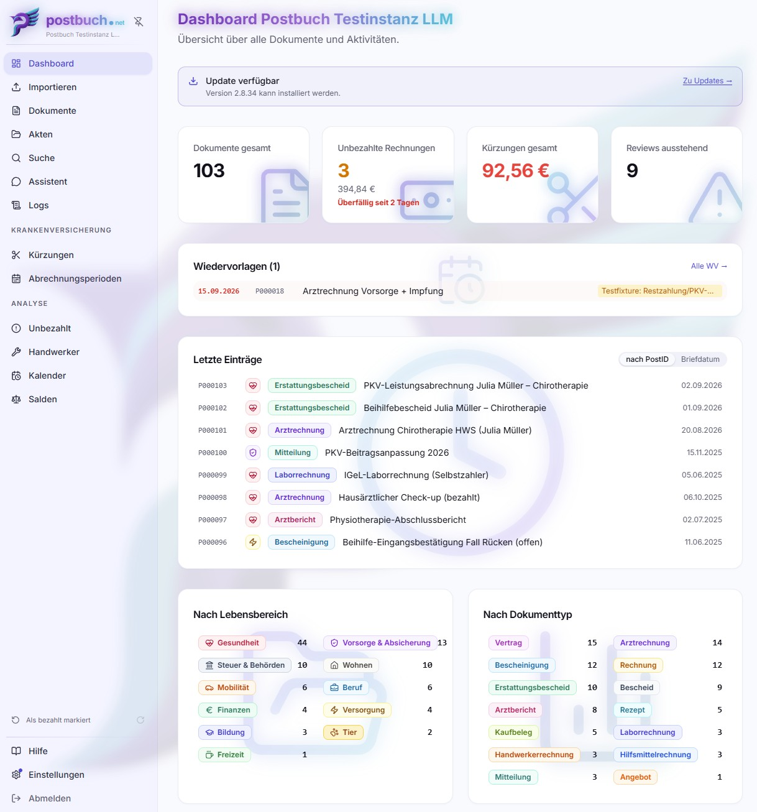

<p align="center">
  
</p>

# postbuch.net - Dokumentenverwaltung mit KI

**Deine Post, automatisch gelesen, sauber abgelegt und jederzeit wiederzufinden.**

postbuch.net ist eine selbstgehostete Anwendung für die private Dokumentenablage
im Haushalt. Du scannst einen Brief oder lädst ein PDF hoch, eine KI liest es,
trägt Absender, Datum, Betreff und Dokumentart ein und legt die Datei mit
sprechendem Namen in OneDrive oder deiner Nextcloud ab. Später findest du es
über eine Suche, die nach Bedeutung statt nur nach Wörtern sucht, oder fragst
einfach im Chat danach.

Das Backend läuft in Docker auf deinem eigenen Rechner, ein Raspberry Pi
genügt. Die Oberfläche öffnest du im Browser oder installierst sie als App auf
PC, Smartphone und Tablet.

<p align="center">
  <picture>
    <source srcset=".github/assets/postbuch-net-promo.avif" type="image/avif">
    
  </picture>
</p>

## Was postbuch.net für dich erledigt

- **Erfassen ohne Abtippen.** Die KI versteht jedes Dokument und trägt die
  Metadaten selbst ein: Absender, Datum, Betreff, Dokumentart, Betrag, eine
  kurze Zusammenfassung und Schlagworte.
- **Ablegen ohne Nachdenken.** Jede Datei landet mit passendem Namen in einer
  aufgeräumten Ordnerstruktur in deiner Cloud-Ablage. Die Ordner bleiben auch
  ohne postbuch.net lesbar.
- **Wiederfinden, auch nach Jahren.** Die semantische Suche findet ein
  Dokument auch, wenn du andere Begriffe verwendest als der Absender. Im Chat
  beantwortet die KI Fragen zu deinen Unterlagen und zeigt die Belege, aus
  denen sie die Antwort ableitet.
- **Fristen und Wiedervorlagen im Blick.** Erinnerungen kommen als
  Push-Nachricht aufs Handy.
- **Zusammenhänge mit einem Klick.** Ähnliche Dokumente, etwa alle Rechnungen
  eines Handwerkers oder alle Unterlagen zu einem Autounfall, lassen sich
  finden und zu einer Akte bündeln.
- **Arztrechnungen für Privatversicherte.** Für PKV und Beihilfe sammelt
  postbuch.net die Belege, bündelt sie für die Einreichung und gleicht die
  Erstattungen automatisch ab. Kürzungen meldet es dir zur Prüfung.

Gedacht ist postbuch.net für alles, was als Brief oder PDF ins Haus kommt:
Rechnungen, Verträge, Angebote, Kaufbelege, Gesundheitsunterlagen, Bescheide
von Behörden, Versicherungen und Banken, Kontoauszüge, Steuerunterlagen und
Urkunden.

## Funktionen

- Posteingang über Netzwerkscanner, Handykamera, Datei-Upload, das Teilen-Menü
  des Smartphones oder einen überwachten Cloud-Ordner – alles läuft in
  derselben Warteschlange zusammen.
- KI-Analyse jedes Dokuments mit frei wählbarem Anbieter: OpenAI, Anthropic,
  Mistral (mit EU-Rechenzentren), AWS Bedrock oder jeder OpenAI-kompatible
  Endpunkt, auch selbst gehostet.
- Ablage in OneDrive oder einer Nextcloud (selbst betrieben oder z. B.
  MagentaCLOUD), mit einem Umzug, der in beide Richtungen läuft.
- Semantische Suche und Chat mit den eigenen Dokumenten, jeweils mit Belegen.
- Akten, Fristen, Wiedervorlagen und Verbleib der Papieroriginale.
- Arztrechnungen, PKV und Beihilfe: Belege sammeln, für die Einreichung
  bündeln, nachhalten, Erstattungen und Kürzungen automatisch abgleichen.
- Auswertungen wie unbezahlte Rechnungen und Handwerkerkosten fürs Finanzamt,
  Excel-Export und Export einer Akte, etwa für den Anwalt.
- Push-Benachrichtigungen für neue Dokumente, Fehler, Duplikate, Fristen und
  Wiedervorlagen.
- Mehrere Personen im Haushalt mit Voll- oder Lesezugriff; ein Lesezugriff
  lässt sich auf die eigenen Dokumente beschränken.
- Etikettendruck fürs Papieroriginal (Niimbot D110).
- MCP-Server: postbuch.net als Datenquelle für Claude Desktop, ChatGPT und
  andere Tools.
- Backup und Wiederherstellung der Datenbank in der Oberfläche; die Dokumente
  selbst sicherst du über deine Ablage.
- Signierte Releases; die Oberfläche meldet neue Versionen samt Änderungen.

## Ist postbuch.net das Richtige für dich?

postbuch.net passt gut, wenn

- du **privat** Ordnung in deine Unterlagen bringen willst, allein oder im
  Haushalt,
- du **in Deutschland** lebst – Oberfläche, Doku und KI-Auswertung sind
  deutsch, und Fachfunktionen wie PKV und Beihilfe, GOÄ/GOZ, der Steuerabzug
  für Handwerkerleistungen oder deutsche IBANs setzen deutsche Verhältnisse
  voraus,
- du einen kleinen Server betreiben magst – die Installation ist geführt,
  etwas Terminal-Grundwissen (per SSH verbinden, einen Befehl einfügen) solltest
  du aber mitbringen.

Weniger passend ist es für Unternehmen, Selbstständige und Vereine: Dafür
bietet postbuch.net weder einen Auftragsverarbeitungsvertrag noch eine
revisionssichere Ablage, und die Rechtsfragen lägen allein bei dir.

postbuch.net archiviert **PDFs**. Fotos vom Handy wandelt die Kamerafunktion
selbst in PDFs um. Ein Editor für Entwürfe ist es nicht.

### Was du brauchst

- **Einen Linux-Rechner, der durchläuft**, z. B. einen Raspberry Pi mit
  mindestens 2 GB RAM. Docker richtet der Installer auf Debian/Ubuntu-artigen
  Systemen selbst ein.
- **Einen Zugang zu einem Sprachmodell**, z. B. einen API-Key bei OpenAI,
  Mistral oder Anthropic. Bei OpenAI reicht die Mindestaufladung von 5
  US-Dollar je nach Modellwahl in der Regel für viele Monate privater Nutzung.
  Alternativ betreibst du einen eigenen KI-Server, etwa mit Ollama oder LM
  Studio. Die Embeddings für Suche und Duplikatprüfung berechnet postbuch.net
  mit einem eingebauten Dienst selbst.
- **Eine Ablage**: ein Microsoft-Konto für OneDrive (der Assistent führt dich
  durch die dafür nötige kostenlose Azure-App-Registrierung) **oder** eine
  Nextcloud bzw. ownCloud, selbst betrieben oder bei einem Anbieter. OneDrive
  und MagentaCLOUD bieten kostenlose Tarife, die für die meisten privaten
  Archive reichen.
- **Empfohlen:** eine kostenlose DuckDNS-Subdomain. Damit bekommt die Instanz
  automatisch HTTPS, und App-Installation sowie Push-Nachrichten werden
  möglich.
- **Optional:** einen eSCL-fähigen Netzwerkscanner (das kann fast jedes
  aktuelle Multifunktionsgerät) und einen Niimbot-D110-Etikettendrucker.

Einzelheiten stehen unter [Voraussetzungen](docs/voraussetzungen.md).

## Schnellstart

Der empfohlene Weg ist ein einzelner Installationsbefehl – kein manuelles
`git clone` und kein Editieren einer `.env`:

```bash
curl -fsSL https://github.com/ceramgcf/postbuch.net/releases/latest/download/install.sh | bash
```

Der Installer lädt das aktuelle, signierte Release, prüft es, richtet Docker bei
Bedarf selbst ein und fragt nur, was der Server selbst wissen muss:

- Name der Instanz und Admin-Passwort – Datenbank- und Session-Secret erzeugt
  der Installer selbst, zufällig,
- ob ein vorhandenes Datenbank-Backup eingespielt werden soll (für Umzug oder
  Neuaufbau),
- optional eine DuckDNS-Domain für automatisches HTTPS und ob die Oberfläche
  danach nur noch darüber erreichbar sein soll.

Am Ende startet der Stack und der Installer nennt die Adresse. Dort meldest du
dich als Admin an.

### Danach: der Einrichtungsassistent

Nach dem ersten Login öffnet sich der Einrichtungsassistent. Er führt durch
Instanz und Netzwerk, Personen und Zugänge, die Verbindung zur Ablage samt
Ordnerstruktur, KI und Embeddings, Scanner, Benachrichtigungen und Backup.
Jeder Schritt prüft sein Ergebnis gegen den echten Dienst und zeigt an, was
noch offen ist. Optionale Schritte wie Scanner und Benachrichtigungen dürfen
offenbleiben; ohne verbundene Ablage hat postbuch.net dagegen keine
Dokumentenfunktion. Alle Werte lassen sich später einzeln unter
`Einstellungen` ändern.

### Alternative: manuell mit Docker Compose

Wer keine Installationsskripte per Pipe ausführen möchte: Repository klonen,
`.env` aus `.env.example` selbst befüllen (Secrets, Ablage, Domain) und
`docker compose up -d --build` starten. Alles, was der Installer automatisch
setzt, gehört dann von Hand in die `.env`. Der Einrichtungsassistent läuft
danach genauso. Ausführlich in [docs/installation.md](docs/installation.md).

### Von unterwegs

Die Instanz bleibt im Heimnetz. Von unterwegs erreichst du sie über ein VPN,
etwa mit WireGuard auf der FRITZ!Box oder mit Tailscale – eine Portfreigabe
für postbuch.net ist nicht nötig. Die gewohnte Adresse, die installierte App
und Push-Nachrichten funktionieren dann wie zu Hause. Anleitung:
[Zugriff von unterwegs](docs/zugriff-von-unterwegs.md).

## Datenschutz, Sicherheit und Projektstatus

Damit du weißt, worauf du dich einlässt:

- **Deine Dokumente gehen dorthin, wohin du sie schickst.** postbuch.net ist
  kein Cloud-Dienst: Das Projekt betreibt keine Server, speichert nichts und hat
  keinen Zugriff auf deine Daten. Zum Lesen gehen die Dokumente an den
  KI-Anbieter, den du auswählst, und abgelegt werden sie bei deinem
  Speicher-Anbieter – beides mit deinen eigenen Zugangsdaten. Wähle diese
  Anbieter bewusst, denn sie sehen deine Dokumente.
- **Ein Betrieb ganz ohne Cloud ist möglich**, mit eigener Nextcloud und
  lokalen KI-Modellen; der Cloud-frei-Check unter
  `Einstellungen → Allgemein` zeigt, ob alles im eigenen Netz bleibt. Dafür
  brauchst du passende Hardware und etwas Erfahrung, und bei kniffligen
  Dokumenten bleibt die Qualität lokaler Modelle derzeit hinter Cloud-Modellen
  zurück.
- **Im Heimnetz betreiben, nicht offen im Internet.** postbuch.net verarbeitet
  Gesundheits- und Finanzdaten, hat aber keine Zwei-Faktor-Anmeldung und ist
  nicht für den offenen Betrieb gehärtet. Von unterwegs ist ein VPN der
  passende Weg (siehe oben).
- **Die Ablage-Verbindung reicht weit.** Bei OneDrive arbeiten neue
  Verbindungen nur im eigenen App-Ordner; ältere mit Vollzugriff lassen sich
  unter `Einstellungen → Dateiablage` darauf umstellen. Ein Nextcloud-App-Passwort gilt
  dagegen meist für das ganze Konto; dass postbuch.net nur in seinem Ordner
  bleibt, ist dort eine Selbstbeschränkung der Anwendung. Die Zugangsdaten
  liegen unverschlüsselt in der Datenbank. Wer Zugriff auf den Server hat, hat
  also auch Zugriff auf die Ablage. Wer das begrenzen will, nutzt ein eigenes
  Konto nur für postbuch.net. Einzelheiten unter
  [Sicherheit](docs/sicherheit.md#wie-weit-der-zugriff-auf-die-dateiablage-reicht).
- **Ein Hobbyprojekt in der Public Beta.** postbuch.net ist bei seinem
  Entwickler täglich im Einsatz, aber noch jung. Zwischen Versionen kann sich
  einiges ändern, und Fehler kommen vor; regelmäßige Backups gehören deshalb
  dazu. Der Code ist maßgeblich mit
  KI-Coding-Werkzeugen entstanden und nicht vollständig von Menschen
  gegengeprüft. Es gibt keine Garantie und keinen Support im kommerziellen
  Sinn. Fehlerberichte sind als
  [Issue](https://github.com/ceramgcf/postbuch.net/issues) willkommen, Fragen
  und Ideen in den
  [Discussions](https://github.com/ceramgcf/postbuch.net/discussions).

Weitere Hinweise:

- Bei der manuellen Installation müssen die Platzhalter in der `.env` (u. a.
  `APP_PASSWORD=CHANGEME`) vor dem ersten Start ersetzt werden. Die `.env`
  enthält Admin-Passwort und Secrets im Klartext und gehört nie in ein
  Repository.
- Ein Datenbank-Backup ist standardmäßig verschlüsselt und enthält dann auch
  die Zugangsdaten zu Ablage und KI. Unverschlüsselte Backups lassen die
  Zugangsdaten weg, alle übrigen Daten stehen dann im Klartext darin.
- Der Scanner-Webhook ist bei neuen Installationen nur auf dem Rechner selbst
  erreichbar und wird unter `Einstellungen → Scanner` freigegeben.

Sicherheitslücke gefunden? Bitte über GitHubs privates Vulnerability-Reporting
melden (Tab „Security" → „Report a vulnerability"), nicht als öffentliches
Issue – siehe [SECURITY.md](SECURITY.md).

## Architektur

Docker Compose betreibt folgende Dienste:

- `postgres`: PostgreSQL + pgvector
- `app`: Node.js-API und Hintergrundjobs
- `web`: React-Oberfläche, ausgeliefert über nginx
- `caddy`: Reverse-Proxy mit automatischem HTTPS
- `scanner` + `cleaner`: eSCL-Scanner-Webhook und
  OCR-/Bildbereinigungs-Pipeline, gemeinsam optional über das Compose-Profil
  `scanner`

## Lizenz

Copyright (c) 2026 ceramgcf

postbuch.net ist freie Software unter der
[GNU Affero General Public License, Version 3](LICENSE): Nutzung, Selfhosting,
Veränderung und Weitergabe sind erlaubt, auch kommerziell.

Mitgelieferte Drittkomponenten behalten ihre eigene Lizenz, siehe
[THIRD-PARTY-NOTICES.md](THIRD-PARTY-NOTICES.md). **Das Projekt-Logo ist von
dieser Lizenz ausgenommen** – siehe [LOGO-LICENSE.md](LOGO-LICENSE.md). Name und
Marke sind ebenfalls nicht Teil der Lizenz, siehe [TRADEMARK.md](TRADEMARK.md).

## Transparenzhinweise

Nennungen konkreter Anbieter bzw. Hersteller in diesem README (z. B. Microsoft,
OpenAI, Anthropic, DuckDNS, Niimbot) sowie deren Unterstützung im Code erfolgen
unabhängig aus eigener Erfahrung des Entwicklers – nicht gesponsert, keine
Affiliate-Links, keine Provisionen oder sonstigen Zuwendungen von den genannten
Anbietern.

Auch im Übrigen ist das Projekt vollständig nicht-kommerziell. Es besteht auch
keine Spendenmöglichkeit.

## Weiterführende Dokumentation

Die ausführliche Dokumentation liegt in [`docs/`](docs/README.md).

**Einstieg**

- [Überblick](docs/ueberblick.md) – was postbuch.net ist, welche Begriffe gelten, worauf man sich einlässt
- [Voraussetzungen](docs/voraussetzungen.md) – Server, Ablage, KI-Anbieter, optionale Hardware
- [Installation](docs/installation.md) – Installer, manuelle Alternative, Einrichtungsassistent, OAuth-Sonderfälle

**Tägliche Arbeit**

- [Die Oberfläche](docs/oberflaeche.md) – alle Module der Web-App im Überblick
- [Dokumente importieren](docs/dokumente-importieren.md) – die sechs Eingangswege, Duplikate, Fehlerfälle
- [Die Dokumentansicht](docs/dokumentansicht.md) – Freigabe, Metadaten, Bestreiten, Erstattungen verknüpfen, Kürzungen, PDF-Betrachter
- [Akten, Verbleib und Wiedervorlagen](docs/akten-und-organisation.md) – Ordnung schaffen, Papieroriginale, Fristen
- [Suche und Assistent](docs/suche-und-assistent.md) – Volltext, semantische Suche, Chat mit den eigenen Dokumenten
- [PKV, Beihilfe und Abrechnung](docs/abrechnung-pkv-beihilfe.md) – Arztrechnungen, Einreichungen, Erstattungen, Kürzungen
- [Export und Import](docs/export-import.md) – Akte für den Anwalt, Auswertung, Umzug zwischen Instanzen
- [Mobil und PWA](docs/mobil-und-pwa.md) – Mobilansicht, Bedienung auf Touch-Geräten, App-Installation
- [Etiketten drucken](docs/etiketten-drucken.md) – Niimbot D110, Etikettenaufbau, Browser-Voraussetzungen
- [MCP-Zugriff](docs/mcp.md) – postbuch.net als Datenquelle für Claude, ChatGPT und andere Tools
- [Benachrichtigungen](docs/benachrichtigungen.md) – empfohlene PWA-/Browser-Push-Nachrichten und experimentelles Discord

**Betrieb**

- [Ablage-Backends](docs/storage-backends.md) – OneDrive und WebDAV, Ordnerstruktur, Umzug
- [KI-Anbieter](docs/ki-provider.md) – Provider, Modellstufen, Embeddings, cloudfreier Betrieb
- [Backup und Wiederherstellung](docs/backup-wiederherstellung.md) – Datenbank **und** Dokumente sichern, Restore, Notfallwiederherstellung
- [Sicherheit](docs/sicherheit.md) – Rollenmodell, Netzwerk, Secrets, Meldewege
- [Zugriff von unterwegs](docs/zugriff-von-unterwegs.md) – per VPN ins Heimnetz: WireGuard über die FRITZ!Box oder Tailscale
- [Architektur](docs/architektur.md) – Dienste, Datenfluss, Datenmodell, Schema-Pflege
- [Betrieb und Troubleshooting](docs/betrieb-troubleshooting.md) – Updates, Neustart, Logs, häufige Fehlerbilder
- [FAQ](docs/faq.md) – kurze Antworten auf wiederkehrende Fragen

**Nachschlagen**

- [Stichwortverzeichnis](docs/stichwortverzeichnis.md) – alphabetischer Index aller wichtigen Begriffe mit Sprungmarken in die Kapitel
