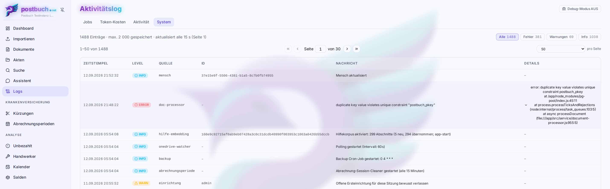

# Betrieb und Troubleshooting

Was im laufenden Betrieb anfällt: Updates einspielen, nachsehen was passiert
ist, und die Handvoll Fehlerbilder, die tatsächlich vorkommen.

## Wo man nachsieht

Der Bereich  **Logs** in der Seitenleiste hat vier Registerkarten:

| Registerkarte | Zeigt |
|---|---|
|  **Jobs** | Laufende, wartende und kürzlich beendete Pipeline-Läufe. Hier steht, in welcher Phase ein Dokument hängt. |
|  **Token-Kosten** | Was die KI-Aufrufe verbraucht haben, aufgeschlüsselt nach Modell und Zweck. |
|  **Aktivität** | Wer hat wann was angelegt, geändert, gelöscht – mit Sprung zum betroffenen Dokument. |
|  **System** | Meldungen der Anwendung selbst: INFO, WARN, ERROR mit Quelle und Details. |

Das System-Log behält die **letzten 2000 Zeilen** und läuft danach hinten
heraus. Es ersetzt die Container-Logs nicht: Was beim Start schiefgeht, bevor
die Datenbank steht, landet nur dort.

Auf dem Server, im Installationsverzeichnis (Standard `~/postbuch`):

```bash
docker compose ps                       # laufen alle Container?
docker compose logs app --tail 100      # letzte Meldungen der API
docker compose logs -f app              # laufend mitlesen
docker compose logs web --tail 50       # nginx
```

Ein schneller Lebenszeichen-Test ohne Anmeldung:

```bash
curl -s http://localhost:3420/api/health
# {"status":"ok"}
```

Antwortet das, laufen `web`, `app` und die Verbindung dazwischen.



### Debug-Modus

Für die Fehlersuche gibt es unter 
**Einstellungen → Allgemein** den Schalter **Debug-Modus**. Er gilt für die
ganze Instanz, wirkt sofort und lässt sich nur von Admins umlegen. Solange er
an ist,

- speichert die Verarbeitungs-Pipeline je Dokument ein ausführliches Protokoll
  (JSON) im Ordner `_debug` der [Dateiablage](storage-backends.md),
- zeigt die Seite **Importieren** neben **Kamera öffnen** den Knopf
  **Kamera-Diagnose**: Nach der Aufnahme stehen über der Vorschau die Kenndaten
  von Live-Bild und Foto (Kamera, Auflösung, Zoom) und wie das Foto auf den
  Live-Ausschnitt zugeschnitten wurde; **Kopieren** legt diese Angaben als JSON
  in die Zwischenablage,
- bietet das  Zahnrad im Kamerascan
  unter der [Kamerawahl](dokumente-importieren.md#mit-der-kamera-in-postbuchnet)
  zusätzlich die Größe des **Livebilds**. **Maximal** ist der Standard: Nur die
  volle Sensorgröße zeigt auf vielen Handys den ganzen Bildwinkel, kleinere
  Größen sind dort bloß ein Ausschnitt aus der Bildmitte. Läuft das Livebild
  auf einem älteren Gerät träge, hilft eine kleinere Größe. Die Wahl wirkt
  sofort, gilt nur für diesen Browser und bleibt auch nach dem Ausschalten des
  Debug-Modus bestehen,
- steht im Bereich **Logs** oben der Hinweis **Debug-Modus an**.

Nach der Fehlersuche wieder ausschalten: Die Protokolle im Ordner `_debug`
sammeln sich sonst ungebremst an.

## Der Stack

Unter **Einstellungen → Stack** (nur Administratoren) stehen alle Docker-Dienste
dieser Instanz mit ihrem Zustand (**Läuft**, **Angehalten**, **Nicht
installiert**, **Gestört**), dem Platz ihres Images auf der Festplatte und einem
Richtwert für den Arbeitsspeicher unter Last. Oben steht, wie viel auf der
Festplatte noch frei ist.

- **Kern – läuft immer:** Datenbank, Anwendung und Oberfläche. Sie haben keine
  Schalter.
- **Optional:** der [eingebaute Embedding-Dienst](ki-provider.md#der-eingebaute-embedding-dienst),
  die [eingebaute lokale KI](ki-provider.md#eingebaute-lokale-ki) und die
  Scan-Dienste (Scanner-Webhook und Bildbereinigung). Jeder lässt sich
  **einschalten**, **ausschalten** und **entfernen**. Ausschalten hält den
  Dienst an und gibt seinen Arbeitsspeicher frei; Image und Modelldateien
  bleiben, Einschalten geht danach ohne Download. Entfernen löscht zusätzlich
  das Image und bei der lokalen KI sowie beim Embedding-Dienst die
  heruntergeladenen Modelldateien; Einschalten richtet den Dienst dann neu ein.
- **HTTPS (Caddy mit DuckDNS)** wird hier nur angezeigt. Ein- und ausgeschaltet
  wird es unter **Allgemein → Erreichbarkeit**, weil Abschalten den Zugang von
  außen kappen kann.
- **Steuerung:** ob der [Update-Agent](#der-update-agent) sich meldet. Er führt
  alle Schaltaufträge aus; unter Linux startet ihn ein systemd-Timer, unter
  Windows eine geplante Aufgabe.

Ein Auftrag wird innerhalb einer Minute abgeholt. Solange er läuft, zeigt die
Karte seinen Fortschritt, beim Modell-Download mit Balken, und alle Schalter
sind gesperrt. Die Seite darf dabei geschlossen werden.

Ohne Update-Agent zeigt der Reiter nur die Dienste, schalten lässt sich dort
nichts. Dann gilt die Liste `COMPOSE_PROFILES` in der `.env` (etwa
`scanner,embedding`), umgesetzt mit `docker compose up -d`.

## Updates

postbuch.net fragt täglich bei der eingetragenen Bezugsquelle nach, ob es eine
neuere Version gibt. War der Rechner zur Prüfzeit in der Nacht aus oder im
Energiesparmodus, holt postbuch.net die Prüfung nach dem Start nach. Das Ergebnis steht unter  **Einstellungen → Allgemein** und
als Hinweis in der Seitenleiste. Nur Administratoren sehen die Karte.

Die Prüfung ist ab Werk an. Sie überträgt nur die Internetadresse deines
Anschlusses an die Bezugsquelle, keine Dokumente und keine Daten; installiert
wird nur, wenn du es selbst anstößt. Abschalten lässt sie sich mit **Täglich
auf Updates prüfen** auf derselben Karte oder schon im Einrichtungsassistenten
im Schritt **Instanz**. Ist sie aus, geht keine Anfrage nach draußen, und
neue Versionen erscheinen nicht.

### Vorabversionen

Bezieht die Instanz ihre Releases von GitHub (Standard bei neuen
Installationen), zeigt die Karte den Schalter **Vorabversionen erhalten**. Er
ist anfangs aus; die Instanz bekommt dann nur stabile Versionen. Eingeschaltet
bietet sie auch Vorabversionen an. Das sind neue Versionen, die erst eine Weile
im Einsatz sein sollen, bevor sie als stabil gelten. Sie sind genauso signiert
und geprüft, aber weniger erprobt.

Wer den Schalter wieder ausschaltet, wird nicht zurückgestuft. Die Instanz
behält ihre Version und bekommt das nächste Update, sobald eine neuere stabile
Version erscheint.

Bei einer anderen Bezugsquelle als GitHub gibt es den Schalter nicht.

Wie man eine Vorabversion gleich neu installiert, steht unter
[Eine Vorabversion installieren](installation.md#eine-vorabversion-installieren).

Drei Zustände:

- **Aktuell** – dezenter grüner Hinweis, sonst nichts.
- **Update verfügbar** – mit Versionsnummer und Änderungen. Liegen zwischen
  installierter und neuer Version weitere Versionen, listet die Karte die
  Änderungen jeder einzelnen, die neueste zuerst; eine lange Liste scrollt.
  Ist die neue Version als sicherheitsrelevant gekennzeichnet, wird der
  Hinweis auffällig.
- **Automatische Updates sind nicht eingerichtet** – der Regelfall auf einem
  selbst gepflegten Server. Dann gibt es **keinen Knopf**, sondern den Befehl
  zum Kopieren:

  ```bash
  cd ~/postbuch && ./deploy-pages/install.sh --update
  ```

  Bei einer Vorabversion enthält der Befehl zusätzlich
  `--zielversion=<x.y.z>`, damit genau diese Version geladen wird.

Darüber steht immer eine Zeile zur **Release-Signatur**. Sie sagt, ob diese
Instanz Signaturen prüfen kann und ob die letzte geprüfte gültig war. Sobald
eine Instanz einmal eine gültige Signatur gesehen hat, installiert sie nichts
Unsigniertes mehr. Näheres unter [Sicherheit](sicherheit.md).

### Was ein Update tut

Egal ob per Knopf oder von Hand – es ist derselbe Ablauf:

1. Release-Manifest und Tarball von der Bezugsquelle holen, Signatur und
   Prüfsumme prüfen. Stimmt etwas nicht, bricht der Installer ab, **bevor** er
   etwas anfasst.
2. Sicherung anlegen: der bisherige Quellbaum plus ein Datenbank-Dump, unter
   `~/postbuch/backups/backup_<zeitstempel>/`.
3. Neuen Quellbaum auspacken. Die `.env` bleibt unverändert.
4. Container neu bauen und starten. Die App wendet beim Start das Schema an
   (siehe [Architektur](architektur.md)). Bringt das Release ein neues
   PostgreSQL-Image derselben Hauptversion mit, wird auch der
   Datenbankcontainer getauscht (siehe
   [Datenbank-Image aktualisieren](#datenbank-image-aktualisieren)).
5. Die ausgelieferte Hilfe wird mit dem aktiven Embedding-Modell abgeglichen.
   Neue oder geänderte Hilfeabschnitte werden beim externen KI-Anbieter neu
   eingebettet; identische Abschnitte übernimmt postbuch.net ohne neuen Aufruf.
   Dokumente und Akten werden durch ein gewöhnliches Update nicht pauschal neu
   eingebettet. Das ändert sich nur, wenn auch Provider, Modell oder Dimension
   der Embeddings gewechselt wurden. Details und Kostenbeispiele stehen unter
   [KI-Anbieter → Kosten und kostenpflichtige Aufrufe](ki-provider.md#kosten-und-kostenpflichtige-aufrufe).

Während des Bauens läuft die bisherige Version weiter, das kann auf kleinen
Servern 20 bis 35 Minuten dauern. Erst beim Start der neuen Container ist die
Anwendung kurz **nicht erreichbar**, meist wenige Minuten.

Scheitert ein Update, bevor die neuen Container starten, etwa beim Herunterladen,
bei der Prüfung oder beim Bauen, sagt der Update-Dialog, dass die bisherige
Version unverändert weiterläuft. Scheitert es danach oder antwortet die
Anwendung nach dem Containerwechsel länger als zehn Minuten nicht, zeigt der
Dialog den Weg [zurück auf die vorige Version](#zurück-auf-eine-ältere-version).

### Der Update-Agent

Der `app`-Container ist absichtlich unprivilegiert: kein Docker-Socket, kein
Zugriff auf den Quellbaum. Er *kann* kein Update ausführen. Dafür richtet der
Installer bei jedem geführten Lauf einen kleinen Host-Agenten ein, der
regelmäßig nachsieht, ob eine Anforderung vorliegt, und dann `install.sh
--update` startet. Über denselben Agenten steuert die Oberfläche auch Ports,
Ablageordner, Dienste und HTTPS und lädt das Modell der lokalen KI. Die App schreibt nur die Anforderung; ausgeführt wird auf
dem Host. Anforderungen sind einmalig verwendbar und verfallen nach zehn
Minuten.

Fehlt der Agent, etwa weil die Einrichtung ohne sudo scheiterte, funktioniert
alles andere unverändert – man aktualisiert eben über die Shell, und ein
erneuter Installer-Lauf richtet ihn nach.

### Datenbank-Image aktualisieren

Das PostgreSQL-Image ist wie alle Basis-Images per Digest festgelegt. Ein
Release kann diesen Digest anheben, etwa wegen Sicherheitskorrekturen im
Image. Der Datenbankcontainer wird dann gegen das neue Image getauscht, aber
nur, wenn drei Bedingungen erfüllt sind:

- Für das Update liegt eine frische Sicherung mit Datenbank-Dump vor.
- Image und Datenbestand haben dieselbe PostgreSQL-Hauptversion. Ein Wechsel
  der Hauptversion ist immer ein [Umzug](#datenbank-umzug-auf-postgresql-18).
- Das neue Image ist vollständig geladen.

Fehlt eine davon, läuft der bisherige Datenbankcontainer unverändert weiter.
Die Daten unter `data/postgres` bleiben beim Tausch, wo sie sind; die
Datenbank ist nur wenige Sekunden nicht erreichbar.

Ausgelöst wird der Tausch auf drei Wegen:

- **Bei jedem Update** über `install.sh` vor dem Start der neuen Container.
- **Mit Update-Agent** zusätzlich einmal je installierter Version wenige
  Minuten nach dem Update. Das fängt den Fall ab, dass beim Update noch der
  Installer der Vorversion gelaufen ist.
- **Von Hand:**

  ```bash
  cd ~/postbuch && ./deploy-pages/install.sh --postgres-image
  ```

### Eigene Compose-Anpassungen

Eine Datei `docker-compose.override.yml` im Installationsverzeichnis liest
Docker Compose automatisch zusätzlich zu `docker-compose.yml`. Updates lassen
sie stehen, so wie `.env` und `caddy/Caddyfile`. Damit lässt sich zum Beispiel
ein neuerer Digest des PostgreSQL-Images eintragen, ohne auf das nächste
Release zu warten:

```yaml
services:
  postgres:
    image: pgvector/pgvector:pg18@sha256:<digest>
```

Der Tausch läuft dann beim nächsten Update oder sofort mit `install.sh
--postgres-image` nach denselben Regeln wie oben. Das Update meldet dabei,
dass das Image vom Release abweicht.

> [!WARNING]
>
> Die Override-Datei wirkt auf jeden Compose-Aufruf, auch auf die des Updates.
> Was darin steht, ist nicht durch die Release-Signatur abgedeckt. Ein Tag ohne
> Digest (etwa `pg18`) holt bei jedem Update den gerade aktuellen Stand, also
> ungeprüfte Images. Die Verantwortung für den Inhalt liegt beim Betreiber.

### Datenbank-Umzug auf PostgreSQL 18

postbuch.net läuft auf PostgreSQL 18. Eine Instanz, deren Datenbank noch von
PostgreSQL 16 stammt, zieht einmalig um: Die Daten werden in eine neue
PostgreSQL-18-Datenbank übertragen und Tabelle für Tabelle verglichen, erst
dann wird umgeschaltet. Vorher legt der Installer eine Sicherung an. Während
des Umzugs ist postbuch.net einige Minuten nicht erreichbar.

Ausgelöst wird der Umzug auf drei Wegen:

- **Mit Update-Agent** startet ihn der Agent wenige Minuten nach dem Update
  von selbst.
- **Bei jedem Update** über `install.sh` zieht der Installer vor dem
  Containerwechsel um.
- **Von Hand:**

  ```bash
  cd ~/postbuch && ./deploy-pages/install.sh --postgres-umzug
  ```

Solange der Umzug aussteht, zeigt die Karte **Updates** in den Einstellungen
einen Hinweis mit diesem Befehl. postbuch.net arbeitet bis dahin mit
PostgreSQL 16 weiter. Schlägt ein Umzug fehl, bleibt die alte Datenbank
unverändert in Betrieb.

Welche Version gerade läuft, zeigt **Einstellungen → Allgemein →
Datenbankverbindung → Verbindung testen**: Die Rückmeldung nennt die
PostgreSQL- und die pgvector-Version.

Wurde der Datenbank-Container vor dem Umzug von Hand neu erstellt (etwa mit
`docker compose up -d --force-recreate`), startet er nicht und meldet im Log
`there appears to be PostgreSQL data in`. Die Daten sind
dabei unberührt. Der Befehl oben startet die alte Datenbank wieder und zieht
dann um.

Die alte Datenbank bleibt bis zum erfolgreichen Start der App unter
`data/postgres/umzug/` liegen und wird erst danach gelöscht. Der Platzbedarf
liegt dabei beim Dreifachen der Datenbankgröße.

### Update reparieren

Ein Update auf **dieselbe Version** ist die Reparatur. Der Installer spielt das
Release noch einmal vollständig ein: Er prüft Signatur und Prüfsumme, legt eine
Sicherung an, packt den Quellbaum neu aus, baut und startet alle Container und
richtet den Update-Agenten neu ein. `.env`, Datenbank und Dokumente bleiben,
wie sie sind.

Das hilft immer dann, wenn ein Update mittendrin abgebrochen ist, Container
fehlen oder hängen (etwa „No such container“) oder die Oberfläche nach einem
Update nicht mehr erreichbar ist. Der Weg führt über die Shell, weil die
Oberfläche dann oft nicht antwortet:

```bash
curl -fsSL https://github.com/ceramgcf/postbuch.net/releases/latest/download/install.sh | bash
```

Im Menü **Update** wählen. Die Vorschau meldet „Gleiche Version“ und dass das
Release noch einmal eingespielt wird; mit `j` bestätigen. Statt des Downloads
geht auch der Installer im Installationsverzeichnis (`~/postbuch/install.sh`);
er holt das Release ebenfalls von der Bezugsquelle, braucht also Netz.

Unter Windows gibst du in einer PowerShell **Als Administrator** denselben
Befehl wie bei der Installation ein (siehe
[Installation unter Windows](installation.md#unter-windows)) oder gehst über
**Einstellungen → Apps → Installierte Apps → postbuch.net Server → Ändern**
und wählst dort ebenfalls **Update**.

Arbeitet der Update-Agent gerade (etwa an einem Update aus der Oberfläche),
wartet der Installer, bis er fertig ist. Umgekehrt startet der Agent nichts,
solange ein Installer läuft. Hilft auch die Reparatur nicht, bleibt der Weg
[zurück auf die vorige Version](#zurück-auf-eine-ältere-version).

### Zurück auf eine ältere Version

```bash
cd ~/postbuch && ./deploy-pages/install.sh --rollback
```

Der Dialog listet die vorhandenen Sicherungen mit Zeitstempel und Version und
sagt bei jeder dazu, ob ein Datenbank-Dump dabei ist. Dann kommen **zwei
getrennte Fragen**:

1. **Datenbank mit zurückrollen?** Standard ist ja, damit Code und Schema
   zusammenpassen. Alles, was seit der Sicherung entstanden ist, geht damit
   verloren. Nein zu sagen ist möglich, bedeutet aber alten Code auf einer
   neueren Datenbank – das kann dauerhaft inkonsistente Daten erzeugen.
2. **Bestätigung**: das Wort `ROLLBACK` tippen. Enter bricht ab.

Ein Rollback ist nur interaktiv möglich, nicht automatisiert.

Unter Windows führt derselbe Weg über **Einstellungen → Apps → Installierte
Apps → postbuch.net Server → Ändern** und dort **Update rückgängig machen**.

Nutzt die Sicherung eine andere PostgreSQL-Version als die laufende Datenbank,
etwa nach dem Umzug auf PostgreSQL 18, wird die Datenbank zwingend mit
zurückgerollt. Die bisherige Datenbank bleibt unverändert unter
`data/postgres.pg<version>-<zeitstempel>` liegen. Eine Sicherung ohne
Datenbank-Dump lässt sich dann nicht verwenden.

## Häufige Fehlerbilder

**Die Seite lädt nicht.**
`docker compose ps` im Installationsverzeichnis. Steht ein Container auf
`Exited` oder `Restarting`, sagt `docker compose logs <dienst> --tail 100`
warum. Häufigste Ursache nach einem Serverneustart: Docker war schneller als
das Netzwerk oder das Dateisystem – `docker compose up -d` genügt dann.

**Anmeldung wird abgewiesen, obwohl das Passwort stimmt.**
Nach zehn Fehlversuchen innerhalb von fünf Minuten ist der Zugang kurz
gesperrt; die Meldung nennt die Wartezeit. Beim Administrator kommt eine
zweite Möglichkeit dazu: Wurde `APP_PASSWORD` in der `.env` geändert, gilt nur
noch das neue – und alte Admin-Sitzungen sind ungültig.

**Der Code aus der Authenticator-App wird nicht angenommen.**
Jeder Code gilt nur einmal und höchstens 30 Sekunden vor oder nach seinem
Zeitfenster; geht die Uhr des Telefons falsch, passt keiner. Nach fünf falschen
Codes ist der Zugang 15 Minuten gesperrt. Wurde zuvor ein unverschlüsseltes
Backup eingespielt, gelten die Codes aus der App gar nicht mehr. In allen
Fällen hilft ein Wiederherstellungscode; fehlt auch der, setzt der
Administrator den Faktor zurück, für sich selbst über den
[Notschalter](sicherheit.md#notschalter-für-den-administrator).

**Ein Dokument ist in der Pipeline gescheitert.**
Es steht unter  **Importieren → Eingang** in
der Gruppe _Handlung nötig_, mit dem Fehler des letzten Versuchs. Von dort lässt
es sich **neu auslösen**, ohne KI **manuell ablegen** oder **verwerfen** – siehe
[Der Eingang](dokumente-importieren.md#der-eingang-offene-dokumente). Vorher
lohnt ein Blick ins System-Log: Ein abgelaufenes Dateiablage-Token oder ein
nicht erreichbares KI-Modell wiederholt sich sonst.

**Ein Job steht und tut nichts.**
Steht er auf *wartet auf Entscheidung*, ist es kein Fehler, sondern eine
erkannte Dublette – siehe [Dokumente importieren](dokumente-importieren.md).
Steht er auf *in Warteschlange*, laufen bereits so viele Pipelines wie erlaubt
(Standard drei), oder es läuft gerade ein Dateiablage-Umzug, der die Warteschlange
absichtlich anhält. Steht dort „Wartet bis HH:MM – KI-Dienst nicht erreichbar“,
hat kein Modell geantwortet; der Job versucht es zur genannten Zeit erneut
(nach 1, 10 und 60 Minuten, danach scheitert er). Läuft die KI auf demselben
Rechner, arbeitet sie standardmäßig nur einen Aufruf zur Zeit ab – weitere
Dokumente warten dann auf der Stufe *KI-Analyse*, ohne dass etwas hängt
(siehe [Architektur](architektur.md#warteschlange-und-parallelität)).

**Die Dateiablage antwortet nicht mehr.**
Bei OneDrive läuft das Zugriffstoken ab, wenn die Instanz länger stand oder
der Zugang bei Microsoft widerrufen wurde.  **Einstellungen → Dateiablage** zeigt
den Verbindungsstatus; von dort wird neu verbunden. Bei einem eigenen
WebDAV-Speicher prüft man zuerst, ob der Server erreichbar ist und das
App-Passwort noch gilt. Meldet postbuch.net **„Nextcloud verweigert den
Zugriff"**, stimmt die Anmeldung, aber dem Konto fehlt die Berechtigung für den
Ordner oder die Datei, zum Beispiel bei einer nur lesend freigegebenen Ablage.

Fährt OneDrive über den Legacy-Weg mit Client-Secret, unterscheidet
postbuch.net die Microsoft-Fehler `AADSTS7000222` (**„Client-Secret
abgelaufen“**) und `AADSTS7000215` (**„Client-Secret ungültig“**, meist die
geheime ID statt des Werts kopiert). Ein erneuter Login allein hilft nicht. In
Azure ein gültiges Secret erzeugen bzw. kopieren, dessen Wert und Ablaufdatum
unter  **Einstellungen → Dateiablage** eintragen und
danach neu verbinden. Scheitert die Verbindung schon beim Verbinden, bleibt das
Microsoft-Popup mit dieser Erklärung stehen, und die OneDrive-Karte zeigt sie
ebenfalls. Der Gerätecode-Weg hat kein Client-Secret.

Meldet postbuch.net **„App-Registrierung ungültig"**, kennt Microsoft die
eingetragene Client-ID nicht, oder sie passt nicht zur bestehenden Verbindung.
Ein erneuter Login allein hilft auch hier nicht. Client-ID und Mandant unter
 **Einstellungen → Dateiablage**
prüfen, speichern und danach neu verbinden.

**„Pfadprüfung: Ziel liegt außerhalb des konfigurierten Dateiablage-Ordners."**
Diese Meldung kann nur im Rahmen des internen Schutzes gegen Pfad-Ausbrüche aus
dem eigenen Nextcloud-Nutzerspeicher (`davHome`) auftreten, nie durch den
konfigurierten Postbuch-Wurzelordner selbst – der schränkt den Zugriff auf
bereits bekannte Dateien nicht ein (siehe
[Dateien manuell in der Dateiablage verschieben oder umbenennen](storage-backends.md#dateien-manuell-in-der-dateiablage-verschieben-oder-umbenennen)).
Tritt sie dennoch auf, deutet das auf einen Fehler in postbuch.net selbst hin –
bitte melden.

**Dateiablage nicht erreichbar – was bleibt erhalten?**

- Ein Scan aus Scanner/Cleaner wird vor der Verarbeitung unter
  `/data/scan_buffer` gesichert. Scheitert der erste Dateiablage-Upload, versucht
  `_scan_retry_queue` ihn mit Backoff ungefähr 10,7 Tage erneut; danach bleibt
  er als `manual_only` sichtbar und das PDF liegt weiter im Puffer. Eine
  Sicherung enthält den Puffer nicht: Fehlt das PDF dort, etwa nach einer
  Wiederherstellung auf einem anderen Rechner, entfernt postbuch.net den Eintrag
  beim nächsten Start oder Versuch und vermerkt das im App-Log.
- Ein Browser-Upload lebt bis zum ersten erfolgreichen Dateiablage-Upload nur im
  Arbeitsspeicher des App-Prozesses. Schlägt genau dieser Schritt fehl oder
  startet der Container neu, muss die Datei erneut hochgeladen werden.
- Dateien aus dem überwachten Dateiablage-Eingang bleiben dort liegen, wenn bereits
  das Auflisten scheitert. Nach Wiederherstellung findet der nächste Poll sie.
- Ein fehlgeschlagenes Datenbank-Backup wird geloggt; seine lokalen temporären
  Dumps werden anschließend entfernt. Der nächste geplante Lauf erzeugt ein
  neues Backup, es gibt keinen Upload-Retry für den fehlgeschlagenen Dump.

**Die KI liefert Unsinn oder gar nichts.**
Erst in  Logs → Token-Kosten sehen, ob der Aufruf überhaupt stattgefunden hat.
Kam nichts an, liegt es an Adresse, Schlüssel oder daran, dass ein lokal
laufendes Modell nicht erreichbar ist. Kam etwas an und das Ergebnis war
schlecht, ist es eine Modellfrage – siehe [KI-Anbieter](ki-provider.md).

**Der Scanner löst nichts aus.**
Der Scanner-Container läuft nur mit dem Profil `scanner`. `docker compose ps`
muss ihn zeigen. Fehlt er, wurde der Stack ohne das Profil gestartet.

Ohne Host-Agent lässt sich das Profil auf dem Server von Hand aktivieren:
`scanner` in `COMPOSE_PROFILES` der `.env` ergänzen und anschließend
`./restart.sh` ausführen. Die Profile stehen dort kommagetrennt, etwa
`COMPOSE_PROFILES=embedding,scanner`. Ein bereits eingetragenes `embedding`
muss stehen bleiben, sonst startet der eingebaute Embedding-Dienst nicht mehr.
Die Scanner-Adresse selbst wird danach im Web-Assistenten gesucht oder
eingetragen.

**Ähnlichkeitssuche und Hilfe finden nichts, der eingebaute Embedding-Dienst
ist gewählt.**
Der Dienst läuft nur mit dem Profil `embedding`; `docker compose ps` muss den
Container `embedding` zeigen. Fehlt er, meldet das auch die Embedding-Karte
unter  `Einstellungen → KI` und
bietet **Dienst einrichten** an. Ohne Host-Agent gilt dasselbe wie beim
Scanner: `embedding` in `COMPOSE_PROFILES` ergänzen und `./restart.sh`
ausführen. Siehe
[Der eingebaute Embedding-Dienst](ki-provider.md#der-eingebaute-embedding-dienst).

**Die App zeigt nach einem Update noch die alte Oberfläche.**
Selten, weil Startseite und Service-Worker nicht zwischengespeichert werden.
Wenn doch: Seite einmal hart neu laden; auf dem Handy die installierte App
schließen und neu öffnen.

**Die Datenbank ist weg oder kaputt.**
Siehe [Backup und Wiederherstellung](backup-wiederherstellung.md). Das ist der
einzige Fehlerfall, für den es vorher etwas zu tun gab.

## Platz und Wartung

Es gibt wenig zu pflegen, aber drei Dinge wachsen:

- **Docker-Images.** Jedes Update baut neue; die alten bleiben liegen.
  `docker image prune -f` räumt herrenlose Ebenen weg. Was ein optionaler
  Dienst belegt, steht unter [Der Stack](#der-stack); dort lässt er sich auch
  samt Image entfernen.
- **Update-Sicherungen** unter `~/postbuch/backups/`. Jede enthält einen
  Datenbank-Dump. Die letzten paar behalten, ältere löschen.
- **Die Datenbank selbst**, vor allem durch Text- und Bild-Caches der
  KI-Analyse. Die PDFs liegen nicht darin – siehe [Architektur](architektur.md).

> Beim Aufräumen mit Docker-Befehlen genau hinsehen, welche Container gemeint
> sind. Auf demselben Server können andere Anwendungen laufen; `docker system
> prune -a` trifft auch die.

Der Datenbank-Dump in der Dateiablage wird automatisch nach Aufbewahrungsregeln
gestutzt, dort ist nichts zu tun.

## Wenn nichts mehr hilft

Bevor du eine Instanz neu aufsetzt: Ein vollständiges Backup besteht aus dem
Datenbank-Dump **und** den Dokumenten. Liegt beides vor, ist ein Neuaufbau
eine überschaubare Sache – der Weg steht in
[Backup und Wiederherstellung](backup-wiederherstellung.md) unter „Der
Ernstfall".

Fehler, die nach einem Programmfehler aussehen, gehören als
[Issue auf GitHub](https://github.com/ceramgcf/postbuch.net/issues) gemeldet,
Fragen und Ideen in die
[GitHub-Discussions](https://github.com/ceramgcf/postbuch.net/discussions).
Sicherheitslücken bitte **nicht** öffentlich, sondern vertraulich über
[„Report a vulnerability“](https://github.com/ceramgcf/postbuch.net/security/advisories/new)
melden. Mehr dazu unter [Hilfe und Kontakt](faq.md#hilfe-und-kontakt).

---

Weiter: [FAQ](faq.md) · [Zurück zur Übersicht](README.md)
