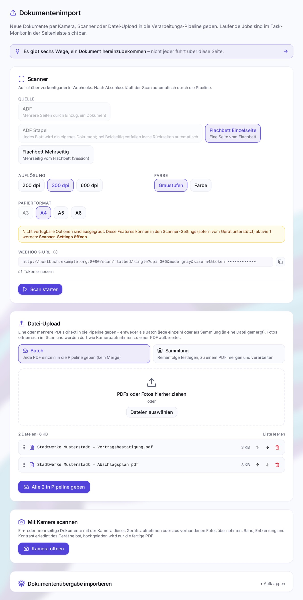

# Dokumente importieren

postbuch.net nimmt **PDF-Dateien** und **Papier** entgegen – sonst nichts.
Papier wird dabei zuerst zu einer PDF: gescannt oder mit dem Handy
abfotografiert.

Word-Dateien, Tabellen oder E-Mails werden nicht angenommen, Fotos eines Blatts
nur über den [Kamerascan](#fotos-importieren), der daraus eine PDF macht. Grund ist
kein fehlendes Format, sondern der Anspruch an das Ergebnis: Die KI-Analyse, die
Dateiablage in der Cloud, die Seitenansicht, der Etikettendruck und jeder spätere
Export arbeiten mit einem einzigen, seitengetreuen Format. Wandle solche Dateien
vorher in eine PDF um – jedes Textprogramm und jedes Handy kann das.

Es gibt sechs Eingangswege. **Alle münden in dieselbe Warteschlange**: Was
danach passiert, ist unabhängig davon, woher das Dokument kam.

| #   | Weg                                                                                                                        | Art    |
| --- | -------------------------------------------------------------------------------------------------------------------------- | ------ |
| 1   | [ Überwachter Cloud-Ordner](#weg-1-überwachter-cloud-ordner)               | PDF    |
| 2   | [ Scannen per Foto vom Smartphone](#weg-2-scannen-per-foto-vom-smartphone)       | Papier |
| 3   | [ Datei-Upload über „Importieren"](#weg-3-datei-upload)                                 | PDF    |
| 4   | [ Scannen über „Importieren"](#weg-4-scannen-über-importieren)                       | Papier |
| 5   | [ Scan-Webhook im eigenen Netz](#weg-5-scan-webhook-im-eigenen-netz)                   | Papier |
| 6   | [ Scanner speichert direkt in die Cloud](#weg-6-scanner-speichert-direkt-in-die-cloud) | Papier |

Dieselbe Übersicht zeigt die App selbst unter 
**Importieren → „Es gibt sechs Wege, ein Dokument hereinzubekommen"** – dort mit
den aufgelösten Ordnerpfaden deiner Instanz. Direkt nach dem
Einrichtungsassistenten erscheint sie einmal von selbst.



_Die Import-Seite am Rechner mit Scanner-Einstellungen, Datei-Upload mit bereits
ausgewählten Dateien und der Karte für den Kamerascan._

## Weg 1: Überwachter Cloud-Ordner

Legst du eine PDF in den Ordner `<postbuch.net-Wurzelverzeichnis>/_inbox` deiner Dateiablage, holt postbuch.net sie
von selbst ab. Der vollständige Pfad ist `<postbuch.net-Wurzelverzeichnis>/_inbox`; welcher
Wurzelordner das auf deiner Instanz ist – bei OneDrive im App-Ordner meist der
App-Ordner `Apps/<Name>` selbst –, steht in der App unter
 `Importieren → Sechs Wege` und unter
 `Einstellungen → Dateiablage`.

Das Polling läuft ab dem Anlegen der Ordnerstruktur alle **60 Sekunden**; unter
 `Einstellungen → Dateiablage` lässt es
sich ausschalten und das Abfrageintervall ändern. Mehrere Dateien auf einmal
sind ausdrücklich vorgesehen – jede wird ein eigenes Dokument.

Das ist der bequemste Weg, wenn die Cloud ohnehin auf deinem Gerät eingebunden
ist: unter Windows als Ordner im Explorer, unter Android eine PDF über „Teilen"
an die OneDrive- oder Nextcloud-App senden und dort in
`<postbuch.net-Wurzelverzeichnis>/_inbox` ablegen. Die PDF-Rechnung aus dem
Mail-Anhang ist damit in zwei Klicks in postbuch.net.

## Weg 2: Scannen per Foto vom Smartphone

Ohne Scanner im Haus genügt die Kamera des Handys oder Tablets. Dafür gibt es
zwei Wege.

### Mit der Kamera in postbuch.net

In der Mobilansicht öffnet der Knopf
 **Scannen** in der Mitte der
[Favoritenleiste](mobil-und-pwa.md#die-mobilansicht) die Rückkamera im
Vollbild, von jeder Seite aus. Daneben gibt es auf der Seite
 `Importieren` die Karte
**Mit Kamera scannen → Kamera öffnen**; sie steht auf Touch-Geräten ganz oben,
am Rechner unter dem Datei-Upload. Vorhandene Fotos kommen in denselben Scan,
siehe [Fotos importieren](#fotos-importieren). Beim ersten Mal fragt der
Browser, ob postbuch.net die Kamera benutzen darf.

1. **Blatt ins Bild halten.** postbuch.net sucht die Blattränder und legt einen
   Rahmen um das Blatt. Erkannt wird ein Blatt ab etwa einem Achtel der
   Bildfläche; kleine Belege wie Visitenkarten näher an die Kamera halten. Ein
   dunkler oder gemaserter Untergrund hilft; auf einem hellen Tisch zeichnet
   meist der Schlagschatten des Blatts die Kante.
2. **Auslösen.** Unten rechts wählst du zwischen **Auto** und **Manuell**. Bei
   **Auto** löst postbuch.net selbst aus, sobald das Gerät ruhig gehalten wird
   und das **ganze** Blatt scharf ist, nicht nur die Bildmitte. Der Ring um den
   Auslöser zeigt, wie weit es ist; ein Tipp ins Bild bricht eine anstehende
   Auslösung ab. Bei **Manuell** tippst du selbst auf den Auslöser. Nach einer
   Aufnahme wartet die Automatik, bis ein neues Blatt liegt, damit dieselbe
   Seite nicht zweimal im Dokument landet. Unten links holt
    ein oder mehrere Fotos aus der Galerie
   in den Scan.
3. **Vorschau prüfen.** Nach jeder Aufnahme erscheint die Seite entzerrt,
   zugeschnitten und mit verbessertem Kontrast. Das Foto zeigt dabei genau den
   Ausschnitt der Live-Ansicht, auch wenn die Kamera selbst mehr aufnimmt.
   Darunter stehen
    **Ecken** (Rahmen von Hand
   korrigieren),  **Drehen**,
    **Neu aufnehmen** und
    **Entfernen**, darunter
    **Seite hinzufügen** und
    **Hochladen**. Die Leiste mit den Miniaturen
   führt zu jeder bisherigen Seite zurück; im Livebild steht an ihrem Ende
   **Fertig**, das ohne weitere Aufnahme in die Vorschau springt.
4. **Hochladen.** Alle Seiten werden zu **einer** PDF und gehen wie eine
   hochgeladene Datei in die Pipeline. Hochgeladen wird erst die fertige PDF;
   die Fotos selbst verlassen das Gerät nicht. Ab zwei Seiten sitzt rechts am
   Knopf ein  Pfeil: **Jede Seite als
   eigenes Dokument** lädt jede Seite als eigene PDF hoch, etwa für einen
   Stapel einzelner Belege. Bricht das Hochladen dabei ab, fallen die schon
   hochgeladenen Seiten aus dem Scan; die übrigen bleiben für einen neuen
   Versuch stehen.

#### Farbmodus und Kamera wählen

Oben rechts wählst du **Farbe**, **Grau** oder **SW** (Schwarzweiß). Die Wahl
gilt für alle Seiten des Scans und lässt sich in der Vorschau noch ändern; die
Seiten werden dann neu berechnet. SW ergibt die kleinsten Dateien und eignet
sich für reine Textseiten, Farbe für Briefköpfe, Stempel und Fotos. Bei allen
drei Arten gleicht postbuch.net ungleichmäßiges Licht und Schatten auf dem Blatt
aus und hebt den Kontrast an. Gibt das Gerät seine Lampe frei, schaltet das
Taschenlampen-Symbol oben rechts sie ein. Modus und Auslöseart merkt sich postbuch.net für
dieses Gerät.

**Kamera wählen:** Das  Zahnrad neben
**Auto** öffnet die Liste der Kameras des Geräts. **Automatisch** nimmt die
Rückkamera mit der kleinsten Nummer, auf Android-Handys meist die
Hauptkamera; ohne diese Regel griffe der Browser auch einmal zum Weitwinkel.
Jede andere Kamera lässt sich direkt antippen; das Livebild wechselt sofort,
sodass du gleich siehst, welches Objektiv das schärfere Bild liefert. Die
gerade laufende Kamera ist mit **Aktiv** markiert. Solange die Liste offen
ist, löst die Automatik nicht aus. Die Wahl gilt nur für diesen Browser.

#### Seiten ordnen und Ecken anpassen

**Seiten ordnen:** Ein Tipp auf 
**Seite 2 von 5** oben öffnet alle Seiten als Raster. Eine Seite gedrückt
halten (mit der Maus: einfach ziehen) und an die neue Stelle ziehen ändert die
Reihenfolge. Ein Tipp auf eine Seite wählt sie aus; ausgewählte Seiten rücken
mit  **Nach vorn** bzw.
 **Nach hinten** um einen Platz oder
verschwinden mit **Seiten entfernen**. Erst **Fertig** übernimmt die
Änderungen;  oben links bzw. der Zurück-Knopf
des Geräts bricht ab und lässt die Seiten, wie sie waren.

**Ecken anpassen:** Liegt der Rahmen daneben oder wurde kein Blatt erkannt,
zeigt **Ecken** das Foto mit vier Eckpunkten. Beim Ziehen einer Ecke erscheint
oben eine Lupe, die den Bereich unter dem Finger vergrößert. **Zurücksetzen**
stellt den erkannten Rahmen wieder her, **Ganzes Bild** nimmt das ganze Foto,
**Übernehmen** entzerrt die Seite neu.  oben
links bzw. der Zurück-Knopf des Geräts bricht ab, ohne die Ecken zu ändern.
Wurde kein Blatt erkannt, übernimmt **Ganzes Bild übernehmen** im Hinweis
oben das Foto mit einem Tipp unverändert.

Jede Seite wird im PDF auf DIN-A4-Breite gesetzt und mit höchstens
**200 dpi** gespeichert. Ein A4-Blatt hat damit 1654 × 2339 Bildpunkte, was für
die KI-Analyse und den Ausdruck genügt und die Datei klein hält.

#### Etiketten, Technik und unterbrochene Scans

**Etikett scannen:** Solange noch keine Seite aufgenommen ist, sucht die
Live-Ansicht zugleich nach dem QR-Code eines
[postbuch.net-Etiketts](etiketten-drucken.md); ein Blatt muss dafür nicht
erkannt sein. Hältst du ein Etikett ins Bild, erscheint unten
**Etikett P000123 erkannt** mit einem Countdown-Ring, und nach drei Sekunden
öffnet sich das Dokument; das Etikett einer [Sammelmappe](etiketten-drucken.md#etiketten-für-sammelmappen)
(`S000123`) öffnet die Dokumentliste dieser Sammelmappe. **Öffnen** springt sofort hin, der Ring oder ein Tipp
ins Bild bricht ab und scannt weiter; dasselbe Etikett meldet sich dann bis zum
nächsten Öffnen der Kamera nicht mehr. Erkannt werden ausschließlich Etiketten
dieser Instanz: gedruckt unter der Adresse, unter der postbuch.net gerade
läuft, oder unter einer weiteren Adresse, die der Admin
[freigegeben](etiketten-drucken.md#etiketten-im-kamerascan) hat. Jeder andere
QR-Code, etwa ein GiroCode auf einer Rechnung, gehört zum Papier und wird ganz
normal mitgescannt. Beim Ersetzen der PDF eines
Dokuments ist die Etikett-Erkennung aus.

Erkennung, Entzerrung und Bildverbesserung rechnet das Gerät selbst. Dafür lädt
postbuch.net beim ersten Öffnen einmalig eine Bildverarbeitung von rund 4 MB
nach; danach kommt sie aus dem Browser-Cache. Die Kamera braucht eine
verschlüsselte Verbindung (`https://`), über eine unverschlüsselte Adresse im
Heimnetz erscheint die Karte nicht. Erprobt ist der Kamerascan mit Chrome unter
Android; auf iPhone und iPad ist er ungetestet.

**Scan unterbrechen und fortsetzen:** Der Zurück-Knopf des Geräts bzw. das
 oben links beendet den Scan. Sind schon
Seiten aufgenommen, fragt postbuch.net nach: **Für später behalten** legt die
Seiten auf diesem Gerät ab, **Verwerfen** löscht sie. Ein behaltener Scan
übersteht auch das Schließen der App. Solange er offen ist, trägt in der
Mobilansicht der Knopf **Scannen** die Seitenzahl, und auf der Importseite steht oben
**Offener Scan** mit **Fortsetzen** und **Verwerfen**. Nach dem Hochladen ist
der Scan erledigt; ein nicht fortgesetzter Scan verfällt nach 24 Stunden. Die
Seiten liegen nur im Browser dieses Geräts, ein anderes Gerät sieht sie nicht.

### Fotos importieren

Ein schon vorhandenes Foto eines Blatts – aus der Galerie, aus einem Chat oder
vom Rechner – bekommt dieselbe Aufbereitung wie eine Aufnahme mit der Kamera
und landet im selben Scan. Es gibt drei Wege dorthin:

- **Teilen-Menü:** Ist die App [installiert](mobil-und-pwa.md#als-app-installieren-pwa),
  ein oder mehrere Fotos (JPEG, PNG oder WebP) an postbuch.net teilen – unter
  Android, unter Windows mit Edge, siehe
  [PDFs über das Teilen-Menü übergeben](#pdfs-über-das-teilen-menü-übergeben).
- **Galerie-Knopf:**  unten links im
  Livebild des Kamerascans öffnet die Fotoauswahl des Geräts.
- **Datei-Upload:** Fotos, die unter 
  `Importieren` ausgewählt oder auf das Feld gezogen werden, öffnen den Scan,
  statt direkt in die Pipeline zu gehen – auch am Rechner, ganz ohne Kamera.
  PDFs aus derselben Auswahl gehen den gewohnten Weg.

Jedes Foto wird eine Seite. postbuch.net sucht darauf das Blatt und schneidet,
entzerrt und verbessert es genauso wie beim Kamerascan, auch **Farbe**,
**Grau** und **SW** gelten gleich. Ist ein Blatt erkannt, erscheint die Seite
ohne weiteren Schritt fertig zugeschnitten in der Vorschau. Findet postbuch.net
auf einem Foto kein Blatt, öffnet sich für diese Seite von selbst
**Ecken anpassen**: Die vier Ecken lassen sich frei auf die Blattecken ziehen,
oder **Ganzes Bild übernehmen** im Hinweis oben nimmt das Foto unverändert mit
seinem ganzen Ausschnitt.

Fotos und Kameraaufnahmen lassen sich in einem Scan mischen. Bei einer Seite
aus einem Foto steht in der Vorschau an der Stelle von **Neu aufnehmen**
 **Ganzes Bild**.
 **Seite hinzufügen** führt ins Livebild, auf
einem Gerät ohne Kamera direkt in die Fotoauswahl.

**Nacheinander teilen:** Ist schon ein Scan offen, hängen neu geteilte Fotos
hinten an, statt einen neuen zu beginnen. So lassen sich Fotos aus
verschiedenen Apps nacheinander zu einem Dokument sammeln: Foto teilen,
zurück in die Galerie, nächstes Foto teilen. Ein Hinweis meldet jeweils, wie
viele Seiten der Scan jetzt hat; **Rückgängig** nimmt die gerade angehängten
Fotos wieder heraus. Wurde der offene Scan länger als 30 Minuten nicht
angefasst, fragt postbuch.net vorher: **Hinzufügen** hängt an,
**Neuer Scan** verwirft den alten und beginnt mit den neuen Fotos.

Nach dem Hochladen folgt postbuch.net beim Teilen immer
[automatisch](#automatisch-folgen), sonst wie beim Kamerascan, wenn „Scannen"
eingeschaltet ist. Die Fotos selbst verlassen das Gerät nicht.

### Mit der Scan-Funktion der Cloud-App

Die App deiner Cloudablage bringt ebenfalls einen Dokumentenscan mit. OneDrive
und Nextcloud entzerren die abfotografierte Seite, schneiden sie zu und
speichern sie als PDF; mehrere Seiten landen in einer Datei.

Als Zielordner `<postbuch.net-Wurzelverzeichnis>/_inbox` wählen – damit läuft der
Scan über denselben überwachten Ordner wie
[Weg 1](#weg-1-überwachter-cloud-ordner).

## Weg 3: Datei-Upload

Auf der Seite  `Importieren` per Drag & Drop
oder Dateiauswahl. Fotos darunter öffnen den Scan, siehe
[Fotos importieren](#fotos-importieren). Für PDFs gibt es drei Modi:

 **Batch** – Jede Datei wird **separat**
verarbeitet und bekommt eine eigene Postnummer. Das ist der Weg für einen Stapel
unabhängiger Dokumente. Vorausgewählt ist Batch.

 **Sammlung** – Alle abgelegten PDFs werden
vorab **zu _einer_ Datei zusammengeführt** und als _ein_ Dokument verarbeitet.
Die Reihenfolge lässt sich vorher per  /
 Pfeiltasten ändern, der Dateiname ist
frei wählbar. Das ist der Weg für einen Brief mit Anlagen oder ein mehrteilig
gescanntes Schreiben.

 **Stapel auftrennen** – Nimmt **genau eine**
PDF an und behandelt sie als
[Dokumentenstapel](#dokumentenstapel-aus-dem-einzug): Jede Seite zählt als ein
Blatt, die KI schlägt vor, wo ein Dokument endet, und du prüfst die Trennung im
[Eingang](#einen-dokumentenstapel-trennen). Das ist der Weg für eine PDF, in der
mehrere Schreiben hintereinander stecken, etwa ein Sammelscan aus einem anderen
Gerät. Eine weitere PDF ersetzt die bereits gewählte. Der Vorschlag braucht eine
Textebene in der PDF. Fehlt sie (Scan ohne Texterkennung), sagt postbuch.net das
schon beim Hochladen: Der Stapel steht dann ohne Vorschlag im Eingang, alle Seiten
liegen vorerst in einem Dokument, und du setzt die Trennungen von Hand. Fehlt die
Textebene nur auf einzelnen Seiten, nennt der Hinweis ihre Zahl; an diesen Stellen
lohnt ein genauer Blick. Eine einseitige PDF geht direkt als
ein Dokument in die Pipeline. Ist [Automatisch folgen](#automatisch-folgen) für
Dateien eingeschaltet, öffnet sich die Trennansicht.

### PDFs über das Teilen-Menü übergeben

Ist postbuch.net [als App installiert](mobil-und-pwa.md#als-app-installieren-pwa),
steht sie unter Android und unter Windows im **Teilen-Menü** des Geräts zur
Auswahl – unter Windows nur, wenn die App mit **Edge** installiert wurde.
Eine dort geteilte PDF – etwa aus der
Mail-App, dem Dateimanager oder dem Download-Ordner – geht **ohne weiteren
Klick** in die Pipeline, genau wie eine per Dateiauswahl gewählte PDF im Modus
**Batch**. postbuch.net
[folgt dabei immer automatisch](#automatisch-folgen): Es öffnet
 **Logs → Jobs** und nach erfolgreicher
Verarbeitung das neue Dokument. Mehrere geteilte PDFs werden einzeln
verarbeitet. Einen Hinweis für die KI gibt es auf diesem Weg nicht. Geteilte
Fotos öffnen stattdessen den [Scan](#fotos-importieren) bzw. hängen an einen
offenen an; werden Fotos und PDFs zusammen geteilt, gehen die PDFs sofort in
die Pipeline, und der Scan mit den Fotos liegt darüber. Andere Dateitypen
bietet das Teilen-Menü für postbuch.net nicht an.

Ist postbuch.net beim Teilen nicht erreichbar, erscheint eine eigene
Fehlerseite: Der Server hat nicht geantwortet, die PDF wurde **nicht
übernommen und verworfen**. Sobald die Verbindung wieder steht, die PDF
erneut teilen.

Scheitert die Übergabe an den Server erst danach – etwa weil er gerade neu
startet –, meldet **Logs → Jobs** den Fehler. Die PDF bleibt dann auf dem Gerät
gespeichert und lässt sich mit **Erneut versuchen** noch einmal übergeben.
Sonst geht sie beim nächsten Teilen oder nach der nächsten Anmeldung mit,
höchstens einen Tag lang. Lehnt der Server die Datei ab, etwa bei Lesezugriff,
wird sie nicht aufbewahrt.

Ist die App beim Teilen nicht angemeldet, wartet die Datei bis zur Anmeldung
und wird danach übernommen – höchstens einen Tag lang, danach verfällt sie.
Wer nur Lesezugriff hat, bekommt eine Fehlermeldung. Erscheint der Hinweis,
dass die Datei nicht angekommen ist, war die App auf dem Gerät noch nicht
vollständig eingerichtet: postbuch.net einmal direkt öffnen und erneut teilen.

> [!NOTE]
>
> Das Teilen-Ziel hängt vom Browser ab, mit dem die App installiert wurde:
>
> - **Android:** erprobt mit Chrome.
> - **Windows:** nur Edge. Eine mit Chrome installierte App erscheint nicht im
>   Teilen-Dialog.
> - **iPhone und iPad:** Safari bietet installierten Web-Apps kein Teilen-Ziel
>   an.
>
> Wo das Teilen-Menü fehlt, führen die Dateiauswahl und Drag & Drop zum selben
> Ergebnis.

## Weg 4: Scannen über „Importieren"

Voraussetzung ist ein eSCL-fähiger Netzwerkscanner und das Compose-Profil
`scanner`. Eingerichtet wird er unter
 `Einstellungen → Scanner` oder im
Einrichtungsassistenten; die Gerätesuche findet Geräte im eigenen Netz selbst.
Antwortet das Gerät beim Test oder wird eine neue Geräteadresse gespeichert,
schaltet postbuch.net das Compose-Profil `scanner` automatisch ein – sofern der
Host-Agent läuft. Die Meldung nach dem Speichern sagt dann „der Scan-Dienst wird
eingeschaltet“; das dauert in der Regel weniger als eine Minute. Läuft der
Scan-Dienst nicht, nennt ein Scanversuch genau das und den Weg zum Einschalten
(„Scannerprofil einschalten“ unter `Einstellungen → Scanner`). Ausschalten geht unter
 `Einstellungen → Scanner` und nur
nach ausdrücklicher Rückfrage; danach erreichen gescannte Seiten postbuch.net
nicht mehr.

Auf der  Import-Seite wählst du in der
 Scanner-Card:

| Einstellung      | Optionen                                                                            |
| ---------------- | ----------------------------------------------------------------------------------- |
| **Quelle**       | Einzug · Dokumentenstapel aus dem Einzug · Flachbett Einzelseite · Flachbett Mehrseitig (Session) |
| **Seiten**       | Vorderseite · Beidseitig – nur bei den Einzug-Quellen und nur, wenn der Scanner laut Einstellungen duplexfähig ist; Vorgabe ist Beidseitig |
| **Auflösung**    | Was das Gerät für die gewählte Quelle meldet                                        |
| **Farbe**        | Graustufen oder Farbe                                                               |
| **Papierformat** | A3 (falls unterstützt), A4, A5, A6 – nur bei Flachbett (Einzelseite oder Mehrseitig) |

Auflösung und Farbmodus hängen an der Quelle – der Einzug eines Geräts kann
andere Werte anbieten als das Flachbett. Beim Einzug (ADF) ist das Papierformat
fest auf A4 eingestellt, dort gibt es keine Auswahl. Ist der Scanner laut
Einstellungen nicht duplexfähig, entfällt der Seiten-Schalter und es wird immer
nur die Vorderseite gescannt.

Bei **Flachbett Mehrseitig** läuft eine Session: Seite auflegen, scannen,
nächste Seite auflegen, und am Ende die Session abschließen. Alle Seiten werden
zu einem Dokument. Das gewählte Papierformat gilt für die gesamte Session und
lässt sich nach der ersten Seite nicht mehr ändern. Passiert 60 Sekunden lang
nichts mehr, wird eine Session automatisch abgeschlossen und die bis dahin
gescannten Seiten gehen in die Verarbeitungs-Pipeline.

Bei **Einzug** werden alle eingezogenen Blätter zu **einem** Dokument
zusammengefasst – das eignet sich für ein mehrseitiges Schreiben. Willst du
dagegen mehrere unterschiedliche Dokumente auf einmal in den Einzug legen, nutze
den [Dokumentenstapel aus dem Einzug](#dokumentenstapel-aus-dem-einzug).

Nach dem Scan durchläuft jede Datei die Bereinigungs-Pipeline im
`cleaner`-Container (automatische Drehung, Zuschnitt, Entzerrung, OCR-Textebene)
und wird dann an die App übergeben. Im Dokumentenstapel mit Beidseitig werden für den
Zuschnitt die Inhaltsmasken beider Seiten übereinandergelegt. So bestimmt der
gesamte Nutzinhalt von Vorder- und Rückseite den gemeinsamen Ausschnitt, der
auf beide Seiten angewendet wird. Die Lage erkennt der Cleaner für jede Seite
einzeln und dreht ein Blatt nur, wenn die Erkennung sicher ist und keine Seite
widerspricht; Vorder- und Rückseite drehen dabei gemeinsam. Bleibt eine Seite
trotzdem falsch herum, drehst du sie in der
[Trennansicht](#einen-dokumentenstapel-trennen). Automatisch erkannte Leerseiten werden bei
Beidseitig entfernt (typische unbedruckte Rückseite); bei Vorderseite und
Flachbett Mehrseitig bleibt jede gescannte Seite erhalten, da du sie dort
bewusst selbst ausgelöst hast.

### Dokumentenstapel aus dem Einzug

Mit der Quelle **Dokumentenstapel aus dem Einzug** legst du mehrere Dokumente auf einmal
in den Einzug – etwa die Post einer Woche. postbuch.net liest jedes Blatt
einzeln ein, die KI schlägt vor, wo ein Dokument endet und das nächste beginnt, und
du prüfst den Vorschlag im [Eingang](#einen-dokumentenstapel-trennen). Erst danach
entsteht aus jedem ein eigenes Dokument, das ganz normal verarbeitet wird,
mit KI-Analyse und Duplikatprüfung. Die Quelle gibt es nur, wenn der Scanner
einen Einzug hat.

- Bei **Beidseitig** gehören Vorder- und Rückseite eines Blatts immer zusammen;
  eine leere Rückseite wird automatisch entfernt. Ein Blatt, das ganz leer ist,
  fällt weg.
- Ein **Hinweis** zum Scan hilft der KI beim Trennen und wird an jedes
  entstehende Dokument weitergegeben.
- Ein Stapel hat höchstens 200 Blätter. Es können höchstens fünf Dokumentenstapel
  gleichzeitig offen sein; einen weiteren lehnt die Import-Seite mit der Bitte
  ab, die offenen zuerst im Eingang zu prüfen. Kommt ein Dokumentenstapel über den
  [Scan-Webhook](#weg-5-scan-webhook-im-eigenen-netz) und ist kein Platz
  mehr, wird aus jedem Blatt ein eigenes Dokument.
- Kommt es mitten im Stapel zu einem **Papierstau**, werden die bereits
  eingelesenen Blätter trotzdem als Dokumentenstapel übernommen. Die übrigen Blätter
  scannst du als neuen Stapel.

Ist [Automatisch folgen](#automatisch-folgen) für Scans eingeschaltet, öffnet
sich nach dem Scan die Trennansicht des Stapels. Während die Blätter eingelesen und erkannt
werden, steht der Stapel im Eingang unter **In Verarbeitung**, danach unter
**Dokumentenstapel**.

**Eindeutige Stapel ohne Rückfrage:** Unter
 `Einstellungen → Scanner` steht
der Schalter **Eindeutige Dokumentenstapel ohne Rückfrage verarbeiten** (Vorgabe:
an). Ein Stapel geht dann von selbst weiter, wenn alles davon zutrifft:

- Die KI ist sich bei jeder Trennstelle sicher und hält den Stapel für eindeutig.
- Alle Blätter sind angekommen.
- Kein Blatt ist als Anlage, Vorblatt, Duplikat, Beilage oder Werbung erkannt.
- Kein entstehendes Dokument hat mehr als 20 Seiten.

Vorher läuft auf der Kachel im Eingang ein **Countdown von 15 Sekunden**. Ein
Tipp darauf oder das Öffnen des Stapels hält ihn an; der Stapel wartet dann auf
deine Prüfung. Trifft eine Bedingung nicht zu oder ist der Schalter aus, wartet
der Stapel immer im Eingang.

### Scanner-Erkennung kalibrieren

Administrierende Personen können unter **Einstellungen → Scanner →
Scanner-Kalibrierungsassistent** bis zu drei einseitige Testseiten aufnehmen.
Diese Dateien bleiben ausschließlich im lokalen Testbereich: Sie durchlaufen
weder die Dokumentpipeline noch die Datenbank und erhalten keine PostID.

Für eine belastbare Abstimmung eignen sich unterschiedliche Grenzfälle – etwa
eine wirklich leere Seite, helles Durchscheinen von der Vorderseite und ein
blasser Thermobeleg. Im zweiten Schritt zeigt der Assistent für alle Testseiten
live, ob sie als Leerseite entfernt würden und wo der automatische Zuschnitt
läge. Erst die ausdrückliche Bestätigung im letzten Schritt übernimmt die Werte.
Der Assistent darf jederzeit folgenlos geschlossen werden; vorhandene Testseiten
stehen beim nächsten Start wieder bereit und können einzeln ersetzt oder
gelöscht werden.

## Weg 5: Scan-Webhook im eigenen Netz

Jede Scan-Einstellung auf der Import-Seite hat eine eigene Adresse. Sie steht
dort als **Webhook-URL** zum Kopieren und ändert sich mit Quelle, Auflösung,
Farbmodus und Format – die angezeigte URL gehört immer genau zu dem, was gerade
eingestellt ist. Ihre Form:

```
http://<adresse-dieser-instanz>:<scanner-port>/scan/adf/simplex?dpi=300&mode=gray&token=<scanner-token>
```

Ein Aufruf dieser URL löst sofort einen Scan aus. Das ist eine **technische
Schnittstelle** für andere Geräte im selben Netz: ein Smarthome-Knopf neben dem
Scanner, eine Tastenbelegung, ein Skript, eine Hausautomatisierung. Für den
täglichen Gebrauch brauchst du sie nicht.

Der **Scanner-Token** am Ende der URL ist ein Geheimnis: Ohne ihn lehnt der
Scanner-Dienst jeden Aufruf ab, wer die vollständige URL kennt, kann scannen.
Statt als Parameter `token` lässt er sich auch im Header `X-Scanner-Token`
mitschicken. Die URL sehen nur Nutzer mit Vollzugriff und der Administrator.
Der Administrator kann den Token unter der URL mit **Token erneuern** austauschen;
bisher kopierte URLs funktionieren danach nicht mehr, der Scanner-Dienst
übernimmt den neuen Token innerhalb von 30 Sekunden.

> [!NOTE]
>
> Der Scanner-Dienst gehört nie ins Internet weitergeleitet. Er ist für Geräte im
> eigenen Netz gedacht.

**Freigabe für andere Geräte:** Neuinstallationen binden den Scanner-Port nur
an den Rechner selbst. Der Webhook ist dann von anderen Geräten aus nicht
erreichbar, und die Import-Seite zeigt statt der URL einen Hinweis. Freigeben
lässt er sich unter  **Einstellungen →
Scanner** mit **Freigeben**; **Schließen** nimmt die Freigabe zurück. Beides
erledigt der Host-Agent auf dem Server, in der Regel innerhalb einer Minute.

Ohne Host-Agent bestimmt `SCANNER_BIND` in der `.env` die Freigabe:
`127.0.0.1` für nur den Rechner selbst, leer (oder ohne Zeile) für alle Geräte
im Netz. Nach einer Änderung den Scanner-Dienst neu starten:

```sh
docker compose up -d --no-deps scanner app
```

Scannen über die Import-Seite funktioniert in beiden Fällen, weil postbuch.net
den Scanner-Dienst über das interne Docker-Netz anspricht.

Auch der [Dokumentenstapel](#dokumentenstapel-aus-dem-einzug) hat eine eigene URL
(`/scan/adf/stapel/simplex` bzw. `…/duplex`). Ein Aufruf scannt den ganzen
Stapel; er steht danach im Eingang zur Prüfung oder geht, wenn er eindeutig
ist, nach dem Countdown von selbst weiter.

Bei **Flachbett Mehrseitig** braucht es mehrere Aufrufe: je Seite
`/scan/flatbed/session/scan`, am Ende `/scan/flatbed/session/finish`.

## Weg 6: Scanner speichert direkt in die Cloud

Manche Netzwerkscanner können selbst in eine Cloud ablegen. Ist deine
Cloud-Dateiablage mit `<postbuch.net-Wurzelverzeichnis>/_inbox` als Ziel
eingerichtet, holt postbuch.net die Scans wie jede andere Datei über
[Weg 1](#weg-1-überwachter-cloud-ordner) ab.

Das können nur wenige Geräte. Ob es geht, entscheidet allein der Scanner. Eine
Bereinigung durch den `cleaner`-Container findet auf diesem Weg nicht statt –
die Seiten kommen so an, wie das Gerät sie speichert.

## Was danach passiert

Die Verarbeitung läuft in Phasen. Standardmäßig laufen bis zu **drei** Dokumente
gleichzeitig. Anpassen lässt sich das unter

`Einstellungen → Allgemein → Verarbeitungs-Pipeline`. Dort stehen auch drei
Grenzen, die unabhängig von der Dokumentzahl gelten: **KI auf diesem Rechner**
(Standard 1 Aufruf gleichzeitig), **KI-Dienste im Internet** (Standard 6) und
**Bildverarbeitung** (Standard: Prozessorkerne − 1). Leer lassen heißt
Standard.

Sobald der Upload bestätigt ist, ist das Dokument sicher angenommen: Auch ein
Neustart der App dazwischen verliert es nicht, es wird danach weiterverarbeitet.
Ist kein KI-Dienst erreichbar, wartet der Job und versucht es nach 1, 10 und
60 Minuten erneut.

| Phase | Was passiert                                                                                                     |
| ----- | ---------------------------------------------------------------------------------------------------------------- |
| 0     | Scanner-Eingang in die Dateiablage hochladen                                                                          |
| 1     | PDF herunterladen                                                                                                |
| 2     | **KI-Analyse** – Absender, Datum, Betreff, Zusammenfassung, Schlagwörter, Lebensbereich × Dokumentart, Fachdaten |
| 2.5   | Validierung und Reparatur der KI-Ausgabe; ein fehlender Fachblock wird leer angelegt (**Review nötig**)          |
| 3     | **Duplikatprüfung** über Embedding-Ähnlichkeit                                                                   |
| 4     | Duplikat-Handling, falls nötig                                                                                   |
| 5     | Dateiablage in den Zielordner, Umbenennung                                                                            |
| 6     | PWA-/Browser-Push und, falls bewusst eingerichtet, experimentelles Discord                                       |
| 7     | PDF-Rotation korrigieren                                                                                         |
| 8     | Datenbank-Einträge inkl. Embedding                                                                               |
| 9     | PDF-Cache (das Embedding wurde bereits in Phase 8 gespeichert)                                                   |

Den Fortschritt siehst du live im Navigationpunkt `Logs → Jobs`. Die Seite darf
man verlassen. Bei einem laufenden oder wartenden Eingang führt
**Im Eingang ansehen** zu seiner Seite in der Eingangsgalerie mit der Vorschau
des Dokuments.

### Automatisch folgen

Nach einem Import kann postbuch.net selbst zu
 **Logs → Jobs** wechseln. Ein Kasten oben
zeigt, was mit dem Dokument gerade passiert, darunter läuft der Job mit seinen
Phasen. Ist die Verarbeitung erfolgreich abgeschlossen, öffnet sich nach drei
Sekunden das neue Dokument. Ein Tipp auf den ablaufenden Ring oder eine
beliebige Taste bricht das ab; **Dokument öffnen** führt dann von Hand hin.
Erkennt die Pipeline einen [Duplikatverdacht](#duplikate), wartet sie auf
deine Entscheidung; schlägt sie fehl, bleibt die Ansicht mit der
Fehlermeldung stehen.

Bei mehreren Dokumenten auf einmal – Batch mit mehreren Dateien – zählt der
Kasten mit, wie viele fertig sind; ein Dokument öffnet sich dann nicht
automatisch, ein Tipp auf einen Eintrag im Verlauf führt zum jeweiligen
Dokument. Ein [Dokumentenstapel](#dokumentenstapel-aus-dem-einzug) führt stattdessen zu
seiner Trennansicht im Eingang.

Wann postbuch.net folgt:

| Weg                                                                  | Folgt                                                                   |
| -------------------------------------------------------------------- | ----------------------------------------------------------------------- |
| [Teilen-Menü](#pdfs-über-das-teilen-menü-übergeben)                  | immer, bei Fotos nach dem Hochladen                                     |
| [Datei-Upload](#weg-3-datei-upload)                                  | nach dem Hochladen, wenn eingeschaltet                                  |
| [Mit der Kamera in postbuch.net](#mit-der-kamera-in-postbuchnet)     | nach dem Hochladen, wenn „Scannen" eingeschaltet ist                    |
| [Fotos importieren](#fotos-importieren) per Galerie oder Upload      | nach dem Hochladen, wenn „Scannen" eingeschaltet ist                    |
| [Scannen über „Importieren"](#weg-4-scannen-über-importieren)        | sobald der Scan in der Pipeline angekommen ist, wenn eingeschaltet      |
| Überwachter Ordner, Scan-Webhook, Scan per Knopf am Gerät            | nie – dabei schaut niemand auf die App                                  |

Dateiimport und Scannen lassen sich unter
 **Einstellungen →
Persönlich → Automatisch folgen beim Import** einzeln ein- und ausschalten.
Beide sind anfangs eingeschaltet. Die Wahl gilt nur für den jeweiligen Browser,
sodass Handy und Rechner unterschiedlich eingestellt sein können.

Beim Scannen wartet die Seite `Importieren`, bis der Scanner den Scan an die
Pipeline übergeben hat, und zeigt das an. Kommt er nach zehn Minuten noch nicht
an, bleibt die Seite mit einem Hinweis stehen.

Bei einem Cloud-Anbieter rufen die KI-Phasen den eingestellten Provider
kostenpflichtig auf; bei einem lokal betriebenen, OpenAI-kompatiblen Anbieter
entstehen keine externen API-Kosten pro Dokument. Ein Import umfasst
normalerweise die Hauptanalyse und ein Embedding, bei der Einzelwahl
([Modellwahl](ki-provider.md#modellwahl)) vorher eine kurze Voranalyse; bei
Reparatur, Fallback oder einem Erstattungsbescheid können weitere Aufrufe
dazukommen. Als grobe Orientierung sind **1–20 Eurocent je Dokument** üblich,
mit günstigen Modellen auch weniger und bei langen, schwierigen oder mehrfach
versuchten Dokumenten auch mehr. Die vollständige Aufschlüsselung steht unter
[KI-Anbieter → Kosten und kostenpflichtige Aufrufe](ki-provider.md#kosten-und-kostenpflichtige-aufrufe).

### Duplikate

Erkennt Phase 3 einen **Duplikatverdacht**, wird die Verarbeitung
**angehalten** statt blind fortgesetzt. Der Eingang steht dann im Reiter
**Eingang** unter **Duplikatverdacht**, die Dashboard-Karte **Offene Eingänge**
zählt ihn mit, und
eine PWA-/Browser-Push-Nachricht führt direkt zum Vergleich.

So entsteht ein Verdacht:

- postbuch.net sucht im Bestand nach inhaltlich ähnlichen Dokumenten (ab der
  [Ähnlichkeits-Schwelle](ki-provider.md#duplikat-erkennung), Standard 80 %).
- Stimmen bei einem davon Briefdatum, Person und die übrigen Merkmale überein
  (fremdes Zeichen, Betrag), gilt es als Verdacht.
- Stimmt nur ein Teil überein, entscheidet die
  [KI-Duplikatprüfung](ki-provider.md#duplikat-erkennung), wenn sie
  eingeschaltet ist. Sie meldet nur, wenn sie sich sehr sicher ist. Ist sie aus
  oder unsicher, wird das Dokument normal abgelegt: Ein fälschlich angehaltenes
  Dokument wiegt schwerer als ein übersehenes Duplikat.

**Vergleichen und entscheiden:** Die Vergleichsansicht zeigt links die alte
Fassung aus dem Bestand und rechts die neue; beide scrollen gemeinsam. Auf dem
Handy wechselt ein Umschalter zwischen alt und neu. Drei Knöpfe stehen zur Wahl:

| Knopf                                       | Wirkung                                                                 |
| ------------------------------------------- | ----------------------------------------------------------------------- |
| **Alte Fassung behalten**                   | Die neue PDF wird verworfen, das bestehende Dokument bleibt.            |
| **Neue Fassung behalten**                   | Die neue PDF ersetzt die alte Fassung unter derselben Kennung.          |
| **Beide Dokumente behalten (kein Duplikat)** | Die Verarbeitung läuft weiter, das neue Dokument bekommt eine eigene Kennung. |

Ohne Entscheidung innerhalb der Frist (Standard 7 Tage) werden **beide
Dokumente behalten**; postbuch.net verwirft nie selbsttätig etwas. Ist die nicht
empfohlene, experimentelle Discord-Anbindung bewusst eingerichtet, enthält auch
deren Meldung einen Link oder dieselben Knöpfe.

### Wenn etwas schiefgeht

Ein Dokument, dessen Verarbeitung scheitert, geht nicht verloren: Die Datei
wandert in den Ordner `<postbuch.net-Wurzelverzeichnis>/_failed` der Dateiablage
und steht im [Eingang](#der-eingang-offene-dokumente), bis du entschieden hast,
was mit ihr geschieht. Angehaltene Läufe (z. B. wegen Duplikatverdacht) liegen
in `<postbuch.net-Wurzelverzeichnis>/_suspended` und werden fortgesetzt, sobald
du entschieden hast.

Häufige Ursachen und ihre Behebung stehen unter
[Betrieb und Troubleshooting](betrieb-troubleshooting.md).

## Der Eingang: offene Dokumente

 **Importieren** hat zwei Reiter:
**Hochladen** mit Scanner, Datei-Upload und Kamerascan sowie **Eingang**. Der
Eingang zeigt als Galerie jede angenommene PDF, die noch kein Dokument in
postbuch.net ist – mit Vorschaubild der ersten Seite, Name, Stand, Herkunft und
Eingangszeit. Neueste stehen oben.

Jeder Eingang gehört zu einer von fünf Gruppen, nach denen sich die Galerie
filtern lässt:

| Gruppe              | Was dort steht                                                                                                                              |
| ------------------- | ------------------------------------------------------------------------------------------------------------------------------------------- |
| **Duplikatverdacht** | angehalten, weil das Dokument schon im Bestand liegen könnte; wartet auf deinen [Vergleich](#duplikate) |
| **Handlung nötig**  | Verarbeitung fehlgeschlagen, Scan, dessen Upload in die Dateiablage auch nach allen Wiederholungen scheiterte |
| **Dokumentenstapel**     | ein [Dokumentenstapel](#dokumentenstapel-aus-dem-einzug), dessen Trennung du prüfen sollst; läuft der Countdown, geht er gleich von selbst weiter |
| **Wartet**          | eingereiht, zurückgestellt, weil kein KI-Dienst erreichbar ist, oder Scan, dessen Upload in die Dateiablage automatisch wiederholt wird      |
| **In Verarbeitung** | läuft gerade durch die Pipeline, oder ein Scan, den der Scanner noch einliest oder dessen Texterkennung noch läuft                           |

Gibt es offene Eingänge, zeigt das Dashboard die Karte **Offene Eingänge** mit
der Anzahl je Gruppe. Braucht mindestens einer eine Handlung, einen Vergleich
oder die Prüfung eines Dokumentenstapels, trägt **Importieren** in der Navigation
einen roten Punkt.

Ein Scan über **Importieren** erscheint sofort nach dem Auslösen als **Scan
läuft** im Eingang und unter  **Logs →
Jobs**, auch bei einem langen Stapel im Einzug. Die PDF folgt, sobald alle
Seiten eingelesen und erkannt sind; dann geht der Eintrag nahtlos in die
Verarbeitung über.

Was der Eingang **nicht** zeigt:

- Eine Datei im überwachten Ordner, die postbuch.net noch nicht übernommen hat.
- Fertige Dokumente – die stehen in der Dokumentliste.

### Einen Eingang behandeln

Ein Klick auf eine Kachel öffnet den Eingang: links die PDF, rechts Stand,
Herkunft, Eingangszeit, Zahl der Versuche und der letzte Fehler. Auf dem Handy
wechselt ein Umschalter zwischen **Eingang** und **Dokument**; die Aktionen
stehen fest am unteren Rand.

Für fehlgeschlagene und zurückgestellte Eingänge sowie für Scans mit
ausgeschöpften Wiederholungen gibt es drei Aktionen:

- **Neu auslösen** startet die normale Verarbeitung mit KI-Analyse sofort noch
  einmal. Sinnvoll, sobald die Ursache behoben ist – etwa der KI-Dienst wieder
  erreichbar oder das Guthaben aufgefüllt.
- **Manuell ablegen** legt die PDF ohne KI als Dokument ab, siehe unten.
- **Verwerfen** legt die PDF nach einer Rückfrage in den
  [Papierkorb von postbuch.net](storage-backends.md#der-postbuchnet-papierkorb)
  in der Dateiablage. Ein Dokument entsteht nicht. Gelingt das Verschieben
  nicht, bleibt der Eingang stehen und meldet den Fehler.

Ein Scan, dessen Upload in die Ablage gescheitert ist, wartet zunächst auf
seinen nächsten automatischen Versuch (zuerst nach 30 Minuten, danach in
wachsenden Abständen). Ist die Ablage schon vorher wieder erreichbar – etwa
nach einer erneuten Anmeldung bei OneDrive –, lädt **Jetzt erneut versuchen**
ihn sofort hoch. Der Knopf zählt als einer der Versuche.

Je nach Fehler spricht postbuch.net eine **Empfehlung** aus und hebt den
passenden Knopf hervor:

| Fehler | Empfehlung |
|---|---|
| Ablage nicht erreichbar, Scan-Upload gescheitert | Neu auslösen, sobald die Ablage wieder da ist. Manuell ablegen hilft hier nicht. |
| KI-Dienst vorübergehend gestört (Zeitüberschreitung, zu viele Anfragen) | Neu auslösen |
| KI nicht nutzbar (Guthaben aufgebraucht, Schlüssel ungültig) oder KI-Auswertung gescheitert | Manuell ablegen |
| PDF nicht lesbar | Verwerfen; zeigt die Vorschau die PDF doch lesbar an, Manuell ablegen |

Die anderen Aktionen bleiben trotzdem wählbar.

Bei einem Duplikatverdacht öffnet **Alt und neu vergleichen** die
[Vergleichsansicht](#duplikate). Läuft ein Eingang gerade oder ist er bereits eingereiht,
gibt es keine Aktion: Die Seite zeigt den Fortschritt und aktualisiert sich
selbst.

Hat inzwischen jemand anderes oder die Automatik denselben Eingang behandelt,
meldet postbuch.net das und lädt den aktuellen Stand; eine doppelte Verarbeitung
entsteht nicht. Ist der Eingang als Dokument abgelegt, nennt die Seite dessen
Kennung und den Dateinamen und führt zum Dokument.

### Einen Dokumentenstapel trennen

Ein Klick auf die Kachel eines Dokumentenstapels öffnet die **Trennansicht**.
Solange der Stapel noch eingelesen wird oder die KI noch vorschlägt, zeigt sie
nur die Blätter in der Reihenfolge ihres Eintreffens; ein noch ausstehendes Blatt
steht als Platzhalter „Blatt n wird noch eingelesen“ da. Mit dem Vorschlag zeigt sie
alle Blätter in Scanreihenfolge, gruppiert in Karten: Jede Karte ist ein
Dokument, so wie es nach dem Vorschlag der KI entstünde, mit Seitenzahl und
erkannter Dokumentart. Die Karten wechseln zwischen Flieder und Türkis, damit
du auf einen Blick siehst, wo ein Dokument endet. Zwischen zwei Blättern sitzt ein runder Knopf:

-  **Schere** (gefüllt): Hier beginnt ein
  neues Dokument.
-  **Verbinden**: Das nächste Blatt gehört
  zum Dokument davor.

Ein Tipp schaltet um, die Karten ordnen sich sofort neu. Ein Dokument behält
die von der KI erkannte Dokumentart, solange es aus denselben Blättern besteht;
nur die Dokumente, die du neu zuschneidest, verlieren sie. Stellen, bei denen die
KI unsicher ist, tragen einen gelben Ring mit Fragezeichen. Ein Tipp darauf
zeigt das Ende des einen und den Anfang des nächsten Blatts nebeneinander, dazu
die Begründung der KI; du entscheidest mit **Trennen** oder **Zusammen lassen**.
**Nächste unklare Stelle** (auf dem Handy oben) bzw. die Liste **Unklare
Stellen** (am Desktop rechts) führt der Reihe nach hin. Eine ungeprüfte Stelle
darfst du stehen lassen; sie bleibt dann beim Vorschlag der KI.

#### Weitere Möglichkeiten in der Trennansicht

Weitere Möglichkeiten:

- Ein Tipp auf ein Blatt öffnet die **Großansicht** bildschirmfüllend, ein
  weiterer Tipp auf die Seite schließt sie wieder. Dort wischst du von Blatt
  zu Blatt und legst mit **Neues Dokument ab hier** fest, ob mit diesem Blatt
  ein neues Dokument beginnt.
- Das  an der Ecke einer Seite **entfernt** sie, etwa
  Werbung oder ein Begleitschreiben. Sie wird nicht abgelegt. **Rückgängig**
  bzw. ein erneuter Tipp holt sie zurück. Sind alle Seiten eines Dokuments
  entfernt, entsteht es nicht. Blätter, die die KI als Anlage, Beilage oder
  Werbung erkannt hat, sind markiert.
- Der  **Drehknopf** an der unteren Ecke
  einer Seite dreht sie um 90 Grad im Uhrzeigersinn, zweimal tippen stellt eine
  kopfstehende Seite richtig. Gedreht wird jede Seite für sich, auch die
  Rückseite eines Blatts unabhängig von der Vorderseite; in der Großansicht
  heißt der Knopf **Drehen**. Die Drehung geht beim Übernehmen in das Dokument ein.
- **Ein Dokument** fasst alles zusammen, **Jedes Blatt einzeln** trennt überall,
  **Vorschlag der KI** stellt den Vorschlag wieder her.
- **Neu vorschlagen** fragt die KI noch einmal; deine Trennungen gehen dabei
  verloren, entfernte Seiten bleiben entfernt. Ein neuer Vorschlag geht nie
  ohne Rückfrage weiter.
- **Dokumentenstapel verwerfen** löscht den Stapel nach einer Rückfrage samt allen
  Blättern. Ein Dokument entsteht nicht.

Am Desktop wandern die Pfeiltasten über die Trennstellen, die Leertaste
schaltet um und **U** springt zur nächsten unklaren Stelle. Gedrehte Seiten
zählen wie Trennungen zu den ungespeicherten Änderungen.

**Übernehmen** (der Knopf nennt die Zahl der Dokumente) reiht jedes Dokument in
die normale Verarbeitung ein; es erscheint dann im Eingang unter **In
Verarbeitung**. Verlässt du die Seite mit ungespeicherten Änderungen, fragt
postbuch.net nach.

**Leere und fehlende Blätter:** Ein ganz leeres Blatt steht als Platzhalter
„Blatt n war leer“ im Stapel und fällt beim Aufteilen weg. Ist ein Blatt nicht
angekommen – etwa weil seine Texterkennung scheiterte –, zeigt nach dem
Einlesen ein Platzhalter „Blatt n ist nicht angekommen“, und ein Hinweis oben empfiehlt: Entferne die
Seiten des unvollständigen Dokuments, übernimm den Rest und scanne das Dokument
mit dem fehlenden Blatt neu. Fehlen Blätter, wartet postbuch.net 15 Minuten
auf Nachzügler, bevor die KI ihren Vorschlag macht.

Ohne erreichbare KI oder ohne lesbaren Text gibt es keinen Vorschlag; dann liegen
alle Seiten vorerst in einem Dokument, und du trennst von Hand, wo ein neues
Dokument beginnt.

Hat jemand anderes den Stapel inzwischen übernommen oder verworfen, meldet die
Seite das. Ist der Stapel aufgeteilt, listet sie die entstandenen Dokumente;
jeder Eintrag führt zu seinem Stand im Eingang.

### Manuell ablegen

**Manuell ablegen** ist der Weg für PDFs, die die KI nicht auswerten kann oder
soll. Das Formular fragt nur das Nötigste ab; alles Weitere lässt sich bei
Bedarf in der [Dokumentansicht](dokumentansicht.md) nachtragen. Pflicht sind
**Lebensbereich**, **Dokumentart** und **Name/Betreff**:

- **Name/Betreff** wird vollständig der Betreff des Dokuments und zugleich sein
  Dateiname: postbuch.net ergänzt die Kennung, die Datei heißt danach
  `<Name> <Kennung>.pdf`. Im Dateinamen werden unzulässige Zeichen entfernt, ein
  sehr langer Name wird abgeschnitten; den tatsächlichen Namen zeigt die Seite
  nach dem Ablegen.

Freiwillig sind:

- **Dokumentdatum** – ohne Angabe bleibt das Dokument undatiert und lässt sich
  später in der Dokumentansicht datieren.
- **Ist eine Rechnung** – legt einen leeren Rechnungsblock an. Das Häkchen
  fehlt bei Dokumentarten, bei denen das ohnehin feststeht (z. B. Arztrechnung,
  Handwerkerrechnung).

Was ein manuell abgelegtes Dokument von einem ausgewerteten unterscheidet:

- Es wird **ohne automatische Duplikatprüfung** abgelegt.
- Kontakt, Zusammenfassung und Schlagwörter bleiben leer, bis sie in der
  Dokumentansicht nachgetragen werden oder das Dokument mit KI ausgewertet wird.
- Über den Betreff ist es von Anfang an in der Suche auffindbar, nach
  Wortlaut wie nach Inhalt. Jede spätere Änderung an Betreff, Zusammenfassung, Kontakt,
  Schlagwörtern oder Datum aktualisiert das nach kurzer Zeit.
- Bei einer Arztrechnung erfasst du Rechnungsdaten, Einzelpositionen und
  Belegzeilen nach dem Ablegen von Hand in der Dokumentansicht. Auch den
  Fachblock einer Handwerkerrechnung kannst du dort befüllen.
- Ein Erstattungsbescheid bekommt Betrag und Positionen durch eine
  KI-Auswertung. Bis dahin zählt er in Auswertungen nicht mit. Die
  Dokumentansicht weist darauf hin.

Die KI-Auswertung lässt sich jederzeit nachholen – über
[Wiederverarbeiten](dokumentansicht.md#wiederverarbeiten) in der Dokumentansicht.

Scheitert das Ablegen, bleibt das ausgefüllte Formular stehen und der Eingang
erhalten.

### Wer den Eingang sieht

Administrator und Benutzer mit Vollzugriff sehen und behandeln alle Eingänge.
Mit Lesezugriff auf alle Dokumente lässt sich der Eingang ansehen, aber nicht
behandeln. Wer nur die eigenen Dokumente sieht, hat keinen Zugriff: Ein Eingang
ist noch keiner Person zugeordnet.

## Nachträglich korrigieren

 **Erneut verarbeiten** – Auf der
Detailseite eines Dokuments lässt sich die KI-Analyse wiederholen, wahlweise mit
einer anderen Modellstufe (Auto, Lang, Leicht, Mittel, Schwer). Man kann dem
Modell auch eine Freitext-Korrekturanweisung mit auf den Weg geben, die es
beachten wird. Sinnvoll, wenn ein schwieriges Dokument beim ersten Versuch
falsch verstanden wurde. Optional lässt sich dabei die OCR-Textebene entfernen,
wenn sie schlechter ist als das Bild selbst; postbuch.net schlägt das von sich
aus vor, wenn es eine fragwürdige Textebene erkennt. Dabei entstehen erneut
ungefähr dieselben KI-Kosten wie beim Import; eine feste Modellstufe spart die
Voranalyse, nicht aber die Hauptanalyse und das neue Embedding. Die Wahl der
Modellstufe gibt es nur bei der Einzelwahl
([Modellwahl](ki-provider.md#modellwahl)); mit zwei Aufgabentypen verarbeitet
das Modell für **Anspruchsvoll & Komplex** das Dokument erneut.

Bei einem Erstattungsbescheid gilt die Korrekturanweisung auch für das
anschließende Auslesen der Positionen und den Abgleich der Kürzungen. Eine fest
gewählte Modellstufe liest auch die Positionen aus; bei „Auto“ übernimmt das die
Stufe Mittel, mit zwei Aufgabentypen das Modell für **Anspruchsvoll & Komplex**. Schlägt dieser Schritt fehl, wiederholt postbuch.net ihn nach
wenigen Minuten automatisch mit derselben Anweisung.

 **PDF ersetzen** – Ersetzt nur die
PDF-Datei (neuer Scan derselben Sache, in besserer Qualität). Die Postnummer,
alle Metadaten, Akten- und
Verbleib-Zuordnungen bleiben unverändert, und es läuft **kein** KI-Lauf.
Erreichbar über die Aktionsleiste des Dokuments; die neue Datei kommt aus einem
Scan, einem [Kamerascan](#mit-der-kamera-in-postbuchnet) oder einem Upload. Fehlt die bisherige Datei in
der Dateiablage bereits nachweislich, heißt derselbe Knopf **Fehlende PDF
reimportieren** (siehe
[Wenn eine Datei endgültig fehlt](storage-backends.md#wenn-eine-datei-endgültig-fehlt)).

**Dokumentart ändern** – Ist die neue Art mit der alten kompatibel (gleiche
Fachdatenstruktur), werden Datenbank und Dateiablageort direkt aktualisiert. Das
Dokument wird auch in der Dateiablage entsprechend verschoben. Erfordert die neue Art
eine andere Auswertung, fragt postbuch.net nach und startet danach eine
KI-Wiederverarbeitung.

**Manuelle Änderungen** – Fast alle Metadatenfelder lassen sich über das  Stift-Symbol händisch korrigieren. Vor allem für kleinere Änderungen ist das oft der schnellste Fix.

## Cache-Mode

Wer viele Dokumente am Stück einliest – etwa beim erstmaligen Digitalisieren
eines Aktenschranks –, kann den **Cache-Mode** einschalten. Er bündelt die
Verarbeitung auf ein _fixes_ Modell und nutzt dessen Prompt-Caching, was die
Kosten deutlich senken kann. Ob der Cache greift, hängt vom Modell ab, siehe
[Cache-Mode](ki-provider.md#cache-mode).

- Die Modellstufe wird vorher gewählt und bleibt für die Dauer fest.
- Der Modus gilt **global** für alle Eingangswege, auch Scanner und
  Cloud-Ordner.
- Lange Dokumente (mehr als 10 Seiten) laufen weiterhin über die normale Kette.
- Ohne neue Verarbeitung schaltet sich der Modus nach einer Weile selbst ab; die
  verbleibende Zeit steht auf der Karte.

Die Karte erscheint auf der Import-Seite nur, wenn Cache-Mode in den
KI-Einstellungen freigeschaltet ist. Den Cache-Mode gibt es nur bei der
Einzelwahl ([Modellwahl](ki-provider.md#modellwahl)); mit zwei Aufgabentypen ist das
Prompt-Caching ohnehin immer an.

## Sonderfall: Dokumentenübergabe einspielen

Kein Weg für ein erstes Dokument, sondern für einen bestehenden Bestand: Ein
zuvor exportiertes **Dokumentenübergabe-ZIP** wird ohne erneuten KI-Lauf wieder
eingelesen. Abrechnungsperioden, Akten, Wiedervorlagen, Salden und PKV-Prüfungen
werden bewusst nicht übernommen; direkte Beziehungen zwischen den im Paket
enthaltenen Dokumenten bleiben erhalten. Vor dem Import ordnest du die
Personen aus dem Paket den Menschen dieser Instanz zu. Nur mit Admin-Zugang
sichtbar, bis 2 GB pro ZIP. Ausführlich in
[Export und Import](export-import.md#anwendungsfall-dokumente-in-eine-andere-instanz-umziehen).

---

Weiter: [Die Dokumentansicht](dokumentansicht.md) ·
[Zurück zur Übersicht](README.md)
