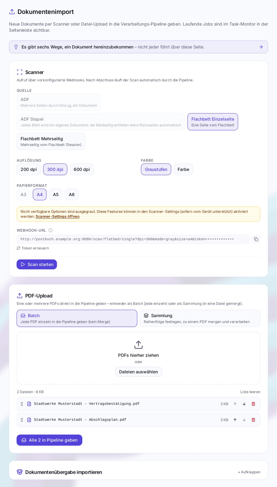

# Dokumente importieren

postbuch.net nimmt **PDF-Dateien** und **Papier** entgegen – sonst nichts.
Papier wird dabei zuerst zu einer PDF: gescannt oder mit dem Handy
abfotografiert.

Word-Dateien, Bilder, Tabellen oder E-Mails werden nicht angenommen. Grund ist
kein fehlendes Format, sondern der Anspruch an das Ergebnis: Die KI-Analyse, die
Dateiablage in der Cloud, die Seitenansicht, der Etikettendruck und jeder spätere
Export arbeiten mit einem einzigen, seitengetreuen Format. Wandle solche Dateien
vorher in eine PDF um – jedes Textprogramm und jedes Handy kann das.

Es gibt sechs Eingangswege. **Alle münden in dieselbe Warteschlange**: Was
danach passiert, ist unabhängig davon, woher das Dokument kam.

| #   | Weg                                                                                                                        | Art    |
| --- | -------------------------------------------------------------------------------------------------------------------------- | ------ |
| 1   | [ Überwachter Cloud-Ordner](#weg-1-überwachter-cloud-ordner)               | PDF    |
| 2   | [ Scannen per Foto vom Smartphone](#weg-2-scannen-per-foto-vom-smartphone)       | Papier |
| 3   | [ Datei-Upload über „Importieren"](#weg-3-datei-upload)                                 | PDF    |
| 4   | [ Scannen über „Importieren"](#weg-4-scannen-über-importieren)                       | Papier |
| 5   | [ Scan-Webhook im eigenen Netz](#weg-5-scan-webhook-im-eigenen-netz)                   | Papier |
| 6   | [ Scanner speichert direkt in die Cloud](#weg-6-scanner-speichert-direkt-in-die-cloud) | Papier |

Dieselbe Übersicht zeigt die App selbst unter 
**Importieren → „Es gibt sechs Wege, ein Dokument hereinzubekommen"** – dort mit
den aufgelösten Ordnerpfaden deiner Instanz. Direkt nach dem
Einrichtungsassistenten erscheint sie einmal von selbst.



_Die Import-Seite mit Scanner-Einstellungen, PDF-Sammlung und bereits
ausgewählten Dateien._

## Weg 1: Überwachter Cloud-Ordner

Legst du eine PDF in den Ordner `<postbuch.net-Wurzelverzeichnis>/_inbox` deiner Dateiablage, holt postbuch.net sie
von selbst ab. Der vollständige Pfad ist `<postbuch.net-Wurzelverzeichnis>/_inbox`; welcher
Wurzelordner das auf deiner Instanz ist – bei OneDrive im App-Ordner meist der
App-Ordner `Apps/<Name>` selbst –, steht in der App unter
 `Importieren → Sechs Wege` und unter
 `Einstellungen → Dateiablage`.

Das Polling läuft ab dem Anlegen der Ordnerstruktur alle **60 Sekunden**; unter
 `Einstellungen → Dateiablage` lässt es
sich ausschalten und das Abfrageintervall ändern. Mehrere Dateien auf einmal
sind ausdrücklich vorgesehen – jede wird ein eigenes Dokument.

Das ist der bequemste Weg, wenn die Cloud ohnehin auf deinem Gerät eingebunden
ist: unter Windows als Ordner im Explorer, unter Android eine PDF über „Teilen"
an die OneDrive- oder Nextcloud-App senden und dort in
`<postbuch.net-Wurzelverzeichnis>/_inbox` ablegen. Die PDF-Rechnung aus dem
Mail-Anhang ist damit in zwei Klicks in postbuch.net.

## Weg 2: Scannen per Foto vom Smartphone

Ohne Scanner im Haus genügt die Kamera des Handys oder Tablets. Dafür gibt es
zwei Wege.

### Mit der Kamera in postbuch.net

In der Mobilansicht öffnet der Knopf
 **Scannen** in der Mitte der
[Favoritenleiste](mobil-und-pwa.md#die-mobilansicht) die Rückkamera im
Vollbild, von jeder Seite aus. Daneben gibt es auf der Seite
 `Importieren` die Karte
**Mit Kamera scannen → Kamera öffnen**; sie steht auf Touch-Geräten ganz oben,
am Rechner unter dem Datei-Upload. Beim ersten Mal fragt der Browser, ob postbuch.net die
Kamera benutzen darf.

1. **Blatt ins Bild halten.** postbuch.net sucht die Blattränder und legt einen
   Rahmen um das Blatt. Erkannt wird ein Blatt ab etwa einem Achtel der
   Bildfläche; kleine Belege wie Visitenkarten näher an die Kamera halten. Ein
   dunkler oder gemaserter Untergrund hilft; auf einem hellen Tisch zeichnet
   meist der Schlagschatten des Blatts die Kante.
2. **Auslösen.** Unten rechts wählst du zwischen **Auto** und **Manuell**. Bei
   **Auto** löst postbuch.net selbst aus, sobald das Gerät ruhig gehalten wird
   und das **ganze** Blatt scharf ist, nicht nur die Bildmitte. Der Ring um den
   Auslöser zeigt, wie weit es ist; ein Tipp ins Bild bricht eine anstehende
   Auslösung ab. Bei **Manuell** tippst du selbst auf den Auslöser. Nach einer
   Aufnahme wartet die Automatik, bis ein neues Blatt liegt, damit dieselbe
   Seite nicht zweimal im Dokument landet.
3. **Vorschau prüfen.** Nach jeder Aufnahme erscheint die Seite entzerrt,
   zugeschnitten und mit verbessertem Kontrast. Das Foto zeigt dabei genau den
   Ausschnitt der Live-Ansicht, auch wenn die Kamera selbst mehr aufnimmt.
   Darunter stehen
    **Ecken** (Rahmen von Hand
   korrigieren),  **Drehen**,
    **Neu aufnehmen** und
    **Entfernen**, darunter
    **Seite hinzufügen** und
    **Hochladen**. Die Leiste mit den Miniaturen
   führt zu jeder bisherigen Seite zurück; **Fertig** neben dem Auslöser springt
   ohne weitere Aufnahme in die Vorschau.
4. **Hochladen.** Alle Seiten werden zu **einer** PDF und gehen wie eine
   hochgeladene Datei in die Pipeline. Hochgeladen wird erst die fertige PDF;
   die Fotos selbst verlassen das Gerät nicht.

Oben rechts wählst du **Farbe**, **Grau** oder **SW** (Schwarzweiß). Die Wahl
gilt für alle Seiten des Scans und lässt sich in der Vorschau noch ändern; die
Seiten werden dann neu berechnet. SW ergibt die kleinsten Dateien und eignet
sich für reine Textseiten, Farbe für Briefköpfe, Stempel und Fotos. Bei allen
drei Arten gleicht postbuch.net ungleichmäßiges Licht und Schatten auf dem Blatt
aus und hebt den Kontrast an. Gibt das Gerät seine Lampe frei, schaltet das
Taschenlampen-Symbol oben rechts sie ein. Modus und Auslöseart merkt sich postbuch.net für
dieses Gerät.

**Kamera wählen:** Das  Zahnrad neben
**Auto** öffnet die Liste der Kameras des Geräts. **Automatisch** nimmt die
Rückkamera mit der kleinsten Nummer, auf Android-Handys meist die
Hauptkamera; ohne diese Regel griffe der Browser auch einmal zum Weitwinkel.
Jede andere Kamera lässt sich direkt antippen; das Livebild wechselt sofort,
sodass du gleich siehst, welches Objektiv das schärfere Bild liefert. Die
gerade laufende Kamera ist mit **Aktiv** markiert. Solange die Liste offen
ist, löst die Automatik nicht aus. Die Wahl gilt nur für diesen Browser.

**Ecken anpassen:** Liegt der Rahmen daneben oder wurde kein Blatt erkannt,
zeigt **Ecken** das Foto mit vier Eckpunkten. Beim Ziehen einer Ecke erscheint
oben eine Lupe, die den Bereich unter dem Finger vergrößert. **Zurücksetzen**
stellt den erkannten Rahmen wieder her, **Ganzes Bild** nimmt das ganze Foto,
**Übernehmen** entzerrt die Seite neu.

Jede Seite wird im PDF auf DIN-A4-Breite gesetzt und mit höchstens
**200 dpi** gespeichert. Ein A4-Blatt hat damit 1654 × 2339 Bildpunkte, was für
die KI-Analyse und den Ausdruck genügt und die Datei klein hält.

**Etikett scannen:** Solange noch keine Seite aufgenommen ist, sucht die
Live-Ansicht zugleich nach dem QR-Code eines
[postbuch.net-Etiketts](etiketten-drucken.md); ein Blatt muss dafür nicht
erkannt sein. Hältst du ein Etikett ins Bild, erscheint unten
**Etikett P000123 erkannt** mit einem Countdown-Ring, und nach drei Sekunden
öffnet sich das Dokument; das Etikett einer [Sammelmappe](etiketten-drucken.md#etiketten-für-sammelmappen)
(`S000123`) öffnet die Dokumentliste dieser Sammelmappe. **Öffnen** springt sofort hin, der Ring oder ein Tipp
ins Bild bricht ab und scannt weiter; dasselbe Etikett meldet sich dann bis zum
nächsten Öffnen der Kamera nicht mehr. Erkannt werden ausschließlich Etiketten
dieser Instanz: gedruckt unter der Adresse, unter der postbuch.net gerade
läuft, oder unter einer weiteren Adresse, die der Admin
[freigegeben](etiketten-drucken.md#etiketten-im-kamerascan) hat. Jeder andere
QR-Code, etwa ein GiroCode auf einer Rechnung, gehört zum Papier und wird ganz
normal mitgescannt. Beim Ersetzen der PDF eines
Dokuments ist die Etikett-Erkennung aus.

Erkennung, Entzerrung und Bildverbesserung rechnet das Gerät selbst. Dafür lädt
postbuch.net beim ersten Öffnen einmalig eine Bildverarbeitung von rund 4 MB
nach; danach kommt sie aus dem Browser-Cache. Die Kamera braucht eine
verschlüsselte Verbindung (`https://`), über eine unverschlüsselte Adresse im
Heimnetz erscheint die Karte nicht. Erprobt ist der Kamerascan mit Chrome unter
Android; auf iPhone und iPad ist er ungetestet.

Der Zurück-Knopf des Geräts bzw. das  oben
links beendet den Scan. Sind schon Seiten aufgenommen, fragt postbuch.net
vorher, ob sie verworfen werden sollen.

### Mit der Scan-Funktion der Cloud-App

Die App deiner Cloudablage bringt ebenfalls einen Dokumentenscan mit. OneDrive
und Nextcloud entzerren die abfotografierte Seite, schneiden sie zu und
speichern sie als PDF; mehrere Seiten landen in einer Datei.

Als Zielordner `<postbuch.net-Wurzelverzeichnis>/_inbox` wählen – damit läuft der
Scan über denselben überwachten Ordner wie
[Weg 1](#weg-1-überwachter-cloud-ordner).

## Weg 3: Datei-Upload

Auf der Seite  `Importieren` per Drag & Drop
oder Dateiauswahl. Zwei Modi:

 **Batch** – Jede Datei wird **separat**
verarbeitet und bekommt eine eigene Postnummer. Das ist der Weg für einen Stapel
unabhängiger Dokumente. Vorausgewählt ist Batch.

 **Sammlung** – Alle abgelegten PDFs werden
vorab **zu _einer_ Datei zusammengeführt** und als _ein_ Dokument verarbeitet.
Die Reihenfolge lässt sich vorher per  /
 Pfeiltasten ändern, der Dateiname ist
frei wählbar. Das ist der Weg für einen Brief mit Anlagen oder ein mehrteilig
gescanntes Schreiben.

### PDFs über das Teilen-Menü übergeben

Ist postbuch.net auf einem Android-Gerät
[als App installiert](mobil-und-pwa.md#als-app-installieren-pwa), steht sie im
**Teilen-Menü** des Geräts zur Auswahl. Eine dort geteilte PDF – etwa aus der
Mail-App, dem Dateimanager oder dem Download-Ordner – geht **ohne weiteren
Klick** in die Pipeline, genau wie eine per Dateiauswahl gewählte PDF im Modus
**Batch**. postbuch.net
[folgt dabei immer automatisch](#automatisch-folgen): Es öffnet
 **Logs → Jobs** und nach erfolgreicher
Verarbeitung das neue Dokument. Mehrere geteilte PDFs werden einzeln
verarbeitet. Einen Hinweis für die KI gibt es auf diesem Weg nicht. Andere
Dateitypen bietet das Teilen-Menü für postbuch.net nicht an.

Ist postbuch.net beim Teilen nicht erreichbar, erscheint eine eigene
Fehlerseite: Der Server hat nicht geantwortet, die PDF wurde **nicht
übernommen und verworfen**. Sobald die Verbindung wieder steht, die PDF
erneut teilen.

Ist die App beim Teilen nicht angemeldet, wartet die Datei bis zur Anmeldung
und wird danach übernommen – höchstens einen Tag lang, danach verfällt sie.
Wer nur Lesezugriff hat, bekommt eine Fehlermeldung. Erscheint der Hinweis,
dass die Datei nicht angekommen ist, war die App auf dem Gerät noch nicht
vollständig eingerichtet: postbuch.net einmal direkt öffnen und erneut teilen.

> [!NOTE]
>
> Getestet ist der Weg nur unter Android. Auf iPhone und iPad bietet Safari
> installierten Web-Apps kein Teilen-Ziel an.

## Weg 4: Scannen über „Importieren"

Voraussetzung ist ein eSCL-fähiger Netzwerkscanner und das Compose-Profil
`scanner`. Eingerichtet wird er unter
 `Einstellungen → Scanner` oder im
Einrichtungsassistenten; die Gerätesuche findet Geräte im eigenen Netz selbst.
Antwortet das Gerät beim Test, schaltet postbuch.net das Compose-Profil
`scanner` automatisch ein – sofern der Host-Agent läuft. Ausschalten geht unter
 `Einstellungen → Scanner` und nur
nach ausdrücklicher Rückfrage; danach erreichen gescannte Seiten postbuch.net
nicht mehr.

Auf der  Import-Seite wählst du in der
 Scanner-Card:

| Einstellung      | Optionen                                                                            |
| ---------------- | ----------------------------------------------------------------------------------- |
| **Quelle**       | ADF · ADF Stapel · Flachbett Einzelseite · Flachbett Mehrseitig (Session)           |
| **Seiten**       | Vorderseite · Beidseitig – nur bei ADF-Quellen und nur, wenn der Scanner laut Einstellungen duplexfähig ist; Vorgabe ist Beidseitig |
| **Auflösung**    | Was das Gerät für die gewählte Quelle meldet                                        |
| **Farbe**        | Graustufen oder Farbe                                                               |
| **Papierformat** | A3 (falls unterstützt), A4, A5, A6 – nur bei Flachbett (Einzelseite oder Mehrseitig) |

Auflösung und Farbmodus hängen an der Quelle – der Einzug eines Geräts kann
andere Werte anbieten als das Flachbett. Beim Einzug (ADF) ist das Papierformat
fest auf A4 eingestellt, dort gibt es keine Auswahl. Ist der Scanner laut
Einstellungen nicht duplexfähig, entfällt der Seiten-Schalter und es wird immer
nur die Vorderseite gescannt.

Bei **Flachbett Mehrseitig** läuft eine Session: Seite auflegen, scannen,
nächste Seite auflegen, und am Ende die Session abschließen. Alle Seiten werden
zu einem Dokument. Das gewählte Papierformat gilt für die gesamte Session und
lässt sich nach der ersten Seite nicht mehr ändern. Passiert 60 Sekunden lang
nichts mehr, wird eine Session automatisch abgeschlossen und die bis dahin
gescannten Seiten gehen in die Verarbeitungs-Pipeline.

Bei **ADF** werden alle eingezogenen Blätter zu **einem** Dokument
zusammengefasst – das eignet sich für ein mehrseitiges Schreiben. Willst du
dagegen mehrere unterschiedliche Belege auf einmal in den Einzug legen, nutze
**ADF Stapel**: Hier wird **jedes Blatt zu einem eigenen Dokument**. Bei
Beidseitig zählen Vorder- und Rückseite eines Blatts zusammen; eine leere
Rückseite wird automatisch entfernt, sodass das Ergebnis in diesem Fall
einseitig ist. Kommt es mitten im Stapel zu einem Papierstau, gehen die bereits
fertig gescannten Blätter trotzdem einzeln in die Pipeline; nur für die
verbliebenen Blätter musst du den Vorgang wiederholen.

Nach dem Scan durchläuft jede Datei die Bereinigungs-Pipeline im
`cleaner`-Container (automatische Drehung, Zuschnitt, Entzerrung, OCR-Textebene)
und wird dann an die App übergeben. Im ADF-Stapel mit Beidseitig werden für den
Zuschnitt die Inhaltsmasken beider Seiten übereinandergelegt. So bestimmt der
gesamte Nutzinhalt von Vorder- und Rückseite den gemeinsamen Ausschnitt, der
auf beide Seiten angewendet wird. Automatisch erkannte Leerseiten werden bei
Beidseitig entfernt (typische unbedruckte Rückseite); bei Vorderseite und
Flachbett Mehrseitig bleibt jede gescannte Seite erhalten, da du sie dort
bewusst selbst ausgelöst hast.

### Scanner-Erkennung kalibrieren

Administrierende Personen können unter **Einstellungen → Scanner →
Scanner-Kalibrierungsassistent** bis zu drei einseitige Testseiten aufnehmen.
Diese Dateien bleiben ausschließlich im lokalen Testbereich: Sie durchlaufen
weder die Dokumentpipeline noch die Datenbank und erhalten keine PostID.

Für eine belastbare Abstimmung eignen sich unterschiedliche Grenzfälle – etwa
eine wirklich leere Seite, helles Durchscheinen von der Vorderseite und ein
blasser Thermobeleg. Im zweiten Schritt zeigt der Assistent für alle Testseiten
live, ob sie als Leerseite entfernt würden und wo der automatische Zuschnitt
läge. Erst die ausdrückliche Bestätigung im letzten Schritt übernimmt die Werte.
Der Assistent darf jederzeit folgenlos geschlossen werden; vorhandene Testseiten
stehen beim nächsten Start wieder bereit und können einzeln ersetzt oder
gelöscht werden.

## Weg 5: Scan-Webhook im eigenen Netz

Jede Scan-Einstellung auf der Import-Seite hat eine eigene Adresse. Sie steht
dort als **Webhook-URL** zum Kopieren und ändert sich mit Quelle, Auflösung,
Farbmodus und Format – die angezeigte URL gehört immer genau zu dem, was gerade
eingestellt ist. Ihre Form:

```
http://<adresse-dieser-instanz>:<scanner-port>/scan/adf/simplex?dpi=300&mode=gray&token=<scanner-token>
```

Ein Aufruf dieser URL löst sofort einen Scan aus. Das ist eine **technische
Schnittstelle** für andere Geräte im selben Netz: ein Smarthome-Knopf neben dem
Scanner, eine Tastenbelegung, ein Skript, eine Hausautomatisierung. Für den
täglichen Gebrauch brauchst du sie nicht.

Der **Scanner-Token** am Ende der URL ist ein Geheimnis: Ohne ihn lehnt der
Scanner-Dienst jeden Aufruf ab, wer die vollständige URL kennt, kann scannen.
Statt als Parameter `token` lässt er sich auch im Header `X-Scanner-Token`
mitschicken. Die URL sehen nur Nutzer mit Vollzugriff und der Administrator.
Der Administrator kann den Token unter der URL mit **Token erneuern** austauschen;
bisher kopierte URLs funktionieren danach nicht mehr, der Scanner-Dienst
übernimmt den neuen Token innerhalb von 30 Sekunden.

> [!NOTE]
>
> Der Scanner-Dienst gehört nie ins Internet weitergeleitet. Er ist für Geräte im
> eigenen Netz gedacht.

**Freigabe für andere Geräte:** Neuinstallationen binden den Scanner-Port nur
an den Rechner selbst. Der Webhook ist dann von anderen Geräten aus nicht
erreichbar, und die Import-Seite zeigt statt der URL einen Hinweis. Freigeben
lässt er sich unter  **Einstellungen →
Scanner** mit **Freigeben**; **Schließen** nimmt die Freigabe zurück. Beides
erledigt der Host-Agent auf dem Server, in der Regel innerhalb einer Minute.

Ohne Host-Agent bestimmt `SCANNER_BIND` in der `.env` die Freigabe:
`127.0.0.1` für nur den Rechner selbst, leer (oder ohne Zeile) für alle Geräte
im Netz. Nach einer Änderung den Scanner-Dienst neu starten:

```sh
docker compose up -d --no-deps scanner app
```

Scannen über die Import-Seite funktioniert in beiden Fällen, weil postbuch.net
den Scanner-Dienst über das interne Docker-Netz anspricht.

Bei **Flachbett Mehrseitig** braucht es mehrere Aufrufe: je Seite
`/scan/flatbed/session/scan`, am Ende `/scan/flatbed/session/finish`.

## Weg 6: Scanner speichert direkt in die Cloud

Manche Netzwerkscanner können selbst in eine Cloud ablegen. Ist deine
Cloud-Dateiablage mit `<postbuch.net-Wurzelverzeichnis>/_inbox` als Ziel
eingerichtet, holt postbuch.net die Scans wie jede andere Datei über
[Weg 1](#weg-1-überwachter-cloud-ordner) ab.

Das können nur wenige Geräte. Ob es geht, entscheidet allein der Scanner. Eine
Bereinigung durch den `cleaner`-Container findet auf diesem Weg nicht statt –
die Seiten kommen so an, wie das Gerät sie speichert.

## Was danach passiert

Die Verarbeitung läuft in Phasen. Standardmäßig laufen bis zu **drei** Dokumente
gleichzeitig. Anpassen lässt sich das unter

`Einstellungen → Allgemein → Verarbeitungs-Pipeline`.

| Phase | Was passiert                                                                                                     |
| ----- | ---------------------------------------------------------------------------------------------------------------- |
| 0     | Scanner-Eingang in die Dateiablage hochladen                                                                          |
| 1     | PDF herunterladen                                                                                                |
| 2     | **KI-Analyse** – Absender, Datum, Betreff, Zusammenfassung, Schlagwörter, Lebensbereich × Dokumentart, Fachdaten |
| 2.5   | Validierung und Reparatur der KI-Ausgabe                                                                         |
| 3     | **Duplikatprüfung** über Embedding-Ähnlichkeit                                                                   |
| 4     | Duplikat-Handling, falls nötig                                                                                   |
| 5     | Dateiablage in den Zielordner, Umbenennung                                                                            |
| 6     | PWA-/Browser-Push und, falls bewusst eingerichtet, experimentelles Discord                                       |
| 7     | PDF-Rotation korrigieren                                                                                         |
| 8     | Datenbank-Einträge inkl. Embedding                                                                               |
| 9     | PDF-Cache (das Embedding wurde bereits in Phase 8 gespeichert)                                                   |

Den Fortschritt siehst du live im Navigationpunkt `Logs → Jobs`. Die Seite darf
man verlassen.

### Automatisch folgen

Nach einem Import kann postbuch.net selbst zu
 **Logs → Jobs** wechseln. Ein Kasten oben
zeigt, was mit dem Dokument gerade passiert, darunter läuft der Job mit seinen
Phasen. Ist die Verarbeitung erfolgreich abgeschlossen, öffnet sich nach drei
Sekunden das neue Dokument. Ein Tipp auf den ablaufenden Ring oder eine
beliebige Taste bricht das ab; **Dokument öffnen** führt dann von Hand hin.
Erkennt die Pipeline ein mögliches Duplikat, wartet sie auf die Entscheidung
unter **Offene Entscheidungen**; schlägt sie fehl, bleibt die Ansicht mit der
Fehlermeldung stehen.

Bei mehreren Dokumenten auf einmal – Batch mit mehreren Dateien, **ADF
Stapel** – zählt der Kasten mit, wie viele fertig sind; ein Dokument
öffnet sich dann nicht automatisch, ein Tipp auf einen Eintrag im Verlauf führt
zum jeweiligen Dokument.

Wann postbuch.net folgt:

| Weg                                                                  | Folgt                                                                   |
| -------------------------------------------------------------------- | ----------------------------------------------------------------------- |
| [Teilen-Menü](#pdfs-über-das-teilen-menü-übergeben)                  | immer                                                                   |
| [Datei-Upload](#weg-3-datei-upload)                                  | nach dem Hochladen, wenn eingeschaltet                                  |
| [Mit der Kamera in postbuch.net](#mit-der-kamera-in-postbuchnet)     | nach dem Hochladen, wenn „Scannen" eingeschaltet ist                    |
| [Scannen über „Importieren"](#weg-4-scannen-über-importieren)        | sobald der Scan in der Pipeline angekommen ist, wenn eingeschaltet      |
| Überwachter Ordner, Scan-Webhook, Scan per Knopf am Gerät            | nie – dabei schaut niemand auf die App                                  |

Dateiimport und Scannen lassen sich unter
 **Einstellungen →
Persönlich → Automatisch folgen beim Import** einzeln ein- und ausschalten.
Beide sind anfangs eingeschaltet. Die Wahl gilt nur für den jeweiligen Browser,
sodass Handy und Rechner unterschiedlich eingestellt sein können.

Beim Scannen wartet die Seite `Importieren`, bis der Scanner den Scan an die
Pipeline übergeben hat, und zeigt das an. Kommt er nach zehn Minuten noch nicht
an, bleibt die Seite mit einem Hinweis stehen.

Bei einem Cloud-Anbieter rufen die KI-Phasen den eingestellten Provider
kostenpflichtig auf; bei einem lokal betriebenen, OpenAI-kompatiblen Anbieter
entstehen keine externen API-Kosten pro Dokument. Ein Import umfasst
normalerweise die Hauptanalyse und ein Embedding, bei gestaffelter
[Modellwahl](ki-provider.md#modellwahl) vorher eine kurze Voranalyse; bei
Reparatur, Fallback oder einem Erstattungsbescheid können weitere Aufrufe
dazukommen. Als grobe Orientierung sind **1–20 Eurocent je Dokument** üblich,
mit günstigen Modellen auch weniger und bei langen, schwierigen oder mehrfach
versuchten Dokumenten auch mehr. Die vollständige Aufschlüsselung steht unter
[KI-Anbieter → Kosten und kostenpflichtige Aufrufe](ki-provider.md#kosten-und-kostenpflichtige-aufrufe).

### Duplikate (Experimentell)

Erkennt Phase 3 ein wahrscheinliches Duplikat, wird die Verarbeitung
**angehalten** statt blind fortgesetzt. Auf dem Dashboard erscheint eine
**offene Entscheidung**: das neue und das bestehende Dokument nebeneinander, mit
der Wahl zwischen Verwerfen, Ersetzen und Trotzdem anlegen. Dieselbe
Entscheidung lässt sich aus der PWA-/Browser-Push-Nachricht öffnen. Ist die
nicht empfohlene, experimentelle Discord-Anbindung bewusst eingerichtet, enthält
auch deren Meldung einen Link oder Bot-Schaltflächen.

Das Feature ist experimentell. Aktuell werden viele Duplikate nicht zuverlässig
erkannt.

### Wenn etwas schiefgeht

Fehlgeschlagene Dokumente landen im Ordner
`<postbuch.net-Wurzelverzeichnis>/_failed` der Dateiablage und erscheinen in einer
eigenen Karte auf dem Dashboard, von wo aus sich die Verarbeitung wiederholen
lässt. Angehaltene Läufe (z. B. wegen Duplikatverdacht) liegen in
`<postbuch.net-Wurzelverzeichnis>/_suspended` und werden fortgesetzt, sobald du
entschieden hast.

Häufige Ursachen und ihre Behebung stehen unter
[Betrieb und Troubleshooting](betrieb-troubleshooting.md).

## Nachträglich korrigieren

 **Erneut verarbeiten** – Auf der
Detailseite eines Dokuments lässt sich die KI-Analyse wiederholen, wahlweise mit
einer anderen Modellstufe (Auto, Lang, Leicht, Mittel, Schwer). Man kann dem
Modell auch eine Freitext-Korrekturanweisung mit auf den Weg geben, die es
beachten wird. Sinnvoll, wenn ein schwieriges Dokument beim ersten Versuch
falsch verstanden wurde. Optional lässt sich dabei die OCR-Textebene entfernen,
wenn sie schlechter ist als das Bild selbst; postbuch.net schlägt das von sich
aus vor, wenn es eine fragwürdige Textebene erkennt. Dabei entstehen erneut
ungefähr dieselben KI-Kosten wie beim Import; eine feste Modellstufe spart die
Voranalyse, nicht aber die Hauptanalyse und das neue Embedding. Die Wahl der
Modellstufe gibt es nur bei gestaffelter
[Modellwahl](ki-provider.md#modellwahl); mit einem Modell für alles verarbeitet
das Analysemodell das Dokument erneut.

Bei einem Erstattungsbescheid gilt die Korrekturanweisung auch für das
anschließende Auslesen der Positionen und den Abgleich der Kürzungen. Eine fest
gewählte Modellstufe liest auch die Positionen aus; bei „Auto“ übernimmt das die
Stufe Mittel, mit einem Modell für alles das Analysemodell. Schlägt dieser Schritt fehl, wiederholt postbuch.net ihn nach
wenigen Minuten automatisch mit derselben Anweisung.

 **PDF ersetzen** – Ersetzt nur die
PDF-Datei (neuer Scan derselben Sache, in besserer Qualität). Die Postnummer,
alle Metadaten, Akten- und
Verbleib-Zuordnungen bleiben unverändert, und es läuft **kein** KI-Lauf.
Erreichbar über die Aktionsleiste des Dokuments; die neue Datei kommt aus einem
Scan, einem [Kamerascan](#mit-der-kamera-in-postbuchnet) oder einem Upload. Fehlt die bisherige Datei in
der Dateiablage bereits nachweislich, heißt derselbe Knopf **Fehlende PDF
reimportieren** (siehe
[Wenn eine Datei endgültig fehlt](storage-backends.md#wenn-eine-datei-endgültig-fehlt)).

**Dokumentart ändern** – Ist die neue Art mit der alten kompatibel (gleiche
Fachdatenstruktur), werden Datenbank und Dateiablageort direkt aktualisiert. Das
Dokument wird auch in der Dateiablage entsprechend verschoben. Erfordert die neue Art
eine andere Auswertung, fragt postbuch.net nach und startet danach eine
KI-Wiederverarbeitung.

**Manuelle Änderungen** – Fast alle Metadatenfelder lassen sich über das  Stift-Symbol händisch korrigieren. Vor allem für kleinere Änderungen ist das oft der schnellste Fix.

## Cache-Mode

Wer viele Dokumente am Stück einliest – etwa beim erstmaligen Digitalisieren
eines Aktenschranks –, kann den **Cache-Mode** einschalten. Er bündelt die
Verarbeitung auf ein _fixes_ Modell und nutzt dessen Prompt-Caching, was die
Kosten deutlich senken kann. Ob der Cache greift, hängt vom Modell ab, siehe
[Cache-Mode](ki-provider.md#cache-mode).

- Die Modellstufe wird vorher gewählt und bleibt für die Dauer fest.
- Der Modus gilt **global** für alle Eingangswege, auch Scanner und
  Cloud-Ordner.
- Lange Dokumente (mehr als 10 Seiten) laufen weiterhin über die normale Kette.
- Ohne neue Verarbeitung schaltet sich der Modus nach einer Weile selbst ab; die
  verbleibende Zeit steht auf der Karte.

Die Karte erscheint auf der Import-Seite nur, wenn Cache-Mode in den
KI-Einstellungen freigeschaltet ist. Den Cache-Mode gibt es nur bei gestaffelter
[Modellwahl](ki-provider.md#modellwahl); mit einem Modell für alles ist das
Prompt-Caching ohnehin immer an.

## Sonderfall: Dokumentenübergabe einspielen

Kein Weg für ein erstes Dokument, sondern für einen bestehenden Bestand: Ein
zuvor exportiertes **Dokumentenübergabe-ZIP** wird ohne erneuten KI-Lauf wieder
eingelesen. Abrechnungsperioden, Akten, Wiedervorlagen, Salden und PKV-Prüfungen
werden bewusst nicht übernommen; direkte Beziehungen zwischen den im Paket
enthaltenen Dokumenten bleiben erhalten. Vor dem Import ordnest du die
Personen aus dem Paket den Menschen dieser Instanz zu. Nur mit Admin-Zugang
sichtbar, bis 2 GB pro ZIP. Ausführlich in
[Export und Import](export-import.md#anwendungsfall-dokumente-in-eine-andere-instanz-umziehen).

---

Weiter: [Die Dokumentansicht](dokumentansicht.md) ·
[Zurück zur Übersicht](README.md)
