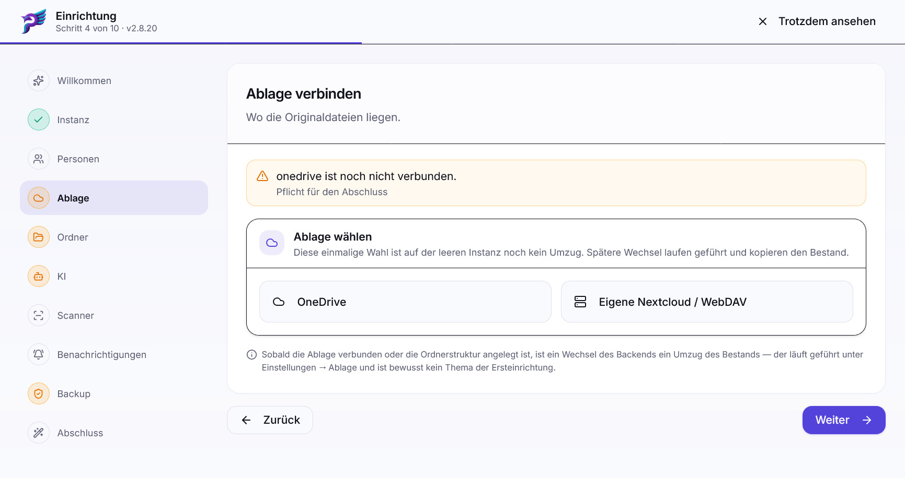

# Installation

Es gibt zwei Wege: den **Installer** (empfohlen) und die **manuelle Installation
mit Docker Compose**. Beide führen zum selben Stack; der Installer nimmt nur die
Handarbeit ab und erzeugt Secrets zufällig.

## Weg 1: Installer

```bash
curl -fsSL https://github.com/ceramgcf/postbuch.net/releases/latest/download/install.sh | bash
```

Den Installer startest du als normaler Benutzer, **ohne `sudo`**. Wo er
Administratorrechte braucht (Docker einrichten, Host-Agent), fragt er selbst
nach dem `sudo`-Passwort. Mit `sudo bash install.sh` liefe er als `root`:
`~` stünde dann für `/root`. Er schlüge `/root/postbuch` als
Installationsverzeichnis vor, und die Merkdatei deiner Instanz (siehe unten)
fände er nicht; eine vorhandene Instanz erkennt er dann nur, wenn du ihn in
ihrem Verzeichnis startest oder `--install-dir=` angibst.

Der Installer

1. lädt Release-Manifest und Tarball von der Bezugsquelle, standardmäßig den
   [GitHub Releases](https://github.com/ceramgcf/postbuch.net/releases) des Projekts,
2. prüft die **Ed25519-Signatur** des Manifests und den SHA-256 des Archivs
   (siehe [Sicherheit](sicherheit.md#herkunft-der-software)),
3. richtet Docker auf Debian-/Ubuntu-artigen Systemen bei Bedarf ein,
4. führt durch den Einrichtungsdialog,
5. schreibt `.env` mit `chmod 600`,
6. startet den Stack.

Auf Debian 13 installiert der Installer Docker Compose aus dem Systempaket
`docker-compose`; es stellt auch den Aufruf `docker compose` bereit.
Nach einer automatischen Docker-Installation setzt der Installer die Einrichtung
im selben Lauf mit `sudo docker compose` fort. Ein neues Login ist nur nötig,
wenn du Docker später ohne `sudo` bedienen möchtest.

Installationsverzeichnis ist standardmäßig `~/postbuch` (bei Diensten unter
`root`: `/root/postbuch`). Der Installer fragt danach; mit `--install-dir=`
steht es fest, und die Frage entfällt. Unter Windows gibt das Skript
`/root/postbuch` in der eigenen Instanz vor. Pro Rechner ist genau
eine postbuch.net-Instanz zulässig; der Installer legt keine zweite an.

Liegt die Instanz nicht unter `~/postbuch`, findet der Installer sie trotzdem.
Ohne `--install-dir=` sucht er in dieser Reihenfolge:

1. im Verzeichnis, in dem das aufgerufene `install.sh` liegt,
2. im aktuellen Verzeichnis (z. B. `cd /pfad/zur/instanz` vor
   `curl … | bash`),
3. im Pfad aus der Merkdatei `~/.postbuch-installdir`,
4. unter `~/postbuch`.

Die Merkdatei schreibt der Installer nach jeder Installation und bei jedem
Aufruf gegen eine bestehende Instanz; bei der Deinstallation entfernt er sie.
Die gefundene Quelle zeigt das Menü unter „Bestehende Installation gefunden“ an.

### Unter Windows

Auf einem Windows-PC läuft postbuch.net in einer eigenen Linux-Umgebung (WSL 2)
namens `postbuch.net`. Den Windows-Teil richtet ein PowerShell-Skript ein. Öffne
dazu PowerShell mit **Als Administrator ausführen** und gib ein:

```powershell
irm https://github.com/ceramgcf/postbuch.net/releases/latest/download/install.ps1 | iex
```

Das Skript

1. prüft Windows (64 Bit, Windows 10 ab Version 2004 oder Windows 11) und die
   Virtualisierung; ist sie im BIOS/UEFI ausgeschaltet, nennt es die Einstellung
   („SVM Mode“ bei AMD, „Intel Virtualization Technology“ bzw. „VT-x“ bei Intel),
2. fragt, ob andere Geräte über das [Heimnetz](#zugriff-aus-dem-heimnetz-unter-windows)
   auf postbuch.net zugreifen dürfen. Enter übernimmt **Ja**,
3. installiert WSL bei Bedarf aus den Releases von Microsoft auf GitHub und prüft
   dabei Prüfsumme und Signatur des Pakets,
4. schaltet bei Bedarf die Windows-Funktion „VM-Plattform“ ein. Danach muss
   Windows einmal neu starten. Danach führst du denselben Befehl erneut aus,
5. bereitet das gespiegelte WSL-Netz vor und legt die Instanz
   `postbuch.net` (Debian) unter `C:\Users\<name>\wsl\postbuch.net` an,
6. legt die geplante Aufgabe „postbuch.net Wachhalten“ an. Sie startet postbuch.net
   beim Hochfahren mit normalen Windows-Benutzerrechten, auch ohne Anmeldung,
   und hält es wach. Windows-Programme lassen sich aus dieser WSL-Instanz
   nicht direkt aufrufen,
7. übergibt an den Installer in der Instanz. Ab hier laufen Signaturprüfung und
   [Einrichtungsdialog](#der-einrichtungsdialog-schritt-für-schritt) wie unter
   Linux, vorgeschlagen ist die Betriebsart [Komplett lokal](#komplett-lokal),
8. richtet bei Zustimmung die Firewall-Regel ein und legt auf dem Desktop die
   Verknüpfung „postbuch.net“ an. Sie öffnet `http://localhost:3420` bzw. den
   gewählten Port,
9. trägt postbuch.net als **postbuch.net Server** unter **Einstellungen → Apps →
   Installierte Apps** bzw. **Systemsteuerung → Programme und Features** ein.
   Version und Größe entsprechen dem Stand des letzten Windows-Installationslaufs.
   Die Größe enthält die Linux-Instanz mit Containern und vorhandenen KI-Modellen,
   ohne den Ablageordner,
10. öffnet zum Schluss postbuch.net im Standardbrowser. Steht noch das
    [Einspielen eines Backups](backup-wiederherstellung.md#beim-neuaufsetzen) aus,
    führen Browser und Desktop-Verknüpfung bis dahin auf die Seite dafür.

#### Windows-Einträge

Wird postbuch.net danach im Browser [als App registriert](mobil-und-pwa.md#windows),
legt der Browser unter „Installierte Apps“ einen zweiten Eintrag **postbuch.net**
an, etwa mit „1.0.0.0 | localhost:3420“. Das ist nur das App-Fenster der
Oberfläche, Versionsnummer und Name vergibt der Browser. Wer diesen Eintrag
deinstalliert, entfernt nur das App-Fenster; postbuch.net selbst läuft weiter.

Sperrt Windows den Desktop (etwa der überwachte Ordnerzugriff von Microsoft
Defender), fehlt nur die Verknüpfung; der Installer meldet das und nennt die
Adresse. Alles andere wird trotzdem eingerichtet.

Beim Start von WSL meldet Windows auf manchen Rechnern „Fehler beim Ermitteln
der Unterstützung für geschachtelte Virtualisierung“. Die Meldung kommt von WSL
selbst; die Installation läuft trotzdem weiter, und postbuch.net braucht diese
Funktion nicht.

#### Installationsoptionen unter Windows

Sind die Ports 3420, 80 oder 443 unter Windows schon von einem anderen Programm
belegt, nimmt die Erstinstallation selbst freie Ports (ab 3421, 8080 bzw. 8443)
und meldet das. Eigene Ports gibst du mit `-WebPort`, `-HttpPort` und
`-HttpsPort` vor; ein belegter Port bricht dann mit einem Hinweis ab:

```powershell
& ([scriptblock]::Create((irm https://github.com/ceramgcf/postbuch.net/releases/latest/download/install.ps1))) -WebPort 8420
```

Bei einer bestehenden Installation stellen dieselben Schalter die Ports um.
Ohne Schalter öffnet derselbe Befehl das Windows-Menü des Installers. Wähle
**Installation verwalten** für Update, Adminpasswort oder Ports. Das Menü
erreichst du auch über **Ändern** beim Eintrag postbuch.net Server. Die
Aktionen **Ändern** und **Deinstallieren** fragen nach Administratorrechten.

Bricht ein Schritt ab, setzt derselbe Befehl die Einrichtung fort; erledigte
Schritte überspringt er.

Geht der PC am Netzteil nach einiger Zeit in den Energiesparmodus, weist das
Skript am Ende darauf hin. Solange der PC schläft, ist postbuch.net nicht
erreichbar und die Verarbeitung pausiert; nach dem Aufwachen läuft alles weiter,
eine verpasste [automatische Sicherung](backup-wiederherstellung.md#einrichten)
wird nachgeholt. Soll postbuch.net jederzeit erreichbar sein, stelle unter
**Einstellungen → System → Netzbetrieb und Energie → Bildschirm und
Energiesparmodus** den Energiesparmodus am Netzteil auf **Nie**.

Entfernt wird postbuch.net ebenfalls in einer PowerShell als Administrator:

```powershell
& ([scriptblock]::Create((irm https://github.com/ceramgcf/postbuch.net/releases/latest/download/install.ps1))) -Deinstallieren
```

Dafür nimmt das Skript den Installer, der bei der Instanz liegt und zur
installierten Version passt; nur wenn er fehlt, lädt es ihn herunter. Das legt
zuerst eine Sicherung der Datenbank in der Ablage an und entfernt dann
den Stack, die geplante Aufgabe, die Verknüpfung, die Einstellungen für das
Heimnetz, den Eintrag in „Programme und Features“ und die Instanz. Der Ablageordner bleibt mit allen Originalen stehen.
Liegt er ausnahmsweise im Linux-Teil der Instanz, bietet das Skript an, ihn
vorher nach `Dokumente\postbuch.net-Ablage` zu kopieren; lehnst du ab oder
scheitert die Kopie, bleibt die Instanz bestehen.

WSL selbst bleibt installiert, denn andere Programme können es ebenfalls nutzen.
Deshalb steht im Explorer links weiterhin der Eintrag **Linux**. Wird WSL sonst
nicht gebraucht, entfernt es `wsl --uninstall` in einer PowerShell als
Administrator.

> [!CAUTION]
>
> `wsl --uninstall` entfernt WSL mit allen übrigen Linux-Umgebungen auf diesem
> PC. Welche es gibt, zeigt vorher `wsl --list`.

#### Zugriff aus dem Heimnetz unter Windows

Auf **Windows 11 ab Version 22H2** fragt der Installer vor der Einrichtung
von WSL **Netzwerkzugriff erlauben?**. Enter übernimmt **Ja**. Mit **Nein**
nutzt du postbuch.net über die Desktop-Verknüpfung an diesem PC. Deine Wahl
gilt auch nach einem Neustart während der Installation.

Mit **Ja** richtet der Installer in der Hyper-V-Firewall eine eingehende
TCP-Freigabe für das Windows-Netzwerkprofil **Privat** ein. Sie umfasst die
für die Netzwerknutzung konfigurierten Web-Ports. Standard ist 3420. Für HTTPS
kommen 80 und 443 hinzu. Andere Geräte können
die Anmeldeseite über die Netzwerkadresse des PCs erreichen. Die Freigabe
gilt für die Web-Ports von WSL an diesem PC und kann deshalb auch andere
WSL-Dienste auf denselben Ports betreffen.

Öffne zum Ändern auf dem Server-PC **Windows-Einstellungen → Apps →
Installierte Apps → postbuch.net Server → Ändern**. Bestätige die Abfrage nach
Administratorrechten und wähle im Installer **Netzwerkfreigabe ändern**.
Den Eintrag findest du auch unter **Systemsteuerung → Programme und Features**.
Beim Ausschalten entfernt der Installer seine Firewall-Regel. Am Windows-PC
öffnet die Desktop-Verknüpfung postbuch.net weiterhin. In postbuch.net zeigt
**Einstellungen → Allgemein → Erreichbarkeit** den zuletzt vom Installer
geprüften Zustand.

Der Installer bereitet das gespiegelte WSL-Netz für die spätere Umschaltung vor.
Die Einstellungen `networkingMode=mirrored` und `hostAddressLoopback=true`
stehen in `.wslconfig` und gelten für alle WSL-Instanzen deines Windows-Kontos.
Ein bereits ausdrücklich eingestellter anderer Netzwerkmodus hat Vorrang.
Laufen weitere Linux-Instanzen, übernimmt WSL die Änderung nach einem
Windows-Neustart. Bei der Deinstallation entfernt postbuch.net die markierten
Einstellungen und seine Firewall-Regel.

In einer als Administrator gestarteten PowerShell kannst du die Freigabe
auch mit `install.ps1 -Netzwerkfreigabe an` oder
`install.ps1 -Netzwerkfreigabe aus` ändern.

Für die installierte App auf dem Handy ist zusätzlich eine HTTPS-Adresse nötig,
siehe [DuckDNS/HTTPS](#der-einrichtungsdialog-schritt-für-schritt) und
[Mobil und PWA](mobil-und-pwa.md#als-app-installieren-pwa).

#### Speicher für die lokale KI unter Windows

WSL darf standardmäßig höchstens die Hälfte des Arbeitsspeichers nutzen. Reicht
das zusammen mit dem Grafikspeicher nicht für die
[lokale KI](ki-provider.md#lokale-ki-unter-windows) (24 GB), der ganze PC aber
schon, fragt das Skript, ob WSL mehr bekommen soll. Es bietet nur so viel an,
wie nötig ist (24 GB abzüglich des Grafikspeichers), und nur, wenn Windows
danach mindestens 8 GB behält. Der Eintrag `memory` landet markiert in
derselben `.wslconfig` und gilt damit für **alle** WSL-Umgebungen auf diesem
PC; darauf weist das Skript vor der Frage ausdrücklich hin. Ein vorhandener
`memory`-Wert bleibt unverändert, die Deinstallation entfernt den eigenen
Eintrag wieder. Wer die lokale KI nicht nutzen will, antwortet mit Nein.

### Eine Vorabversion installieren

Neue Versionen erscheinen oft zuerst als
[Vorabversion](betrieb-troubleshooting.md#vorabversionen). Die Befehle oben
holen immer die neueste **stabile** Version. Für eine Vorabversion nennst du
ihre Nummer, sie steht bei der Version in den
[GitHub Releases](https://github.com/ceramgcf/postbuch.net/releases). In den
Befehlen ersetzt du `<version>` zweimal durch diese Nummer, etwa `2.14.1`.

Unter Linux:

```bash
curl -fsSL https://github.com/ceramgcf/postbuch.net/releases/download/v<version>/install.sh | bash -s -- --zielversion=<version>
```

Unter Windows, in einer PowerShell **Als Administrator**:

```powershell
& ([scriptblock]::Create((irm https://github.com/ceramgcf/postbuch.net/releases/download/v<version>/install.ps1))) -Zielversion <version>
```

Das gilt auch, wenn eine Funktion bisher nur in einer Vorabversion steckt.
Signatur und Prüfsumme werden genauso geprüft wie bei einer stabilen Version.
Die übrigen Schalter (`-WebPort`, `-Quelle` …) lassen sich dazuschreiben.

Danach bekommt die Instanz die nächste stabile Version angeboten, die neuer
ist. Weitere Vorabversionen kommen erst, wenn du unter
 **Einstellungen → Allgemein**
**Vorabversionen erhalten** einschaltest. **Ändern** in „Programme und
Features“ holt den Installer der neuesten stabilen Version und, solange es
dort noch keinen für Windows gibt, den der installierten.

### Der Einrichtungsdialog Schritt für Schritt

Das ist der fachliche Einrichtungsdialog. Nach der Bezugsquelle fragt der
Installer nicht: Neue Installationen beziehen Releases von GitHub, bestehende
behalten die Quelle aus ihrer `.env`. Eine andere Quelle setzt nur
`--quelle=<https-url>`; verlangt sie eine Anmeldung, fragt der Installer nach
Basic-Auth-Zugangsdaten. Neue Installationen erhalten nur stabile Versionen;
Vorabversionen lassen sich später in der Oberfläche einschalten (siehe
[Updates](betrieb-troubleshooting.md#updates)).

| Frage                  | Was passiert                                                                                                                                                                                                 |
| ---------------------- | ------------------------------------------------------------------------------------------------------------------------------------------------------------------------------------------------------------ |
| **Instanzname**        | Erscheint in der Seitenleiste und auf gedruckten Etiketten. Frei wählbar, z. B. „Familie Muster".                                                                                                            |
| _(automatisch)_        | Datenbank-Passwort und Session-Secret werden zufällig erzeugt.                                                                                                                                               |
| **Betriebsart**        | „Komplett lokal“ (Ablage in einem Ordner auf diesem Rechner, KI im eigenen Stack) oder „Klassisch“ (Ablage und KI im Assistenten). Die Frage kommt auch, wenn du danach ein Backup einspielst: Die Betriebsart legt fest, welche Dienste dieser Rechner startet, das Backup bringt nur die Daten. Unter Windows ist „Komplett lokal“ vorgeschlagen, unter Linux „Klassisch“. Siehe [Komplett lokal](#komplett-lokal). |
| **Backup einspielen?** | Für Umzüge und Neuaufbau: Der Stack startet leer, danach spielt der Installer die Sicherung selbst ein und fragt dafür bei Bedarf das Backup-Passwort ab. Wer das lieber im Browser erledigt, lässt die Eingabe leer und nimmt die Seite `.../setup/restore`. Von dort geht es auch ohne Backup in den Einrichtungsassistenten. Siehe [Beim Neuaufsetzen](backup-wiederherstellung.md#beim-neuaufsetzen). Bei einer weiterverwendeten Ablage (siehe [Komplett lokal](#komplett-lokal)) entfällt die Frage. |
| **Admin-Passwort**     | Das Kennwort für den Benutzer `admin`. Es landet als `APP_PASSWORD` in der `.env`.                                                                                                                           |
| **DuckDNS/HTTPS**      | Eine kostenlose DuckDNS-Subdomain mit Token; Caddy holt das Zertifikat selbst. Danach fragt der Installer die IP-Adresse dieses Rechners im Heimnetz ab, vorbelegt mit der ermittelten, und trägt sie selbst bei DuckDNS ein. Für OneDrive nachdrücklich empfohlen, für Browserzugriff optional, für eine dauerhaft installierte PWA und Push erforderlich. |
| _(automatisch)_        | Ports: Weboberfläche 3420, mit DuckDNS zusätzlich 80 und 443. Ist einer belegt, nennt der Installer den Grund und schlägt einen freien vor; vorgeben lassen sie sich mit `--web-port`, `--http-port` und `--https-port`. Siehe [Ports ändern](#ports-ändern). |
| **Nur über HTTPS?**    | Nur mit DuckDNS: Bei „j" wird Port 3420 an den Rechner selbst gebunden (`WEB_BIND=127.0.0.1`), die Oberfläche ist dann nur noch über die HTTPS-Adresse erreichbar. Standard ist „N". Antwortet die HTTPS-Adresse am Ende der Installation nicht binnen drei Minuten, öffnet der Installer Port 3420 wieder für das Heimnetz und meldet das. Später umschaltbar unter Einstellungen → Allgemein → Erreichbarkeit. |
| _(automatisch)_        | `SCANNER_BIND=127.0.0.1`: Der [Scan-Webhook](dokumente-importieren.md#weg-5-scan-webhook-im-eigenen-netz) ist zunächst nur auf dem Rechner selbst erreichbar. Freigeben unter Einstellungen → Scanner. |

Dateiablage, OneDrive/Nextcloud, KI samt Embedding, Scanner, Benachrichtigungen und
Backup-Einstellungen konfigurierst du nach dem ersten Admin-Login im
Web-Assistenten – bei „Komplett lokal“ sind Ablage und KI dort schon gewählt.
Nicht-interaktive und Bestandspfade dürfen die entsprechenden ENV-Variablen
weiterhin verwenden.

### Komplett lokal

Bei dieser Betriebsart braucht postbuch.net kein Cloud-Konto. Der Installer
fragt dafür zwei Dinge:

- **Ablageordner** – hier liegen die Originale als normale Dateien. Unter
  Windows schlägt der Installer den Unterordner `postbuch.net` im Ordner
  „Dokumente“ vor, sichtbar im Explorer; unter Linux `postbuch.net-Ablage` im
  eigenen Benutzerverzeichnis. Statt des Vorschlags lässt sich jeder andere
  Ordner eintippen. Der Installer fragt erneut, wenn der Ordner nicht
  beschreibbar oder das Windows-Laufwerk nicht eingebunden ist.
  Erlaubt sind leere oder neue Ordner im eigenen
  Benutzerverzeichnis und auf weiteren Laufwerken, nie aber im
  Installationsverzeichnis und unter Windows nie im Linux-Teil der Instanz: Eine
  Deinstallation löscht beides, der Ablageordner bleibt dagegen stehen. Synchronisiert OneDrive den Ordner „Dokumente“, landet die Ablage
  dort ebenfalls in der Microsoft-Cloud; der Installer weist dann darauf hin und
  nennt einen Ordner außerhalb von OneDrive, etwa `C:\Users\<name>\postbuch.net`. Details: [Ordner auf diesem Rechner](storage-backends.md#ordner-auf-diesem-rechner).
- **Lokale KI** – der Installer erkennt die NVIDIA-Grafikkarte und zeigt die
  [NVIDIA-Containerlizenz](https://developer.download.nvidia.com/licenses/NVIDIA_Deep_Learning_Container_License.pdf)
  und die [CUDA-EULA](https://docs.nvidia.com/cuda/archive/12.8.1/eula/index.html).
  Tippe einmalig `ja`, wenn du CUDA auf diesem Rechner nutzen willst. Der
  Installer richtet bei Bedarf das NVIDIA Container Toolkit ein (mit `apt`).
  Mit nutzbarer Karte wählt er die [Betriebsstufe](ki-provider.md#eingebaute-lokale-ki).
  Ohne Zustimmung oder ohne passende Karte
  wäre die KI deutlich langsamer; dann richtet er sie nur ein, wenn du das mit
  `ja` bestätigst, und sonst wählst du die KI im Assistenten. Unter 8 GB
  Grafikspeicher warnt er rot, dass sie extrem langsam wird. Ergeben
  Arbeitsspeicher und Grafikspeicher zusammen weniger als 24 GB oder blieben
  nach dem Modell (rund 9 GB) keine 5 GB frei, richtet er die lokale KI gar
  nicht ein.

Das Modell lädt der Host-Agent nach dem Start im Hintergrund, Fortschritt
unter [Einstellungen → Stack](betrieb-troubleshooting.md#der-stack). Der
Installer richtet den Host-Agenten immer ein; scheitert das, bleibt nur die
Ablage lokal und die KI wählst du im Assistenten. Bis das Modell bereit ist,
warten neue Dokumente in der Warteschlange.

Später kannst du CUDA über **NVIDIA-Grafikkarte einrichten** im Installer
freigeben. Schalte danach die lokale KI unter **Einstellungen → Stack** ein.
Läuft sie bereits, schalte sie dort kurz aus und wieder ein.

#### Vorhandene Ablage weiterverwenden

Liegt im angegebenen Ordner schon eine Ablage einer früheren Installation,
etwa nach einer Deinstallation, fragt der Installer, ob er den Ordner
weiterverwenden und die neueste Sicherung daraus einspielen soll. Er sucht sie
im Ordner `_backup` direkt im Ablageordner und eine Ebene tiefer, falls die
Ablage einen eigenen Wurzelordner hatte. Mit **J**
startet postbuch.net im Modus *Backup einspielen*; am Ende nennt der Installer
die Adresse `.../setup/restore`. Die Seite bietet die gefundene Sicherung
direkt an: Adminpasswort eingeben, bei einem verschlüsselten Backup auch das
Backup-Passwort, dann **Diese Sicherung einspielen**. Die Schlüsseldatei aus
demselben Ordner `_backup` nimmt sie dabei selbst mit. Danach sind alle Dokumente wieder da. Ohne
die Datenbank aus der Sicherung lässt sich die Ablage nicht übernehmen, weil
postbuch.net darin ein Verzeichnis seiner Dateien führt. Findet er im Ordner
Dateien, aber keine Sicherung, hast du die Wahl: einen neuen Ordner daneben
(`postbuch.net 1`, bei Bedarf die nächste freie Nummer) oder den Ordner
weiterverwenden und nach dem Start eine Sicherung hochladen, die zu dieser
Ablage gehört. Mit **n** bei der Frage nach der gefundenen Sicherung schlägt er
ebenfalls einen neuen Ordner daneben vor. Den alten Ordner löscht er nie; den
räumst du bei Bedarf selbst auf.

Beide Entscheidungen lassen sich später ohne Neuinstallation ändern: der
Ablageordner unter `Einstellungen → Dateiablage` → **Ordner ändern**, die KI
unter `Einstellungen → KI` und der Dienst unter `Einstellungen → Stack`.

#### Betriebsart einer laufenden Instanz wechseln

Die Betriebsart ist keine feste Eigenschaft der Installation, sondern ergibt
sich aus Dateiablage und KI. Gewechselt wird deshalb ohne Neuinstallation und
ohne Datenverlust:

- **Von „Klassisch“ zu „Komplett lokal“:** Unter `Einstellungen → Dateiablage`
  bei [Ordner auf diesem Rechner](storage-backends.md#ordner-auf-diesem-rechner)
  **Umziehen** wählen. Der
  [Migrationsassistent](storage-backends.md#umzug-zwischen-den-dateiablagen)
  lässt dich zuerst mit **Ordner festlegen** den Ablageordner bestimmen; dabei
  startet postbuch.net kurz neu. Danach zieht
  der Assistent die Dokumente aus OneDrive bzw. Nextcloud dorthin um. Bei einer
  noch nicht eingerichteten Instanz bietet der Einrichtungsassistent denselben
  Weg im Schritt **Dateiablage**. Die lokale KI schaltest du
  unter `Einstellungen → Stack` ein und ordnest sie unter `Einstellungen → KI`
  den Modellklassen zu.
- **Von „Komplett lokal“ zu „Klassisch“:** Unter `Einstellungen →
  Dateiablage` OneDrive oder den WebDAV-Speicher verbinden und mit
  **Umziehen** die Dokumente aus dem Ordner dorthin kopieren. Der Ordner bleibt
  danach mit allen Originalen stehen. Unter `Einstellungen → KI` einen anderen
  Anbieter wählen; die lokale KI lässt sich danach unter `Einstellungen →
  Stack` abschalten.

Beides braucht den Host-Agenten. Ohne ihn führt der Installer mit der
Betriebsart **Komplett lokal** und demselben Ablageordner zum selben Ziel.

Unter Windows (WSL) muss der Installationsordner im Linux-Dateisystem liegen,
etwa `~/postbuch`, nicht unter `/mnt/c/…` – die Datenbank braucht ein
Linux-Dateisystem. Die Ablage darf dagegen auf einem Windows-Laufwerk liegen.

Am Ende zeigt der Installer die Adresse an, unter der die Oberfläche erreichbar
ist. Dort als `admin` mit dem gesetzten Passwort anmelden.

Discord fragt der Installer bewusst nicht mehr ab. Für Benachrichtigungen sind
die PWA-/Browser-Push-Benachrichtigungen unter  **Einstellungen →
Benachrichtigungen** vorgesehen. Discord ist experimentell, wird wegen des
Risikos einer Datenoffenlegung durch Fehlkonfiguration nicht empfohlen und kann
nur später in der Weboberfläche nach einer ausdrücklichen Warnbestätigung
eingerichtet werden.

### Nützliche Aufrufformen

```bash
install.sh                                  # geführte Installation oder Update
install.sh --update                         # Update mit Rückfragen
install.sh --update --yes --non-interactive # Update ohne Rückfragen (Agent)
install.sh --rollback                       # auf ein vorhandenes Backup zurückrollen
install.sh --postgres-umzug                 # Datenbank von PostgreSQL 16 auf 18 umziehen
install.sh --postgres-image                 # PostgreSQL-Image derselben Hauptversion tauschen
install.sh --dry-run                        # bis einschließlich Backup laufen, dann abbrechen
install.sh --erwarte-sha256=<hex>           # Tarball muss diese Prüfsumme haben
install.sh --quelle=<https-url>             # abweichende Bezugsquelle
install.sh --update --zielversion=<x.y.z>   # genau diese Version, auch eine Vorabversion
install.sh --web-port=<n>                   # Port der Weboberfläche (Standard 3420)
install.sh --http-port=<n> --https-port=<n> # Ports für Caddy mit DuckDNS (Standard 80/443)
```

### Ports ändern

postbuch.net braucht bis zu drei Ports auf dem Rechner: die Weboberfläche
(Standard 3420) und, nur mit DuckDNS, HTTP (80) und HTTPS (443). Jede freie
Kombination ist möglich. Mit einem anderen HTTPS-Port enthält die Adresse den
Port, z. B. `https://name.duckdns.org:8443`; HTTP leitet dorthin weiter. Das
Zertifikat holt Caddy über DuckDNS und braucht dafür keinen offenen Port.

Ändern lassen sich die Ports einer bestehenden Installation auf drei Wegen:

- **Installer-Menü**, Punkt **Ports ändern**: fragt alle Ports mit dem
  bisherigen Wert ab.
- **Schalter**: `install.sh --web-port=<n>` (und/oder `--http-port`,
  `--https-port`) stellt ohne Menü direkt um.
- **Oberfläche**: Einrichtung → Instanz → Host-Agent → **Port der
  Weboberfläche** (nur dieser Port).

Jeder Weg prüft, ob der Port frei ist, und lehnt einen Port ab, den schon ein
anderer Dienst der Installation nutzt. Enthält die Basisadresse den bisherigen
Port, zieht sie mit (`.env` und Datenbank); eine eigene Adresse bleibt
unverändert. Für OneDrive ist danach die Redirect-URI in Azure anzupassen,
wenn sich die Adresse geändert hat, siehe
[Adresse einer laufenden Instanz ändern](#adresse-einer-laufenden-instanz-ändern).
Eine installierte PWA muss unter einer neuen Adresse neu installiert werden.

Unter Windows gilt ein neuer Port am PC sofort. Öffne danach über
**Windows-Einstellungen → Apps → Installierte Apps → postbuch.net Server →
Ändern** den Installer. Wähle **Netzwerkfreigabe ändern → Netzwerkfreigabe
einschalten**, damit die Firewall-Regel die neuen Ports übernimmt.

> [!WARNING]
>
> Die Notausgänge `--ohne-signatur-fortfahren` und `--erlaube-rueckschritt`
> hebeln Signaturprüfung bzw. Versionsschutz aus. Sie existieren für
> Ausnahmefälle und sollten im Normalbetrieb nie gebraucht werden.

### Der Installer liegt lokal im Installationsverzeichnis

Der Installer gehört zum Release. Er liegt nach einer Installation passend zur
installierten Version unter `<Installationsverzeichnis>/install.sh` und ein zweites Mal unter
`<Installationsverzeichnis>/deploy-pages/install.sh`. Zum Verwalten der Instanz muss er also
nicht erneut heruntergeladen werden:

```bash
~/postbuch/install.sh
```

Der Aufruf funktioniert von jedem Verzeichnis aus, weil der Installer die
Instanz in seinem eigenen Verzeichnis sucht.

Das Menü führt auf Deinstallation, Rollback, Adminpasswort-Wechsel und
Stack-Steuerung (Start/Restart/Stop, Autostart). Diese Punkte fragen die
Bezugsquelle nicht ab und funktionieren deshalb auch ohne Internetzugang. Nur
Update und Clean-Neuinstallation laden ein Release nach und brauchen Netz.

Vor der Deinstallation legt der Installer eine Sicherung der Datenbank in der
Dateiablage an (Unterordner `_backup/user`); gibt es noch keine Dokumente,
entfällt sie. Scheitert sie, geht es nur weiter, wenn du `OHNE SICHERUNG`
eintippst. Ein Ablageordner auf diesem Rechner bleibt mit allen Originalen
erhalten; eine spätere Installation kann ihn samt dieser Sicherung
[weiterverwenden](#komplett-lokal).

Die Kopie wird bei jeder Installation und jedem Update neu geschrieben und
gehört damit immer zur laufenden Version.

## Weg 2: Manuell mit Docker Compose

Für alle, die keine Skripte per Pipe ausführen wollen, und für Entwicklung.

```bash
git clone <repository-url> postbuch
cd postbuch
cp .env.example .env
# .env vollständig ausfüllen – siehe unten
docker compose up -d --build
```

Es gibt hier **keinen geführten Dialog und keine automatisch erzeugten
Secrets**. Alles, was der Installer setzt, muss von Hand hinein. Pflichtfelder
plus eine optionale Variable:

| Variable                 | Bedeutung                                                                                                                   |
| ------------------------ | --------------------------------------------------------------------------------------------------------------------------- |
| `POSTGRES_PASSWORD`      | Datenbank-Passwort. Beliebig, aber lang und zufällig.                                                                       |
| `SESSION_SECRET`         | 32 Byte Zufall in Hex, z. B. `openssl rand -hex 32`.                                                                        |
| `APP_PASSWORD`           | Admin-Passwort.                                                                                                             |
| `INSTANCE_NAME`          | Anzeigename der Instanz.                                                                                                    |
| `APP_BASE_URL`           | Basisadresse für Links in Benachrichtigungen und für den OneDrive-Browser-Callback bei einer Verbindung oder Neuverbindung. |
| `STORAGE_BACKEND`        | `onedrive` oder `nextcloud`. **Wirkt nur bei der Erstinstallation gegen eine leere Datenbank.**                             |
| `POSTBUCH_FEED_BASE_URL` | Bezugsquelle für Updates, z. B. `https://github.com/ceramgcf/postbuch.net/releases`. Leer = keine Update-Prüfung.            |

Alle `CHANGEME`-Platzhalter müssen vor dem ersten Start ersetzt sein.

### Optionale Profile

Welche optionalen Dienste laufen, steht in `COMPOSE_PROFILES` der `.env`,
kommagetrennt. Die Vorlage enthält `embedding`, den
[eingebauten Embedding-Dienst](ki-provider.md#der-eingebaute-embedding-dienst),
den eine neue Instanz als Embedding-Modell verwendet. Weitere Profile:

```bash
docker compose --profile scanner up -d   # Scanner + Cleaner
docker compose --profile caddy   up -d   # Reverse-Proxy mit automatischem HTTPS
```

Dauerhaft wirken sie, wenn sie in `COMPOSE_PROFILES` stehen, etwa
`COMPOSE_PROFILES=embedding,scanner`.

Welche Schnittstellen die veröffentlichten Ports belegen, steuern zwei Werte in
der `.env`: `WEB_BIND` für die Oberfläche (Port 3420) und `SCANNER_BIND` für den
Scan-Webhook. Leer bedeutet alle Schnittstellen, `127.0.0.1` nur den Rechner
selbst. Caddy und die App sprechen `web` und `scanner` über das Docker-Netz an
und sind davon nicht betroffen. Mit Host-Agent schaltet der Admin beide Werte
auch in der Oberfläche um, siehe
[Oberfläche nur über HTTPS](sicherheit.md#oberfläche-nur-über-https) und
[Scanner-Dienst](sicherheit.md#scanner-dienst).

> [!NOTE]
>
> **ENV liefert Startwerte und Laufzeitwerte.**
>
> Beim _ersten_ Start werden die fachlichen ENV-Werte in die Datenbanktabelle
> `_settings` übernommen. Danach liest die Anwendung die meisten Einstellungen
> aus der Datenbank und pflegt sie in der Oberfläche. Die Bezugsquelle für
> Release-Feeds (`POSTBUCH_FEED_BASE_URL` und `POSTBUCH_FEED_AUTH`) kommt
> direkt aus der ENV und wird nach einem Neustart wirksam. Bedrock- und
> Push-Einstellungen richtest du im Web-Assistenten bzw. unter Einstellungen
> ein. Mit
> `ENV_FORCE_OVERRIDE=1` lässt sich das erneute Überschreiben der DB-Settings
> aus der ENV erzwingen.

## Der Einrichtungsassistent

Nach dem ersten Admin-Login öffnet sich automatisch der Assistent unter
`/einrichtung`.



Er hat zehn Schritte:

1.  **Willkommen**
2.  **Instanz** – Instanzname, Basisadresse und die Einstellungen, die der
   Host-Agent auf dem Server ausführt (Port, Adresse, TLS über DuckDNS). Der
   Installer hat all das bereits gesetzt; der Schritt zeigt es deshalb nur an
   und gibt die Formulare erst über  „Ändern" frei
3.  **Personen** – Menschen anlegen, Zugänge vergeben
4.  **Dateiablage** – Backend wählen, OneDrive per Gerätecode verbinden oder Nextcloud
   anmelden
5.  **Ordner** – Wurzelordner festlegen (bei OneDrive im App-Ordner
   liegt die Ablage direkt im App-Ordner, ein Name ist nicht nötig), Ordnerstruktur anlegen,
   Dateiablage-Selbsttest (empfohlen, keine Pflicht)
6.  **KI** – Anbieter verbinden, alle Modellklassen wählen, eingebautes Embedding bestätigen
7.  **Scanner** – Netzwerkscanner suchen und einbinden (optional)
8.  **Benachrichtigungen** – Push auf diesem Gerät einrichten
9.  **Backup** – Sicherung aktivieren oder NOBACKUP bewusst bestätigen
10.  **Abschluss** – Abschlussprüfung

Links steht eine Schrittleiste, die den geprüften Zustand jedes Schritts zeigt
(erledigt, offene Pflicht, offen); auf schmalen Bildschirmen wird daraus eine
Reihe oben. Über sie lässt sich auch direkt zu einem Schritt springen.

Dateiablage und KI werden **im Assistenten selbst** eingerichtet – mit denselben
Karten wie in den Einstellungen. Der Assistent wird dafür nicht verlassen. Die
Dateiablage ist dabei keine optionale Erweiterung: Erst eine eingerichtete
Dateiablage mit angelegter Ordnerstruktur macht die
Dokumentfunktionen von postbuch.net nutzbar. Der Dateiablage-Selbsttest ist
empfohlen, aber keine Pflicht für den Abschluss.

Vorbelegte Felder stammen immer aus dem Ist-Zustand dieser Instanz. Ist ein Wert
der App nicht bekannt – etwa der auf dem Host aktive Port –, bleibt das Feld
leer und sagt das.

Jeder Schritt zeigt Prüfzeilen an; Pflichtprüfungen sind als solche markiert.
Jede Prüfzeile ist zugleich ein Sprungziel: ein Klick führt in den Schritt, in
dem sich die Sache erledigen lässt.  „Weiter" stößt die Istprüfung im Hintergrund
an, damit der nächste Schritt einen aktuellen Stand vorfindet. Solange
Pflichtprüfungen offen sind, führt die Oberfläche Admins zurück in den
Assistenten. „Trotzdem ansehen“ gilt nur für die aktuelle Sitzung und wird
protokolliert. Andere Rollen sehen bis zum Abschluss einen Wartehinweis. Die
Hilfe ist davon ausgenommen und bleibt jederzeit erreichbar:  „Hilfe“ im Kopf des
Assistenten und die Anleitungs-Links in seinen Karten öffnen sie in einem neuen
Tab – schlank, ohne die übrige App-Navigation –, sodass der Assistent dabei nicht
verlassen wird. Jeder
Wert ist danach auch einzeln unter  `Einstellungen` änderbar.

Dieses Zurückführen gilt **ausschließlich für die Ersteinrichtung**, die der
Installer bei einer neuen Installation vormerkt. Eine laufende Instanz wird nie
in den Assistenten gezwungen – weder durch ein Update noch dadurch, dass jemand
ihn später öffnet.

### Den Assistenten später noch einmal öffnen

`Einstellungen` hat oben rechts den Knopf  **„Einrichtung erneut öffnen"** (nur
für den Admin). Er führt in denselben Assistenten mit dem aktuellen Ist-Zustand
der Instanz – zum Nachschauen, was noch offen ist, oder um einen Bereich geführt
nachzuziehen. Die Oberfläche bleibt dabei für alle normal benutzbar: Offene
Pflichtprüfungen sperren hier nichts, und andere Rollen bekommen keinen
Wartehinweis zu sehen. Verlassen wird der Assistent über **Zur Übersicht** oben
rechts, ohne die übrigen Schritte durchzugehen. Dasselbe gilt, wenn ein Hinweis
nach einer [Wiederherstellung](backup-wiederherstellung.md#nach-dem-einspielen-selbstprüfung)
in einen einzelnen Schritt führt.

### Wahl der Dateiablage zurücknehmen

Die Wahl zwischen OneDrive und Nextcloud fällt einmal – sie ist aber nicht
sofort bindend. Solange nichts verbunden, keine Ordnerstruktur angelegt und kein
Dokument vorhanden ist, bietet der Schritt „Dateiablage" den Weg zurück zur Auswahl
an. Danach ist ein Wechsel ein Umzug des Bestands und läuft geführt unter
 `Einstellungen → Dateiablage`.

### Der KI-Schritt baut sich auf

Der Schritt ist in vier Stufen gegliedert, die nacheinander freigeschaltet
werden:

1.  **KI-Provider verbinden** – immer offen.
2. **Modellempfehlungen** – sobald ein Sprachmodell-Provider antwortet. Ganz
   oben steht „Modellempfehlungen alle übernehmen".
3. **Modelle je Aufgabe** – sobald ein Sprachmodell-Provider antwortet.
4. **Embedding** – immer offen. postbuch.net verwendet seinen
   [eingebauten Embedding-Dienst](ki-provider.md#der-eingebaute-embedding-dienst);
   eine neue Instanz hat ihn bereits gewählt.

Sprachmodell und Embedding werden getrennt geprüft und sind **beide Pflicht**.
Für das Embedding braucht es keinen eigenen Anbieter. Ein anderer
Embedding-Dienst lässt sich erst später unter
 `Einstellungen → KI → Embeddings`
wählen. Jede Änderung an den Providern aktualisiert die übrigen Stufen sofort.

Wird die lokale KI nach der Installation noch eingerichtet, zeigt der Schritt
oben den genauen Stand: Download des Modells mit Gigabyte und Prozent, Prüfung
der Datei, Start und Laden in den Arbeitsspeicher. Bis sie bereit ist, blendet
der Assistent die KI-Einstellungen aus. Je nach Internetverbindung und Rechner
dauert das einige Minuten, bei langsamer Leitung auch mehrere Stunden: Modell
und Programm sind zusammen über 10 GB groß. Der Assistent aktualisiert sich von
selbst und zeigt die Einstellungen, sobald alles bereit ist. Ändert sich eine
Stunde lang nichts am Stand, warnt er, dass die Einrichtung nicht vorankommt,
und gibt die Einstellungen wieder frei, etwa für einen Cloud-Anbieter. Lädt nur
der Embedding-Dienst noch, steht derselbe Hinweis oben, die Einstellungen
bleiben sichtbar.

### Scanner im Assistenten

Die Netzwerksuche startet erst auf Klick – es springt kein Dialog von selbst
auf. Antwortet das Gerät beim  Test, schaltet der Assistent das Compose-Profil
`scanner` automatisch ein. Ausschalten lässt es sich später wieder unter
 `Einstellungen → Scanner`.

### TLS über DuckDNS im Assistenten

Läuft auf dem Server der Host-Agent, kann Schritt 2 eine DuckDNS-Domain
einrichten und Caddy dafür starten. Der Assistent zeigt die zuletzt übergebene
Domain wieder an; der **Token** erscheint nur als Punkte, weil postbuch.net ihn
nicht innerhalb der Kernanwendung speichert – er wird unmittelbar an den
Host-Agenten durchgereicht. Hat der Installer den Token in die `.env`
geschrieben, weiß die App davon nur, _dass_ einer existiert, und zeigt genau das
an.

Für jede Änderung wird der Token deshalb erneut gebraucht: „Ändern" gibt das
Feld frei, und ohne neuen Token bleibt der Knopf gesperrt. Wurde die Domain vor
dieser Version eingerichtet, schlägt der Assistent sie aus der Basisadresse vor
und kennzeichnet das als abgeleitet.

Vor dem Auftrag prüft „TLS aktivieren“, ob die Domain wirklich auf diesen
Server zeigt. Dazu fragt postbuch.net öffentliche DNS-Server und vergleicht
die Antwort mit der LAN-Adresse, die der Host-Agent meldet. Anschließend prüft
es, ob auch dein Router die Domain auflöst. Hält die Prüfung an, nennt sie den
Grund: kein Eintrag (Tippfehler oder Subdomain nicht angelegt), eine andere
Adresse (meist die öffentliche, die DuckDNS beim Anlegen einträgt) oder ein
DNS-Rebind-Schutz im Router. Nach der Korrektur prüfst du erneut, oder du
aktivierst TLS trotzdem. Dieselbe Prüfung macht der Installer, wenn du dort
die Domain eingibst. Einen bloßen Namen wie `meinpostbuch` ergänzen beide zu
`meinpostbuch.duckdns.org`.

**TLS wieder abschalten** entfernt Domain und Token aus der Host-Konfiguration
und stoppt Caddy. Danach ist postbuch.net nur noch ohne Verschlüsselung über die
IP-Adresse des Rechners und den Port der Weboberfläche erreichbar, etwa
`http://192.168.178.20:3420`; die Rückfrage nennt die genaue Adresse.
Lesezeichen und installierte Apps mit der https-Adresse funktionieren dann
nicht mehr. War die Oberfläche [nur über HTTPS](sicherheit.md#oberfläche-nur-über-https)
erreichbar, öffnet postbuch.net sie dabei wieder für das Heimnetz, damit du dich
nicht aussperrst.

### Neue Heimnetz-Adresse des Rechners

Die DuckDNS-Domain zeigt auf die Adresse des Rechners im Heimnetz. Vergibt der
Router ihm später eine andere – bei Windows-PCs und Laptops nicht ungewöhnlich –,
trägt der Host-Agent sie selbst bei DuckDNS nach. Er vergleicht dazu alle fünf
Minuten, erstmals rund zwei Minuten nach dem Start, und nutzt das hinterlegte
Token.

Das Nachführen ist eingeschaltet, sobald DuckDNS eingerichtet ist. Hat der
Rechner im Router eine feste Adresse, lässt es sich unter
 `Einstellungen → Allgemein → Erreichbarkeit`
mit **IP-Adresse bei DuckDNS automatisch nachführen** abschalten; der Schalter
erscheint nur bei eingerichteter DuckDNS-Domain und nur für den Admin. Der
Host-Agent prüft dann weiter und zeigt unter „Betrieb“, wohin die Domain zeigt,
ändert den Eintrag aber nicht mehr. Der Schalter gehört zu diesem Rechner und
reist nicht im Backup mit.

Nachgetragen wird nur ein Eintrag, den dieser Rechner hält: Die Domain muss noch
auf die Adresse zeigen, die er zuletzt bestätigt oder selbst eingetragen hat.
Zeigt sie woandershin, etwa auf einen zweiten Rechner mit derselben Domain oder
auf eine bewusst eingetragene öffentliche Adresse, bleibt der Eintrag unberührt.
Der Assistent nennt dann unter „Betrieb“ beide Adressen. Soll die Domain auf
diesen Rechner zeigen, trägst du seine Adresse einmal auf duckdns.org ein und
klickst „update ip“; ab dann hält postbuch.net sie selbst aktuell.

Richtest du TLS über DuckDNS im Assistenten unter **Instanz** ein, übernimmt
dieser Rechner die Domain ausdrücklich. Zeigt sie dann auf eine andere Adresse
im Heimnetz, etwa auf den alten Rechner nach einem Umzug, oder auf gar keine,
trägt postbuch.net seine Adresse sofort selbst ein. Den alten Rechner vorher
abschalten. Eine öffentliche Adresse bleibt auch dann stehen.

Die eingebaute Hilfe bereitet postbuch.net automatisch für den Assistenten auf.
Mit dem eingebauten Embedding-Dienst übernimmt es dafür die mitgelieferten
Vektoren; bei einem anderen Dienst läuft das Einbetten als Hintergrundjob und
blockiert den Einrichtungsassistenten nicht.

### Adresse einer laufenden Instanz ändern

Eine bereits eingerichtete Instanz auf eine andere DuckDNS-Domain umzuziehen
geht im Assistenten. „TLS aktivieren" schreibt Domain, Token und die
Caddy-Konfiguration. Zeigt die Basisadresse auf den Port der Weboberfläche oder
auf eine DuckDNS-Domain, stellt derselbe Auftrag sie auf
`https://<neue-domain>` um, bei einem anderen HTTPS-Port als 443 samt Port; der
Assistent nennt die neue Adresse vorher. Eine eigene Adresse lässt er stehen:
Sie schreibt nur „Auf dem Host anwenden“ als **zweiter Auftrag**. Wer dann nur
die Domain wechselt, hat ein gültiges Zertifikat für die neue Adresse, während
die App weiterhin Links auf die alte erzeugt.

Der Host-Agent nimmt immer nur **einen** Auftrag gleichzeitig an; der zweite
wird abgelehnt, solange der erste offen ist. Zwischen den Schritten also die
Erfolgsmeldung abwarten – der Agent holt sich Aufträge etwa im Minutentakt und
startet dabei Container neu.

In dieser Reihenfolge vorgehen:

1. **DNS und Portfreigabe** auf die neue Domain umstellen. Die neue Domain muss
   auf die eigene öffentliche IP zeigen und die Ports 80/443 müssen den Server
   erreichen, sonst bekommt Caddy kein Zertifikat.
2. **TLS aktivieren** – neue Domain und Token eintragen. Der Token wird dabei
   erneut gebraucht, weil postbuch.net ihn nicht speichert.
3. Nur bei einer eigenen Adresse: **Basisadresse** auf `https://<neue-domain>`
   ändern und **„Auf dem Host anwenden"** drücken. Das schreibt `APP_BASE_URL`
   in die `.env` _und_ den Wert in die Datenbank; `app` und `web` starten neu.

Weicht eine eigene Basisadresse von der DuckDNS-Domain ab, weist der Assistent
im Schritt „Instanz" darauf hin und bietet an, das jeweils andere Feld zu
übernehmen.

Danach ist noch außerhalb von postbuch.net zu erledigen:

- **Azure**: die neue Redirect-URI
  `https://<neue-domain>/api/onedrive-auth/callback` in der App Registration
  eintragen. Ohne sie schlägt die **nächste** Kontoverknüpfung mit
  `redirect_uri_mismatch` fehl – eine bestehende Verbindung läuft zunächst
  weiter, siehe [OneDrive-OAuth](#onedrive-oauth-die-sonderfälle).
- **PWA auf den Geräten**: die alte Adresse ist für den Browser eine andere
  Anwendung. Die installierte App muss entfernt und unter der neuen Adresse neu
  installiert werden; Push-Benachrichtigungen sind dort erneut zu erlauben.
- **Lesezeichen und geteilte Links** zeigen weiterhin auf die alte Adresse.

> [!NOTE]
>
> Eine **eigene Domain** statt DuckDNS lässt sich über den Assistenten nicht
> einrichten. Der Host-Agent akzeptiert nur Namen der Form `name.duckdns.org`
> und schreibt eine feste Caddy-Konfiguration für dessen DNS-Prüfung. Eine
> eigene Domain wird direkt in `caddy/Caddyfile` auf dem Server konfiguriert.

## OneDrive-OAuth: die Sonderfälle

> [!NOTE]
>
> Neue Verbindungen erteilen postbuch.net nur die Berechtigung
> `Files.ReadWrite.AppFolder`: Zugriff auf den eigenen App-Ordner unter
> `Apps/`, nicht auf den Rest des OneDrive. Das Token liegt in der Datenbank
> und in jedem verschlüsselten Backup. Mehr dazu:
> [Sicherheit](sicherheit.md#wie-weit-der-zugriff-auf-die-dateiablage-reicht).

Beim Browser-Redirect geht der OAuth-Callback von Microsoft an
`<APP_BASE_URL>/api/onedrive-auth/callback`. Diese Adresse muss in der Azure App
Registration exakt so eingetragen sein und der verwendete Browser muss sie
während der Anmeldung erreichen können – sonst bricht die Anmeldung mit
`redirect_uri_mismatch` ab.

Nach erfolgreicher Kontoverknüpfung holt postbuch.net neue Zugriffstoken still
aus dem gespeicherten Token-Cache. Eine funktionierende Callback-URL wird wieder
gebraucht, wenn das Konto nach einer Trennung, einem Token-Widerruf, einem
verlorenen Token-Cache oder einem anderen Anmeldefehler erneut verknüpft wird.

**HTTPS-Adresse** Am bequemsten ist eine erreichbare HTTPS-Adresse, zum Beispiel
über DuckDNS. Für eine auf anderen Geräten dauerhaft installierte PWA und für
Push muss diese Adresse gleichbleibend erreichbar sein. Beim
OneDrive-Browser-Redirect dient dieselbe Adresse zugleich als Callback und
erspart den Tunnel. Wird die App-URL vor einer späteren Kontoverknüpfung
geändert, muss die neue Redirect-URI auch in Azure eingetragen werden.

### Localhost-Tunnel von einem anderen Rechner

Auf einem Headless-Server kann der Browser-Redirect ohne öffentliche Domain und
ohne Browser auf dem Server stattfinden. Der Browser-Rechner stellt dabei
`localhost` per SSH zum postbuch.net-Server durch:

1. Setze vor der Verbindung unter  **Einstellungen → Allgemein → App-URL** (bei
   der Erstinstallation: `APP_BASE_URL`) den Wert `http://localhost:3420`.
2. Trage in Azure als Web-Redirect-URI exakt
   `http://localhost:3420/api/onedrive-auth/callback` ein.
3. Starte auf dem Rechner, auf dem der Browser läuft, einen SSH-Tunnel und lass
   das Terminal bis zum Abschluss der Anmeldung offen:

   ```bash
   ssh -N -L 3420:127.0.0.1:3420 <ssh-benutzer>@<server-adresse>
   ```

4. Öffne auf **diesem Browser-Rechner** `http://localhost:3420`, melde dich an
   und starte  **Einstellungen → Dateiablage → OneDrive verbinden**.

Der Microsoft-Redirect zu `localhost` landet nun beim Browser-Rechner und wird
durch SSH an postbuch.net weitergereicht. Nach erfolgreicher Verbindung kann der
Tunnel beendet werden. Soll die App-URL danach wieder für Links in
Benachrichtigungen auf die normale LAN- oder HTTPS-Adresse zeigen, stelle sie
zurück. Für eine spätere Neuverbindung wiederholst du den Tunnel-Ablauf.

**Standard: Gerätecode** Neue Instanzen verwenden den Gerätecode. Er braucht nur
die Client-ID der eigenen App, kein Secret und keine Redirect-URI. Die
vollständige Anleitung steht unter
[OneDrive-App registrieren](onedrive-app-registrierung.md). Der Browser-Redirect
bleibt für Bestands- und Firmen-Setups erhalten und kehrt per Popup in den
Assistenten zurück.

## Weitere Erläuterungen zu den Schritten des Einrichtungsassistenten

- [Dateiablage-Backends](storage-backends.md) – Ordnerstruktur anlegen
- [KI-Anbieter](ki-provider.md) – Modelle wählen
- [Backup und Wiederherstellung](backup-wiederherstellung.md) – **vor** dem
  ersten echten Dokument einrichten

## Nach der Installation

- [Die Oberfläche](oberflaeche.md) kennenlernen
- [Dokumente importieren](dokumente-importieren.md) – der erste Scan

---

Weiter: [Die Oberfläche](oberflaeche.md) · [Zurück zur Übersicht](README.md)
