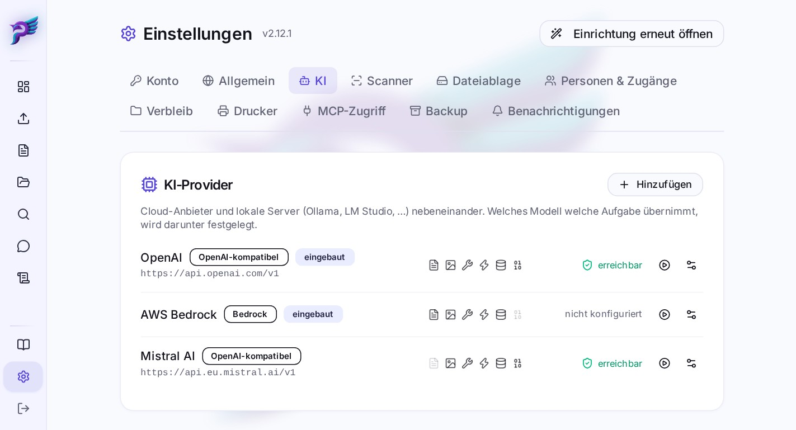

# KI-Anbieter

postbuch.net bringt kein eigenes Sprachmodell mit. Es ruft Modelle auf, die du
selbst bereitstellst – als Cloud-Dienst mit API-Schlüssel oder als lokalen
Server auf deiner eigenen Hardware. Für Embeddings gibt es dagegen einen
[eingebauten Dienst](#der-eingebaute-embedding-dienst) im eigenen Stack. Alles dazu steht unter
 **Einstellungen → KI** (nur für
Administratoren sichtbar).

Ein erreichbares Sprachmodell ist Voraussetzung für die Dokumentverarbeitung. Es
übernimmt die automatische Klassifikation und ermöglicht den Büroassistenten;
Embeddings ergänzen die Suche nach dem Inhalt und die Duplikatprüfung.

Für einen schnellen Einstieg genügt ein Entwicklerkonto mit kleinem Guthaben bei
einem Anbieter von Sprachmodellen, etwa Anthropic oder OpenAI. Beide arbeiten mit
vorab aufgeladenem Guthaben, das du in kleinen Beträgen aufladen kannst. Das ist
keine Preisgarantie. Cloudfrei geht es mit einem lokalen
OpenAI-kompatiblen Chatmodell; die Embeddings liefert ohnehin der eingebaute
Dienst.



---

## Provider

Ein **Provider** ist eine API-Adresse plus ein Schlüssel plus eine Liste von
Fähigkeiten. Drei Einträge sind eingebaut und lassen sich bearbeiten, aber nicht
löschen: `anthropic`, `openai` und `bedrock`. Ein vierter, der **Eingebaute
Embedding-Dienst**, hat nichts Einstellbares: Er lässt sich nur testen und
steht auf „nicht gewählt“, solange er nicht das Embedding-Modell ist. Ebenso
fest ist die [**Lokale KI**](#eingebaute-lokale-ki); sie steht auf
„ausgeschaltet“, bis der Dienst läuft. Alles Weitere legst du selbst an –
beliebig viele.

Beim Anlegen hilft eine Vorlage:

| Vorlage           | Typ               | Adresse                                |
| ----------------- | ----------------- | -------------------------------------- |
| Anthropic         | Anthropic         | `https://api.anthropic.com`            |
| AWS Bedrock       | Bedrock           | – (Region statt URL)                   |
| Ollama            | OpenAI-kompatibel | `http://host.docker.internal:11434/v1` |
| LM Studio         | OpenAI-kompatibel | `http://host.docker.internal:1234/v1`  |
| Mistral AI        | OpenAI-kompatibel | `https://api.eu.mistral.ai/v1`         |
| OpenRouter        | OpenAI-kompatibel | `https://openrouter.ai/api/v1`         |
| Benutzerdefiniert | OpenAI-kompatibel | frei                                   |

Für OpenAI gibt es keine Vorlage: Der eingebaute Provider `openai` deckt diesen
Zugang bereits vollständig ab.

Die Adresse ist die **Basis-URL**, bei OpenAI-kompatiblen Diensten in der
Regel bis einschließlich `/v1`. Die Endpunkte wie `/embeddings` oder
`/chat/completions` hängt postbuch.net selbst an. Eine Adresse, die auf einen
solchen Endpunkt endet, nimmt der Dialog nicht an und sagt, wie sie richtig
lautet. Ist sie schon so gespeichert, weist die Karte des Providers darauf hin.

`host.docker.internal` ist dabei aus Sicht des Containers das der Weg zu einem
Dienst, der auf demselben Rechner läuft. Läuft der Provider auf einem anderen
Rechner innerhalb oder außerhalb deines LANs, muss die Adresse entsprechend
angepasst werden.

### Fähigkeiten

Jeder Provider trägt sechs Schalter:

| Fähigkeit                            | Bedeutung                                                                                      |
| ------------------------------------ | ---------------------------------------------------------------------------------------------- |
| **PDF-Dokumente direkt verarbeiten** | Das Modell nimmt ein PDF als solches entgegen                                                  |
| **Bilder verstehen**                 | PDF wird für dieses Modell in Seitenbilder umgewandelt                                         |
| **Werkzeuge/Tool-Calling**           | Voraussetzung für den Büroassistenten                                                          |
| **Antworten streamen**               | Antwort erscheint fortlaufend statt am Stück                                                   |
| **Prompt-Caching**                   | Wiederholte Prompt-Anteile werden günstiger abgerechnet                                        |
| **Embeddings erzeugen**              | Voraussetzung für die Suche nach dem Inhalt, Duplikatprüfung und die semantische Hilfe des Assistenten |

> [!CAUTION]
>
> postbuch.net probiert diese Fähigkeiten **nicht** aus, sondern glaubt der
> Angabe. Ein Modell, das einen PDF-Block entgegennimmt und ihn still ignoriert,
> antwortet trotzdem – und halluziniert dann eine Klassifikation, statt zu
> scheitern. Ein falsch gesetzter Schalter ist deshalb schlimmer als ein zu
> vorsichtig gesetzter.

Für lokale Server (Ollama, LM Studio, vLLM …) sind PDF und Bild deshalb zunächst
**aus**. Schalte sie erst frei, wenn du geprüft hast, dass dein Modell das
wirklich kann.

Kann ein Modell weder PDF noch Bilder, bekommt es statt des PDFs den lokal
extrahierten Text. In diesem Fall wird die OCR-Textebene nie entfernt – sie ist
dann die einzige Informationsquelle. Solche Modelle werden nicht empfohlen, weil
sie die Klassifikation stark verschlechtern.

### Kontextfenster

Im Feld **Kontextfenster (Tokens)** steht, wie viel Eingabe und Antwort
zusammen höchstens fassen dürfen. Leer gelassen gelten 200.000 Tokens; mehr
nutzt postbuch.net bei keinem Anbieter, auch wenn das Modell ein größeres
Fenster hat. Bei einem lokalen Server trägst du den Wert ein, mit dem er
gestartet wurde.

Von diesem Fenster gehen die Antwort und eine kleine Reserve ab. Was übrig
bleibt, teilen sich Anweisung und Dokument:

- **Text:** Ein zu langer Dokumenttext wird gekürzt. Anfang und Ende bleiben
  erhalten, die Lücke in der Mitte ist für das Modell markiert; im Protokoll
  steht eine Warnung.
- **Gerasterte Seiten:** Es werden nur so viele Seiten gerastert, wie ins
  Fenster passen, höchstens aber das eingestellte **Seitenlimit beim Rastern**.
  Ein längeres Dokument wird nicht abgelehnt: Das Modell bekommt die ersten
  Seiten als Bild und den erkannten Text der übrigen Seiten dazu, soweit das
  PDF eine Textebene hat.
- **Assistent:** Wird der Verlauf einer Recherche zu lang, kürzt postbuch.net
  ältere Werkzeugergebnisse. Im Fortschritt erscheint dann kurz „Ältere
  Rechercheergebnisse verdichtet“; eine Rückfrage gibt es nicht.

Lehnt ein Anbieter die Eingabe trotzdem als zu lang ab, wird der Aufruf nicht
wiederholt: Die Kette geht gleich zum nächsten Modell weiter.

### Mistral AI

Die Vorlage **Mistral AI** trägt den EU-Endpunkt von Mistral ein. Dort laufen die
Modelle nur in Rechenzentren in der EU und im EFTA-Raum; Mistral berechnet dafür
einen Aufpreis von 10 %. Wer darauf verzichten will, trägt stattdessen
`https://api.mistral.ai/v1` ein. Nicht jedes Modell ist auf dem EU-Endpunkt
verfügbar – **Testen** zeigt, welche es dort gibt.

Ein PDF nimmt Mistral nicht direkt entgegen. Die Vorlage schaltet deshalb
**Bilder verstehen** ein: postbuch.net wandelt jedes Dokument in Seitenbilder
um, und die Bildmodelle von Mistral (Mistral Small, Medium und Large sowie
Ministral) sehen das Dokument so, wie es aussieht. Prompt-Caching und
Embeddings (`mistral-embed`) sind ebenfalls eingeschaltet.

Die Fähigkeiten gelten für den ganzen Provider, nicht pro Modell. Reine
Textmodelle wie Codestral oder die GLM-Modelle von Z.ai können keine Bilder
lesen. Wer sie nutzen will, legt dafür einen zweiten Mistral-Provider ohne
**Bilder verstehen** an.

### Lokales Modell

Als Startpunkt für ein lokales Modell hat sich in Tests **Gemma 4 12B** als
bestes Modell erwiesen, das auf hochwertigen Privatrechnern läuft. Getestet ist
der Server von [llama.cpp](https://github.com/ggml-org/llama.cpp) mit diesen
Dateien aus [unsloth/gemma-4-12b-it-GGUF](https://huggingface.co/unsloth/gemma-4-12b-it-GGUF):

- `gemma-4-12b-it-Q5_K_M.gguf` (Modell)
- `mmproj-F16.gguf` (Bildverarbeitung)
- `mtp-gemma-4-12b-it.gguf` (Entwurfsmodell, erst ab 12 GB VRAM)

Aufruf mit einer Grafikkarte ab 12 GB VRAM:

```bash
llama-server -m gemma-4-12b-it-Q5_K_M.gguf --mmproj mmproj-F16.gguf \
  --model-draft mtp-gemma-4-12b-it.gguf --spec-type draft-mtp -ngld 99 \
  -ngl 99 -c 65536 -ctk q8_0 -ctv q8_0 -fa on --jinja --reasoning off \
  --host 0.0.0.0 --port 8080
```

Unter 12 GB VRAM entfallen `--model-draft`, `--spec-type` und `-ngld`.

In postbuch.net legst du dafür einen Provider mit der Vorlage
**Benutzerdefiniert** und der Adresse `http://<rechner>:8080/v1` an. Schalte
**Bilder verstehen** ein; **PDF-Dokumente direkt verarbeiten** bleibt aus.

### Eingebaute lokale KI

postbuch.net kann dieses Modell auch selbst betreiben, als Docker-Dienst `llm`
im eigenen Stack. Eingeschaltet wird er unter
[Einstellungen → Stack](betrieb-troubleshooting.md#der-stack) mit **Einrichten
und einschalten**. Der Update-Agent lädt dann die drei Dateien (zusammen rund
9 GB) in den Modellordner, prüft ihre Prüfsummen und startet den Dienst. Je
nach Leitung dauert das über eine Stunde; ein abgebrochener Download wird beim
nächsten Einschalten fortgesetzt.

Wie das Modell läuft, wählt der Agent selbst anhand der erkannten
NVIDIA-Grafikkarte:

| Grafikkarte                   | Betrieb                               | Kontext       |
| ----------------------------- | ------------------------------------- | ------------- |
| ab 12 GB                      | vollständig auf der Grafikkarte, mit Entwurfsmodell | 65.536 Tokens |
| 10 GB                         | vollständig auf der Grafikkarte       | 32.768 Tokens |
| 6–8 GB                        | teils auf der Grafikkarte, teils im Arbeitsspeicher | 32.768 Tokens |
| keine NVIDIA-Grafikkarte      | nur Prozessor                         | 32.768 Tokens |

Voraussetzungen, die der Reiter **Stack**, der Update-Agent und der Installer
gleichermaßen prüfen:

- **Genug Arbeitsspeicher für die jeweilige Stufe:** ohne NVIDIA-Grafikkarte
  mindestens 15 GB, mit einer Karte mit 6–8 GB mindestens 12 GB, mit einer
  Karte ab 10 GB mindestens 8 GB. Ein PC mit 16 GB reicht also auch ohne
  Grafikkarte. Darunter ist **Einrichten und einschalten** ausgegraut, mit Begründung. Unter
  Windows zählt der Arbeitsspeicher, den WSL bekommt (standardmäßig die Hälfte,
  siehe [unten](#lokale-ki-unter-windows)).
- **Nach dem Laden des Modells noch mindestens 5 GB frei.** Sonst ist der
  Knopf ebenfalls gesperrt.

Unter 8 GB nutzbarem Grafikspeicher läuft das Modell zwar, aber extrem langsam:
Ein Dokument kann dann viele Minuten dauern. Der Reiter **Stack** zeigt dafür
einen roten Warnhinweis. Die Grafikkarte muss für Docker
freigegeben sein (NVIDIA Container Toolkit und einmalige Zustimmung zu den
NVIDIA-Bedingungen). Beides richtet der [Installer](installation.md#komplett-lokal)
ein. Bis dahin verwendet der Dienst den Prozessor.

Sobald das Modell geladen ist und der Dienst läuft, wird der eingebaute
Provider **Lokale KI** aktiv; sein [Kontextfenster](#kontextfenster) übernimmt
er aus der Tabelle oben. Einstellen musst du an ihm nichts, nur die Modellklassen
auf ihn umstellen. In der Modellauswahl und am Dokument steht dabei der Name des
gerade geladenen Modells, etwa „Gemma 4 12B“. Bringt ein Update ein neues Modell mit, stellt der
Update-Agent selbst darauf um: Das neue Modell wird geladen, das alte bleibt
aktiv, bis das neue bereit ist, und wird danach gelöscht. Ist ein Download nur
nicht rechtzeitig fertig geworden, setzt der Agent ihn fort; scheitert die
Umstellung aus einem anderen Grund, versucht er es nach sechs Stunden erneut.
Sofort neu anstoßen lässt sie sich im Reiter **Stack** mit **Modell
aktualisieren**.

Ausschalten oder entfernen lässt sich der Dienst jederzeit. Sind ihm noch
Modellklassen zugeordnet, fragt postbuch.net vorher nach; diese Aufgaben
schlagen danach fehl, bis ein anderer Provider gewählt ist.

#### Wie viel Arbeitsspeicher die lokale KI belegt

Das Modell wird erst bei der ersten Anfrage geladen und nach **5 Minuten ohne
Anfrage** wieder entladen. Arbeitsspeicher belegt es also nur, solange
Dokumente verarbeitet werden oder der Chat läuft:

| Grafikkarte              | Arbeitsspeicher während der Arbeit | im Leerlauf |
| ------------------------ | ---------------------------------- | ----------- |
| ab 10 GB                 | rund 4 GB                          | unter 1 GB  |
| 6–8 GB                   | rund 12 GB                         | unter 1 GB  |
| keine NVIDIA-Grafikkarte | rund 12 GB                         | unter 1 GB  |

Im Leerlauf belegt der Dienst nur noch rund 0,5 bis 0,7 GB. Zusammen mit dem
übrigen Stack (Datenbank, App, Oberfläche, Embedding-Dienst), der immer läuft,
sind es im Leerlauf knapp 2 GB. Beim Laden liest
das System außerdem die rund 9 GB große Modelldatei; sie liegt danach
vorübergehend im Datei-Cache und wird wieder freigegeben, wenn Speicher
anderweitig gebraucht wird oder das Modell entladen ist.

#### Lokale KI unter Windows

Unter Windows läuft postbuch.net in WSL 2, einer kleinen virtuellen Maschine.
Sie darf standardmäßig höchstens die Hälfte des Arbeitsspeichers nutzen; nur
diesen Anteil kann auch das Modell verwenden, und nur er zählt für die
Speicherprüfung. Bei einem PC mit 32 GB sind das 16 GB.

- **Belegt wird nur, was gerade gebraucht wird.** Die Hälfte ist eine
  Obergrenze, keine feste Reservierung. Im Leerlauf zeigt der Task-Manager für
  den Prozess **VmmemWSL** etwa 1 bis 2,5 GB. Während der Verarbeitung steigt
  der Wert (mit Modelldatei im Cache auf rund 10 GB) und fällt nach dem
  Entladen des Modells von selbst wieder; Windows bekommt den Speicher zurück.
- **Mehr Speicher für WSL bietet der Installer selbst an**, bei der
  Betriebsart „Komplett lokal“ und nur, wenn erst dadurch der nötige
  Arbeitsspeicher erreicht wird und Windows danach noch mindestens 8 GB behält.
  Er gibt WSL dann nur so viel, wie die Stufe braucht (ohne Grafikkarte
  15 GB). Reicht der Speicher auch so, fragt er nicht. Die Einstellung
  gilt für **alle** WSL-Umgebungen auf dem PC (etwa Ubuntu oder Docker
  Desktop), die dann ebenfalls bis zu dieser Grenze Speicher belegen können;
  darauf weist er vor der Frage ausdrücklich hin. Die Deinstallation entfernt
  den Eintrag wieder. Siehe
  [Speicher für die lokale KI unter Windows](installation.md#speicher-für-die-lokale-ki-unter-windows).
- **Von Hand** lässt sich die Grenze in der Datei `.wslconfig` im eigenen
  Benutzerordner festlegen. Das ist der Weg, wenn du die lokale KI erst nach
  der Installation unter Einstellungen → Stack einschaltest, etwa für 15 GB:

  ```ini
  [wsl2]
  memory=15GB
  ```

  Wirksam wird das nach `wsl --shutdown` in einer PowerShell. Steht dort schon
  ein `memory`-Wert, ändert der Installer ihn nicht. Lass Windows selbst genug
  übrig, mindestens etwa 8 GB.

### Schlüssel

Der Schlüssel eines Providers wird gespeichert, aber **nie wieder ausgeliefert**
– auch nicht an Administratoren. Im Dialog gibt es nur ein Schreibfeld. Wer den
Schlüssel vergessen hat, trägt einen neuen ein.

Adressen im privaten Netz (`192.168.…`, `localhost`, `host.docker.internal`)
erfordern eine ausdrückliche Freigabe pro Provider. Die Checkbox erscheint nur,
wenn die eingetragene Adresse tatsächlich privat aussieht – sonst würde sie
vorsorglich angehakt und der Schutz wäre wertlos. Hintergrund unter
[Sicherheit](sicherheit.md).

### Testen und Löschen

 **Testen** ruft die Modell-Liste des
Providers ab und zeigt, wie viele Modelle er anbietet. Das ist zugleich die
Quelle für die Auswahllisten weiter unten.

 **Löschen** ist zweistufig: Der erste
Versuch scheitert, wenn der Provider noch in Gebrauch ist, und nennt die
betroffenen Stellen. Erst danach lässt sich das Löschen erzwingen.

---

## Modellwahl

Oben in der **Modell-Konfiguration** steht, wie fein du die Modelle wählst. Die
Wahl gilt sofort; die Modelle der jeweils anderen Wahl bleiben gespeichert und
gelten beim Zurückschalten wieder.

| Modellwahl               | Ablauf                                                                                                                                                                  |
| ------------------------ | ----------------------------------------------------------------------------------------------------------------------------------------------------------------------- |
| **Zwei Aufgabentypen**   | Du wählst nur zwei Modelle: eines für **Einfach & Routine**, eines für **Anspruchsvoll & Komplex**. Sie decken alle KI-Aufgaben ab.                                     |
| **Jede Aufgabe einzeln** | Eine Voranalyse schätzt jedes Dokument ein und wählt danach eine der [Modellstufen](#modellstufen); Fallback, Nachlese, Büroassistent und Akten haben eigene Modelle. |

Neue Instanzen starten mit **Zwei Aufgabentypen**. Eine Instanz, die schon vor
dieser Wahl eingerichtet war, behält die Einzelwahl, bis jemand umschaltet.

### Zwei Aufgabentypen

Die beiden Aufgabentypen teilen sich alle Aufgaben so auf:

| Aufgabentyp                 | Aufgaben                                                                                                                                                        | Empfehlung                     |
| --------------------------- | --------------------------------------------------------------------------------------------------------------------------------------------------------------- | ------------------------------ |
| **Einfach & Routine**       | Prüfung der gelesenen Angaben, Ersatz bei einer gescheiterten Analyse, Recherche und Gesprächstitel im Büroassistenten, Metadaten-Vorschlag für Akten, [KI-Duplikatprüfung](#duplikat-erkennung) | schnelles, günstiges Modell    |
| **Anspruchsvoll & Komplex** | Analyse jedes Dokuments, Arztrechnungs-Positionen und [Nachlese](#arztrechnungen-und-nachlese), Erstattungsbescheide, Kostenträger-Profile, Antworten des Büroassistenten | starkes Modell                 |

Jedes Dokument analysiert das Modell für **Anspruchsvoll & Komplex**. Scheitert
es, springt das Modell für **Einfach & Routine** ein. Eine Voranalyse gibt es
nicht, das spart einen Aufruf je Dokument. Weil das Modell fest ist, nutzt
postbuch.net dabei immer Prompt-Caching, sofern der Provider es kann (siehe
[Cache-Mode](#cache-mode)). Der Büroassistent braucht für beide Aufgabentypen
ein Modell, das Tool-Calling beherrscht.

**Nach einem Update:** Früher verlangte auch die einfache Modellwahl ein Modell
je Aufgabe. Beim ersten Start nach dem Update übernimmt postbuch.net für jeden
Aufgabentyp das Modell, das du für die darin aufgegangenen Aufgaben am
häufigsten gewählt hattest. Gibt es keinen eindeutigen Spitzenreiter, gilt
vorläufig die erste verfügbare Empfehlung für **Einfach & Routine**. Bis du die
Auswahl in der Modell-Konfiguration bestätigst oder änderst, weist das
Dashboard Admins darauf hin und nennt die vorläufigen Modelle samt Herkunft.
Bestätigen heißt: **Auswahl bestätigen** bzw. **Modelle speichern** klicken
oder eine Empfehlung für einen Aufgabentyp übernehmen.

### Arztrechnungen und Nachlese

Die Einzelpositionen einer Arztrechnung liest postbuch.net in einem eigenen
Aufruf nach der Erkennung, immer mit dem Modell der Stufe **Schwierig** (bei
zwei Aufgabentypen mit **Anspruchsvoll & Komplex**). Ebenso zerlegt dieses Modell die
Kürzungen eines Erstattungsbescheids auf die betroffenen Positionen.

Beide Ergebnisse prüft postbuch.net nach, zum Beispiel ob die Positionen den
Rechnungsbetrag ergeben, ob die Zeilen eines beigefügten Belegs den Betrag
ihrer Position ergeben, ob Begründungen im Volltext statt als bloßer Verweis
vorliegen und ob die Anteile einer Kürzung genau ihren Betrag ergeben und jeden
Satz der Begründung abdecken. Scheitert
eine Prüfung, liest das Modell der Klasse **Nachlese** das Dokument mit den
Befunden erneut. Bei zwei Aufgabentypen ist das ebenfalls **Anspruchsvoll &
Komplex**. In der Einzelwahl übernimmt die Nachlese, solange sie nicht eigens
eingerichtet ist, das Modell der Stufe Schwierig. Für die Nachlese lohnt sich das stärkste verfügbare Modell, denn
sie läuft nur in den Fällen, an denen das erste Modell gescheitert ist.

### Modellstufen

Bei der Einzelwahl benutzt postbuch.net nicht ein Modell, sondern
mehrere – nach Schwierigkeit gestaffelt. So bekommt einfache Post ein
günstiges Modell und nur schwierige Post ein teures.

| Stufe                | Wofür                                                                                                                         |
| -------------------- | ----------------------------------------------------------------------------------------------------------------------------- |
| **Voranalyse**       | Schätzt die Schwierigkeit eines Dokuments auf einer Skala von 0 (sehr leicht) bis 1 (sehr schwierig) ein (sehr kurzer Aufruf) |
| **Langes Dokument**  | Alles mit mehr als 10 Seiten                                                                                                  |
| **Leicht**           | Schwierigkeit ≤ 0,25                                                                                                          |
| **Mittel**           | Schwierigkeit > 0,25 und < 0,5                                                                                                |
| **Schwierig**        | Schwierigkeit ≥ 0,5                                                                                                           |
| **Letzter Fallback** | Notfallmodell am Ende jeder Kette                                                                                             |
| **Nachlese**         | Liest nach, wenn eine Plausibilitätsprüfung scheitert (siehe [Arztrechnungen und Nachlese](#arztrechnungen-und-nachlese)) |

Die Voranalyse läuft zuerst und entscheidet, welche Kette greift:

| Fall               | Kette                                       |
| ------------------ | ------------------------------------------- |
| mehr als 10 Seiten | Langes Dokument → Leicht → Letzter Fallback |
| einfach            | Leicht → Letzter Fallback                   |
| mittel             | Mittel → Leicht → Letzter Fallback          |
| schwierig          | Schwierig → Mittel → Letzter Fallback       |

Scheitert ein Modell – Netzwerkfehler, Überlastung, unbrauchbare Antwort –,
rückt automatisch das nächste Glied nach. Ein Konfigurationsfehler (falscher
Schlüssel, unbekanntes Modell) wird dabei als dauerhaft erkannt und nicht
sinnlos wiederholt.

Darunter, in einem eigenen Block, stehen in der Einzelwahl vier Modelle, die
**nicht** an der Dokumentanalyse hängen:

| Klasse                    | Wofür                                                         |
| ------------------------- | ------------------------------------------------------------- |
| Assistent: Recherche      | Der Such-Agent des Büroassistenten – **braucht Tool-Calling** |
| Assistent: Antwort        | Formuliert die endgültige Antwort, gestreamt                  |
| Assistent: Titel          | Erzeugt den Gesprächstitel (sehr kurzer Aufruf)               |
| Akte: Metadaten-Vorschlag | Schlägt Betreff, Beschreibung und Schlagwörter einer Akte vor |

Jede Zeile wird als **Provider + Modell** gespeichert, nie nur als Modellname.
Zwei lokale Server mit demselben `llama3.3` wären sonst nicht unterscheidbar.

Im Einrichtungsassistenten müssen **alle Klassen der gewählten Modellwahl** auf
einen erreichbaren Provider zeigen: bei zwei Aufgabentypen beide, in der
Einzelwahl die sechs Stufen, die Nachlese und die vier für Büroassistent und
Akten-Vorschlag. Zusätzlich ist ein nutzbares Embedding-Modell Pflicht;
Sprachmodell und Embedding werden getrennt geprüft.

### Empfehlungen

Über der Modell-Konfiguration steht eine kuratierte Empfehlungsliste. Sie wird
**mit dem Release ausgeliefert** und nur mit neuen Releases aktualisiert. Die
Informationen können veraltet sein und erfolgen ohne Gewähr. Die Übernahme ist
ein bewusster Klick, keine Automatik. Die Liste zeigt nur die Klassen der
gewählten Modellwahl; „Alle übernehmen" stellt die ausgeblendeten Stufen nicht
um. Kandidaten, die auf deiner Instanz nicht
verwendbar sind, erscheinen mit Grund (z. B. „Provider nicht konfiguriert") –
eine stumm gekürzte Liste sähe aus wie ein Defekt.

Die Liste enthält auch eine Empfehlung für das **Embedding-Modell**. Diese Zeile
ist bewusst ein Sonderfall: „Alle übernehmen" fasst sie **nicht** an, und beim
einzelnen Übernehmen fragt postbuch.net ausdrücklich nach – denn nach einem
Wechsel werden alle vorhandenen Embeddings automatisch neu berechnet (siehe
Abschnitt _Embeddings_). Die Dimension wird auch hier nicht aus der Empfehlung
übernommen, sondern mit einem Testaufruf an deinem Provider ermittelt.

Zu jedem empfohlenen Embedding-Modell gehören eigene Schwellen: ab wann eine
Ähnlichkeit als sinnlos gilt, welcher Wert in der Suche 100 % entspricht und
ab welcher Ähnlichkeit zwei Dokumente als mögliches Duplikat gelten. Bei jedem
Wechsel auf ein empfohlenes Modell übernimmt postbuch.net diese Werte, auch
bei einem Wechsel von Hand; für andere Modelle setzt es Startwerte (siehe
[Suchschwellen](#suchschwellen)). Voyage 4 Nano und EmbeddingGemma 2 erscheinen auf
Geräten mit weniger als 2 GB Arbeitsspeicher als nicht verfügbar. Muss der
eingebaute Dienst das empfohlene Modell erst herunterladen, startet
**Übernehmen** den Download; danach noch einmal übernehmen.

Modellwahl und Nutzung erfolgen auf eigenes Risiko; maßgeblich für Preise und
Verfügbarkeit sind immer die Angaben des jeweiligen KI-Anbieters.

### Kosten und kostenpflichtige Aufrufe

postbuch.net selbst berechnet keine Nutzungsgebühr. Ein externer
Cloud-KI-Anbieter rechnet jedoch jeden LLM- und Embedding-Aufruf nach seinem
eigenen Tarif ab. Bei einem selbst betriebenen Provider wie Ollama oder LM
Studio gibt es keine Rechnung pro Aufruf; Strom und Hardware bleiben natürlich
eigene Betriebskosten.

#### Dokumente verarbeiten

Die folgenden Beträge sind bewusst grobe **Richtwerte in Eurocent, Stand August
2026**. Sie beruhen auf den mitgelieferten Modellpreisen und einem
anonymisierten Plausibilitätsabgleich mit echten Aufrufen. Anbieter rechnen
meist in US-Dollar und können Preise, Wechselkurs, Steuern und Zuschläge ändern.
Maßgeblich ist deshalb immer die Abrechnung des Providers.

| Vorgang                                | Welche externen KI-Aufrufe entstehen?                                                                                                                                 | Grober Richtwert                                                                                                                                           |
| -------------------------------------- | --------------------------------------------------------------------------------------------------------------------------------------------------------------------- | ---------------------------------------------------------------------------------------------------------------------------------------------------------- |
| Dokument importieren                   | Eigentliche PDF-/Textanalyse und ein Embedding, bei der Einzelwahl vorher eine kurze Voranalyse; bei ungültiger Antwort zusätzlich ein Reparatur- oder Fallback-Aufruf | meist **1–20 ct je Dokument**; mit sehr günstigen Modellen auch darunter, bei langen oder schwierigen Dokumenten, Retries und teuren Modellen auch darüber |
| Dokument erneut verarbeiten            | Erneute Analyse und neues Embedding; bei einer fest gewählten Modellstufe entfällt die Voranalyse                                                                    | ungefähr wie ein neuer Import                                                                                                                              |
| KI-Duplikatprüfung (wenn eingeschaltet) | In Zweifelsfällen ein Aufruf mit den ersten Seiten des neuen Dokuments und von bis zu drei Kandidaten | meist **1–3 ct je Prüfung**, je nach Modell |
| Arztrechnung                           | Zusätzlich zum Import ein Aufruf, der alle Einzelpositionen liest; bei einer gescheiterten Prüfung ein weiterer Aufruf der Nachlese                                   | je nach Länge und Modell oft zusätzlich **2–30 ct**, bei sehr langen Rechnungen auch darüber                                                               |
| Erstattungsbescheid                    | Zusätzlich zum Import eine eigene Detailauswertung und, falls Kürzungen vorliegen, je Rechnung ein Zerlegungsaufruf mit hohem Denkaufwand, bei einer gescheiterten Prüfung zusätzlich die Nachlese | oft zusätzlich **1–15 ct**, bei langen Sammelkürzungen auch deutlich darüber                                                                               |

Ein normaler Import besteht also nicht aus „einem KI-Aufruf". Fällt ein Modell
aus oder liefert unbrauchbare Daten, kann die Fallback-Kette mehrere Versuche
abrechnen. Auch ein fehlgeschlagener Provider-Aufruf kann Kosten verursachen.
Umgekehrt sind lokale Schritte wie Scanner-OCR, PDF-Rotation, die Suche nach dem Wortlaut,
Datenbankabfragen und das reine Ersetzen einer PDF **keine** externen
KI-Aufrufe.

#### Assistent, Suche und Embeddings

| Vorgang                                | Welche externen KI-Aufrufe entstehen?                                                                                                                                 | Grober Richtwert                                                                                                                                           |
| -------------------------------------- | --------------------------------------------------------------------------------------------------------------------------------------------------------------------- | ---------------------------------------------------------------------------------------------------------------------------------------------------------- |
| Eine Antwort des Assistenten           | Mehrere Recherche-Runden, Embedding-Suchen, gegebenenfalls PDF-Vision, Schlussantwort und beim ersten Beitrag ein kurzer Titel-Aufruf                                 | häufig **1–15 ct**, bei breiten Fragen oder PDF-Vision auch **25 ct und mehr**                                                                             |
| Suchen                                 | Die Anfrage wird für Dokumente und Akten je einmal eingebettet; eine Nummerneingabe braucht keinen Aufruf                                                            | normalerweise zusammen **unter 0,01 ct je Suche**                                                                                                          |
| Dokument- oder Aktenmetadaten ändern   | Relevante Dokumentfelder werden neu eingebettet. Auch Aktenanlage, Betreff/Beschreibung sowie Hinzufügen oder Entfernen eines Dokuments erneuern das Akten-Embedding. | normalerweise **unter 0,01 ct je Objekt**                                                                                                                  |
| KI-Metadaten für eine Akte vorschlagen | Ein kurzer LLM-Aufruf mit den Akten- und Dokumentmetadaten                                                                                                            | gewöhnlich **unter 1 ct**                                                                                                                                  |
| Embedding-Modell speichern             | Ein winziger Test-Embedding-Aufruf ermittelt die Vektor-Dimension                                                                                                     | deutlich **unter 0,01 ct**                                                                                                                                 |
| Embedding-Modell wechseln              | Nach dem Bestätigen startet automatisch je ein Aufruf pro Dokument und Akte; Hilfeabschnitte nur, wenn sie nicht mitgeliefert oder wiederverwendbar sind              | Beispiel: **500 Dokumente, 20 Akten und 250 Hilfeabschnitte etwa 2–10 ct**, je nach Embedding-Modell und Textlänge                                         |

#### Preise und Token-Kosten

Zu jedem Sprachmodell lassen sich Preise je eine Million Token hinterlegen:
**In** (Eingabe), **Out** (Ausgabe), **Cache-Write** (Schreiben in den
Prompt-Cache) und **Cache-Read** (Lesen aus dem Prompt-Cache). Die beiden
Cache-Preise unterscheiden sich je Anbieter und Modell und stehen in dessen
Preisliste. Bleibt ein Cache-Feld leer, zählen diese Token zum normalen
Eingabepreis. Daraus berechnet postbuch.net die Kosten je Dokument und
unter  **Logs → Token-Kosten**. Dort ist
jeder erfasste Aufruf mit Kategorie, Provider, Modell und Tokenmenge
nachvollziehbar. Dabei gelten vier wichtige Einschränkungen:

- Der Preis hängt am **Modellnamen**, nicht am Provider. Nutzt du dasselbe
  Modell bei zwei Providern zu unterschiedlichen Preisen, teilen sich beide
  einen Wert – die Oberfläche weist darauf hin.
- Von Hand eingetragene Preise werden als _manuell_ markiert und von der
  Empfehlungs-Übernahme nicht überschrieben.
- Embedding-Aufrufe werden im Token-Log erfasst, erscheinen dort aber ohne
  Geldbetrag, wenn für das Embedding-Modell kein Preis hinterlegt ist. Auch
  Aufrufe ohne vom Provider gemeldete Token oder ohne gepflegten Modellpreis
  fehlen in der Kostensumme. Die Summe ist dann **unvollständig**, nicht null;
  die Providerrechnung bleibt die verlässliche Gesamtsicht.
- Möglicherweise umfasst das Token-Log nicht alle angefallenen Kosten.

---

## Embeddings

Embeddings sind Zahlenvektoren, die Inhalte beschreiben. Sie tragen die
**Suche nach dem Inhalt**, die **Duplikatprüfung** und die **Hilfesuche
des Assistenten** – ohne sie findet die Suche nur über den Wortlaut.

Eine neue Installation verwendet den eingebauten Embedding-Dienst. Ein
anderer Dienst lässt sich nur bewusst unter
 `Einstellungen → KI → Embeddings`
wählen; der Einrichtungsassistent bietet keinen an.

### Der eingebaute Embedding-Dienst

postbuch.net bringt einen eigenen Embedding-Dienst mit, den Docker-Dienst
`embedding`. Er rechnet auf dem Prozessor des Servers. Dokumentinhalte
verlassen dafür den Rechner nicht, und es fallen keine Kosten je Aufruf an.

- Der Dienst ist von außen nicht erreichbar; nur die App spricht ihn im
  Docker-Netz an.
- Ein Modell lädt erst bei der ersten Anfrage und wird nach zehn Minuten ohne
  Anfrage wieder entladen. Das erste Einbetten nach einer Pause dauert deshalb
  einige Sekunden länger.
- Der Container ist auf 1200 MB Arbeitsspeicher begrenzt.

#### Modelle des eingebauten Dienstes

Der Dienst bietet drei mehrsprachige offene Modelle an (alle Lizenz Apache
2.0). Gewählt wird das Modell in der Embedding-Karte im Abschnitt
**Eingebauter Dienst**:

- **Snowflake Arctic Embed M v2.0** – im Dienst enthalten, läuft schon mit
  1 GB Arbeitsspeicher (geladen rund 300 MB). 768 Dimensionen, Texte bis
  512 Token. Für dieses Modell kommen die Vektoren der Anwenderhilfe mit dem
  Release; eine neue Instanz muss die Hilfe nicht selbst einbetten.
- **Voyage 4 Nano** – findet in deutschen Dokumenten am treffsichersten.
  2048 Dimensionen, Download rund 370 MB.
- **EmbeddingGemma 2** – 768 Dimensionen, Download rund 240 MB.

Voyage 4 Nano und EmbeddingGemma 2 stehen nur auf Geräten mit mindestens
2 GB Arbeitsspeicher zur Wahl; darunter sind sie ausgegraut. Geladen belegen
sie bis zu rund 900 MB. Ihre Modelldatei lädt der Dienst beim ersten Wählen
einmalig herunter und prüft sie; die Karte zeigt dabei den Fortschritt und
wählt das Modell, sobald die Datei da ist. Die Dateien bleiben über Updates
hinweg erhalten. Die Vorsilben setzt postbuch.net für alle drei Modelle fest.

Der Dienst ist ein eigenes Compose-Profil `embedding` und läuft nur dort, wo
er gewählt ist. Eine neue Installation schaltet das Profil ein. Eine
bestehende Instanz behält beim Update ihr bisher gewähltes Embedding-Modell;
der Dienst wird dabei weder gebaut noch gestartet.

Oben in der Embedding-Karte zeigt der Abschnitt **Eingebauter Dienst**, wie es
um ihn steht:

- **Einrichten und verwenden** – der Dienst ist auf diesem Gerät noch nicht
  eingerichtet. Der Host-Agent baut ihn im Hintergrund, lädt dabei einmalig
  das Modell (rund 300 MB) und startet ihn. Ist er bereit, wird er gewählt.
  Das dauert je nach Gerät und Leitung einige Minuten.
- **Verwenden** und **Abschalten** – der Dienst läuft, ist aber nicht gewählt.
  Abschalten hält ihn an und gibt den Arbeitsspeicher frei; das Image bleibt,
  ein erneutes Einschalten lädt nichts nach.
- **Dienst einrichten** – der eingebaute Dienst ist gewählt, läuft auf diesem
  Gerät aber nicht, etwa nach dem Wiederherstellen einer Sicherung auf einem
  anderen Server. Bis er läuft, arbeiten Ähnlichkeitssuche, Duplikatprüfung
  und Hilfe ohne Vektoren.

Wer danach einen anderen Dienst wählt, dessen eingebauter Dienst wird
automatisch abgeschaltet. Den gewählten Dienst abzuschalten, lehnt
postbuch.net ab.

Ohne [Update-Agent](betrieb-troubleshooting.md#der-update-agent) wird das
Profil von Hand eingeschaltet: `embedding` in `COMPOSE_PROFILES` der `.env`
ergänzen (kommagetrennt, etwa `COMPOSE_PROFILES=scanner,embedding`) und
`docker compose up -d --build embedding` ausführen. Danach lässt sich der
Dienst in der Karte mit **Verwenden** wählen.

Der Wechsel auf den eingebauten Dienst oder zwischen seinen Modellen ist ein
Modellwechsel: Sind schon Dokumente vorhanden, fragt postbuch.net vorher nach
und berechnet deren Embeddings danach automatisch neu (siehe unten). Mit
Arctic muss die Hilfe dabei nicht berechnet werden, ihre Vektoren kommen
mitgeliefert. Antwortet der Dienst beim
Speichern nicht, bleibt das bisherige Modell aktiv.

### Anderen Dienst wählen

Zur Auswahl stehen nur Provider, die _Embeddings erzeugen_ können. Die
**Vektor-Dimension wird nicht eingegeben**: Der Server ermittelt sie mit einem
einzigen Testaufruf, und dieses Ergebnis ist verbindlich.

Die in der Oberfläche sichtbare Vorgabe ist zunächst nur ein **Vorschlag** und
noch keine gespeicherte Konfiguration.

### Vorsilben

Manche offenen Embedding-Modelle sind darauf trainiert, dass vor einer
Suchanfrage oder vor einem gespeicherten Text eine feste Anweisung steht, etwa
`query: ` vor der Anfrage. Ohne diese **Vorsilben** finden sie spürbar
schlechter. Unter `Vorsilben` in der Embedding-Karte stehen zwei Felder:
**Vor Suchanfragen** gilt für die Suche, die Recherche des
Assistenten und die Hilfesuche; **Vor Dokumenten** gilt für alles, was
gespeichert wird – Dokumente, Akten und Hilfeabschnitte – und für die
Duplikatprüfung, die neue Dokumente mit gespeicherten vergleicht.

Für bekannte Modelle wie Qwen3-Embedding, Snowflake Arctic Embed,
EmbeddingGemma, nomic-embed-text, mxbai-embed-large und die e5-Familie belegt
postbuch.net beide Felder beim Auswählen des Modells vor. OpenAI und Mistral
brauchen keine Vorsilben; dort bleiben die Felder leer. Gespeichert wird
genau das, was in den Feldern steht. Ein späteres Update ändert gespeicherte
Vorsilben nicht.

#### Modellwechsel und Neuberechnung

**Wichtig beim Wechsel des Embedding-Modells:** Jede Zeile trägt eine Signatur
aus Provider, Modell und Dimension, bei gesetzten Vorsilben zusätzlich mit einer
Kennung für diese. Eine Änderung der Vorsilben wirkt deshalb wie ein
Modellwechsel. Suche wie Duplikatprüfung
berücksichtigen **ausschließlich** Zeilen mit der aktuell aktiven Signatur.
Ein Wechsel berechnet deshalb alle vorhandenen Embeddings neu. Sind schon
Dokumente da, nennt ein Dialog vor dem Wechsel ihre Zahl und bei einem
Cloud-Anbieter die anfallenden Kosten; **Wechseln und neu berechnen**
bestätigt beides zusammen. Der Lauf startet danach von selbst im Hintergrund,
die Karte und die Aufgabenanzeige zeigen den Fortschritt. Bis er durch ist,
findet die Suche über den Inhalt weniger. Das ist kein Defekt, sondern die
Alternative zu einem stillen Mischbestand aus unvergleichbaren Vektoren.
Bleiben einzelne Einträge zurück, etwa weil der Anbieter zwischendurch nicht
antwortete, holt **Fehlende Embeddings nachberechnen** sie nach.

#### Suchschwellen

Wie die Suche die Ähnlichkeit in die Prozentwerte **Inhalt** und
**Übereinstimmung** umrechnet, hängt vom Modell ab. Zwei Eckwerte legen das
fest: die **Unsinnsschwelle** (so ähnlich ist für dieses Modell auch eine
sinnlose Anfrage, 0 %) und **100 % ab** (ein sehr gut passender Treffer). Die
Zeile **Suchschwellen** in der Karte **Embeddings** zeigt, welche gelten.

Für die [empfohlenen Modelle](#empfehlungen) sind beide gemessen und werden
nur angezeigt. Für jedes andere Modell setzt postbuch.net beim Wechsel
Startwerte (0,30 und 0,90) und öffnet die Zeile zum Anpassen. Die Startwerte
ordnen die Treffer zuverlässig. Manche Modelle liefern aber auch für
unpassende Dokumente hohe Ähnlichkeiten. Zeigt die Suche dann für fast alles
einen hohen Inhaltswert, hebe die Unsinnsschwelle an. Ein erneuter
Modellwechsel setzt beide Werte wieder neu.

#### Eingebettete Hilfe

Die mit der jeweiligen postbuch.net-Version ausgelieferte Hilfe wird ebenfalls
in kleine Abschnitte zerlegt und im Hintergrund eingebettet. So kann der
Assistent-Chat effizient auf die Hilfe zugreifen. Das geschieht automatisch,
sobald bei einer Neuinstallation ein Embedding-Provider konfiguriert wurde,
zusammen mit einer notwendigen Neuberechnung nach einem Provider- oder
Modellwechsel und nach jedem Anwendungsupdate. Ein Hash sorgt dafür, dass
unveränderte Hilfe nicht noch einmal berechnet wird; unveränderte Abschnitte
können aus dem vorherigen Korpus übernommen werden. Mit dem eingebauten Dienst
stammen die Vektoren der Hilfe aus der mitgelieferten Datei; berechnet werden
nur Abschnitte, die darin fehlen.

> [!IMPORTANT]
>
> Mit einem Cloud-Anbieter für Embeddings kann ein Update deshalb kurz nach
> dem Neustart kostenpflichtige Embedding-Aufrufe auslösen. Bei unverändertem Embedding-Modell werden nur neue
> oder inhaltlich geänderte Hilfeabschnitte berechnet; Dokumente und Akten
> werden durch ein gewöhnliches Update nicht pauschal neu eingebettet. Nach
> einem Provider-, Modell- oder Dimensionswechsel berechnet postbuch.net
> dagegen alle Dokumente und Akten neu; der Bestätigungsdialog nennt vorher
> ihre Zahl.

Ein neuer Hilfekorpus wird erst aktiviert, wenn er vollständig ist. Während des
Aufbaus oder bei einem Providerfehler bleibt deshalb der letzte vollständige
Stand nutzbar. Den Zustand zeigt die Embedding-Karte unter
 `Einstellungen → KI`; der Lauf
selbst erscheint in der Aufgabenanzeige.

Die Hilfekorpus-Daten sind ein regenerierbarer Cache und deshalb nicht Teil der
Datenbanksicherung. Nach dem Einspielen eines Backups baut postbuch.net sie beim
Neustart automatisch vollständig aus der mitgelieferten Dokumentation auf.

---

## Cache-Mode

Beim Verarbeiten mehrerer Dokumente hintereinander lohnt es sich, dasselbe
Modell zu benutzen und den gemeinsamen Prompt-Anteil zwischenspeichern zu
lassen. Genau das macht der **Cache-Mode**: festes Klassifikationsmodell statt
Staffelung, dazu Prompt-Caching, sofern der Provider es kann.

Den Cache-Mode gibt es nur bei der Einzelwahl ([Modellwahl](#modellwahl)). Mit
einem Modell für alles ist das Modell ohnehin fest und das Prompt-Caching immer
an; Karte und Import-Schalter entfallen dann.

Ob der Cache tatsächlich greift, entscheidet der Anbieter. Manche Modelle
cachen Anfragen mit Bild- oder PDF-Anhang gar nicht, auch wenn ihre Preisliste
einen Cache-Preis nennt; bei Scans bleibt dann nur das feste Modell. Ob Token
aus dem Cache kamen, zeigt das Token-Log in der Spalte **Cache↓**.

| Einstellung                   | Wirkung                                                                                                                                                             |
| ----------------------------- | ------------------------------------------------------------------------------------------------------------------------------------------------------------------- |
| Auf der Import-Seite anbieten | Blendet dort einen Start/Stopp-Schalter ein                                                                                                                         |
| Automatisch aktivieren        | Springt an, sobald mehrere Dateien gleichzeitig eingehen oder innerhalb von 5 Minuten ein zweites Dokument eintrifft; Rücksetzung nach 15 Minuten ohne Verarbeitung |
| Modellvorgabe für Auto-Modus  | Auf welche Stufe (Leicht/Mittel/Schwierig) gebündelt wird                                                                                                           |

Beide Schalter sind unabhängig voneinander.

---

## Eigene Klassifikations-Hinweise

Ein Freitextfeld (bis 6000 Zeichen), dessen Inhalt bei **jeder** Analyse in den
Prompt wandert. Gedacht für Wissen, das nur bei dir gilt:

- Kontext: _„Fabi ist unser Pferd."_, _„Rechnungen von Dr. Meier wurden immer
  bereits vor Ort beglichen."_
- Ableitungsregeln: _„Ein PAID-Stempel bedeutet, dass die Rechnung bezahlt
  ist."_
- Abgrenzungen: _"Weiterbildungsunterlagen führst du im Lebensbereich 'Beruf',
  nicht unter 'Bildung'."_

Das ist der schnellste Weg, wiederkehrende Fehlklassifikationen abzustellen –
schneller als jeder Modellwechsel. Darunter zeigt eine weitere Karte die
verwendeten System-Prompts, rein zur Ansicht.

---

## Kostenträger-Profile

Beim Auslesen eines Erstattungsbescheids
([Der Erstattungsbescheid kommt](abrechnung-pkv-beihilfe.md#5-der-erstattungsbescheid-kommt))
arbeitet die KI mit einem generischen Prompt, der ohne Zusatzwissen auskommt.
Kennt postbuch.net das Layout eines bestimmten Kostenträgers – etwa eine
bestimmte Beihilfestelle oder Krankenversicherung – zusätzlich, liest sie
zuverlässiger: Tabellenaufbau, typische Formulierungen, wo Kürzungsbegründungen
stehen. Genau dieses Layoutwissen verwaltet die Karte **Kostenträger-Profile**.

postbuch.net bringt fertige Profile für ausgewählte Kostenträger mit. Solange
du keines davon aktiviert hast, stehen sie nur als Vorlage im Programmcode und
belegen keine eigene Zeile in deiner Datenbank – sie tauchen in einem eigenen
Abschnitt **Mitgelieferte Profile verfügbar** auf. Ein Profil beschreibt das
Layout genau eines Absenders, und für einen Kostenträger mit anderem Aufbau
verschlechtert es die Auswertung, statt sie zu stützen. Sie sind Vorlagen,
keine Voreinstellung – aktiviere nur, wenn dein Kostenträger dabei ist. Erst
die Aktivierung legt die Zeile in deiner Datenbank an; von da an gehört sie dir
und wird durch ein App-Update nicht mehr automatisch verändert.

Ändert eine spätere postbuch.net-Version den Text eines bereits von dir
aktivierten mitgelieferten Profils, wird das nicht heimlich nachgezogen. Die
Karte zeigt dir an dem Profil stattdessen das Badge **Update verfügbar** mit
einer Erklärung. Bevor du die neue Fassung übernimmst, verlangt postbuch.net
eine Sicherung der bisherigen Fassung als `.json`-Datei – erst danach lässt
sich **Update übernehmen** anklicken. So verlierst du nie ungewollt eine
Fassung, mit der deine bisherigen Bescheide ausgewertet wurden.

Ein Profil beschreibt nur, wie ein Kostenträger seine Bescheide aufbaut – es
hebt keine der festen Parsing-Regeln auf und ersetzt sie nicht. Jedes Profil
lässt sich einzeln aktivieren oder deaktivieren; höchstens 5 Profile sind
gleichzeitig aktiv. Bearbeiten geht nicht – ein nicht mehr passendes Profil
löschst du und erzeugst bei Bedarf ein neues. Bereits ausgelesene Bescheide
behalten ihren Text, verlieren beim Löschen nur den Verweis auf das Profil.

**Profil extrahieren** erzeugt ein neues Profil automatisch aus echten
Bescheiden: Dazu eine [Akte](oberflaeche.md#akten) anlegen, die ausschließlich
Erstattungsbescheide desselben Kostenträgers enthält – enthält sie auch andere
Dokumente oder mischt sie Kostenträger, bietet postbuch.net sie hier gar nicht
erst an. Idealerweise etwa fünf Bescheide, darunter möglichst welche mit
Kürzungen, damit die KI auch diesen Teil des Layouts sieht. Das fertige Profil
wird automatisch benannt und aktiviert, sofern ein Slot frei ist.

### Profile weitergeben und übernehmen

**JSON exportieren** an einem Profil zeigt zuerst den kompletten Dateiinhalt zum
Mitlesen und lädt ihn erst nach Bestätigung als `.json`-Datei herunter. Die
Datei enthält nur Name, Kostenträger-Typ und den Profiltext.

Die Vorschau ist kein Beiwerk: Der Profiltext ist von der KI geschrieben. Sie
ist angewiesen, ausschließlich Layout zu beschreiben und keinerlei
personenbezogene Daten aufzunehmen – garantieren lässt sich das nicht. Lies den
Text deshalb durch, bevor du ihn aus dem Haus gibst. Namen, Anschriften,
Versicherten-, Vorgangs- oder Rechnungsnummern, Beträge, Daten und Diagnosen
gehören nicht hinein.

**Profil importieren** liest eine solche `.json`-Datei wieder ein – etwa eine,
die du auf einem anderen Gerät erzeugt hast, oder eine aus fremder Hand. Auch
hier zeigt postbuch.net zuerst den kompletten Dateiinhalt und speichert erst
nach Bestätigung. Das Profil wird als „Importiert" abgelegt und bleibt zunächst
**inaktiv**; scharf wird es erst, wenn du es in der Liste aktivierst.

Diese Trennung ist Absicht. Ein aktives Profil geht wörtlich in den Prompt ein,
mit dem die KI deine eigenen Bescheide liest. Zwischen „Datei geöffnet" und
„fremder Text beeinflusst meine Auswertung" gehört deshalb ein bewusster Blick
in den Text – erst recht bei Dateien, die du nicht selbst erzeugt hast. Was dort
steht, soll das Layout eines Absenders beschreiben und sonst nichts.

Ein Profil, das bei dir gut funktioniert, kannst du der Entwicklung vorschlagen;
gut geprüfte Profile können in einer späteren Version für alle mitgeliefert
werden. Der Weg dafür steht im Projekt-Repository unter „Issues" als Vorlage
_Kostenträger-Profil beisteuern_ bereit.

---

## Duplikat-Erkennung

Die Karte **Duplikat-Erkennung** in den KI-Einstellungen steuert, wann
postbuch.net einen Doppeleingang vermutet:

| Einstellung                              | Standard | Bedeutung                                                                         |
| ---------------------------------------- | -------- | --------------------------------------------------------------------------------- |
| Cosinus-Schwelle                         | 80 %     | Ab welcher Ähnlichkeit zweier Embeddings ein Dokument als Kandidat gilt           |
| KI-Duplikatprüfung in Zweifelsfällen     | aus      | Lässt die KI Zweifelsfälle anhand der ersten Seiten beider Dokumente beurteilen    |
| Entscheidungsfrist (Stunden)             | 168 (7 Tage) | Wie lange ein angehaltenes Dokument auf deine Entscheidung wartet             |

Höhere Schwelle = weniger Kandidaten, dafür mehr echte Duplikate, die
durchrutschen. Die Cosinus-Schwelle hängt vom Embedding-Modell ab; beim
Wechsel auf ein [empfohlenes Modell](#empfehlungen) setzt postbuch.net sie auf
dessen Wert, bei anderen Modellen auf den Startwert 85 %. Eine eigene
Einstellung lässt sich danach wieder anpassen. Nach Ablauf der Frist werden immer beide Dokumente behalten.

**KI-Duplikatprüfung:** Ein Zweifelsfall liegt vor, wenn ein Kandidat nur einen
Teil der Merkmale teilt (Briefdatum, fremdes Zeichen, Betrag); bei Rezepten wird
immer gefragt. Die KI bekommt das neue Dokument und höchstens drei Kandidaten,
je die ersten zwei Seiten, und meldet einen Verdacht nur bei hoher Sicherheit.
Jede Prüfung ist ein zusätzlicher, bei einem Cloud-Anbieter kostenpflichtiger
Aufruf. Verwendet wird das Modell für die Voranalyse, bei der einfachen
[Modellwahl](#modellwahl) das Modell „Einfach & Routine“. Kann dieses Modell
weder PDFs noch Bilder lesen, entfällt die Prüfung. Der Ablauf selbst steht
unter [Dokumente importieren](dokumente-importieren.md#duplikate).

---

## Cloudfrei-Check

Ganz oben unter  **Einstellungen →
Allgemein** steht eine eingeklappte Karte, die eine einzige Frage beantwortet:
_Wo verlassen Daten mein eigenes Netzwerk?_

Sie listet jeden möglichen Datenabfluss dieser Instanz – Dateiablage, jeden
KI-Provider, Embeddings, Discord, Push-Benachrichtigungen, dynamisches DNS und
Update-Prüfung – und markiert ihn als „bleibt im Haus" oder „geht nach draußen".
Die Einstufung kommt vom Server und richtet sich nach deiner **tatsächlichen**
Konfiguration, nicht nach einer festen Liste bekannter Cloud-Anbieter.

Grün markiert eine Verbindung im eigenen Netz oder eine nicht aktivierte
Funktion. Der Zähler zeigt die aktuell geprüften Verbindungen als dynamische
Anzahl.

Bei den **Push-Benachrichtigungen** zählt, ob gerade jemand Push bekommt. Ist
das der Fall, nennt die Zeile die Personen mit Anzahl ihrer Geräte und dem
jeweiligen Push-Dienst. Grün steht dort entweder „von niemandem genutzt –
erlaubt“ (jede Person kann Push jederzeit für sich einschalten) oder „vom Admin
abgeschaltet“.

Wer postbuch.net vollständig ohne fremde Dienste betreiben will, braucht: einen
WebDAV-Speicher im eigenen Netz und einen lokalen Modellserver für die
Klassifikation. Die Embeddings übernimmt der eingebaute Dienst. Discord bleibt unkonfiguriert, und Push wird unter
**Einstellungen → Benachrichtigungen → Push auf dieser Instanz**
[für alle abgeschaltet](benachrichtigungen.md#push-für-die-ganze-instanz-abschalten).
Erst damit ist ausgeschlossen, dass jemand Push später für sich einschaltet. Der
Cloudfrei-Check ist die Kontrollinstanz dafür.

---

Weiter: [Backup und Wiederherstellung](backup-wiederherstellung.md) ·
[Zurück zur Übersicht](README.md)
