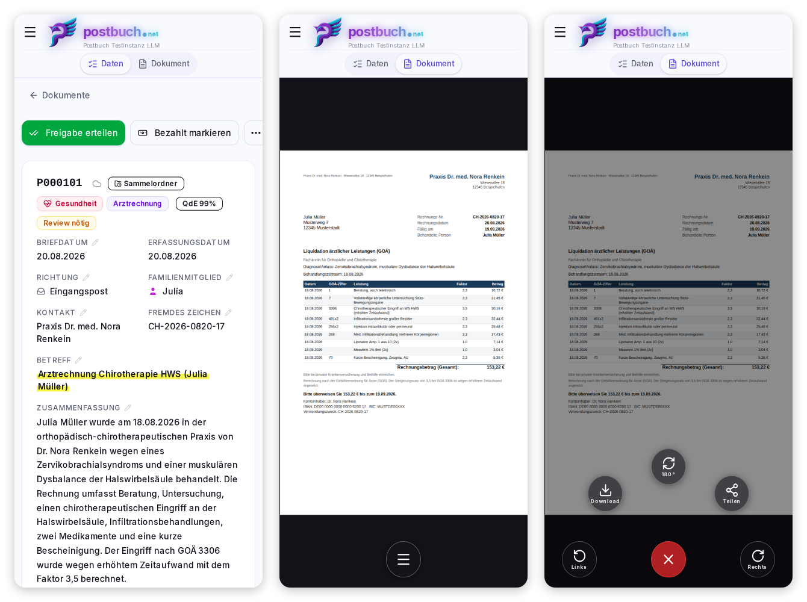

# Mobil und PWA

Die Oberfläche passt sich der Breite des Bildschirms an. Eine Einstellung
dafür gibt es nicht:

- **Unter 1024 px Breite** erscheint die **Mobilansicht** mit Kopfleiste,
  Burgermenü und Karten statt Tabellen – im Hoch- wie im Querformat.
- **Ab 1024 px Breite** erscheint die Desktop-Oberfläche mit Seitenleiste,
  Tabellen und PDF-Panel.

Ein Smartphone zeigt deshalb hoch wie quer die Mobilansicht. Ein großes Tablet
wechselt beim Drehen: hochkant die Mobilansicht, quer die Desktop-Oberfläche.
Am PC zählt die Fensterbreite; ein schmal gezogenes Fenster zeigt ebenfalls die
Mobilansicht.

## Die Mobilansicht

**Kopfleiste.** Oben stehen das Burgermenü, die Wortmarke mit dem Instanznamen
und der Seitentitel. Daneben liegen die Bedienelemente der jeweiligen Seite,
etwa der Umschalter **Daten | Dokument** in der Detailansicht oder der Knopf
für die Gesprächsliste im Assistenten. Gibt es eine Änderung, die sich
rückgängig machen lässt, erscheinen in der Kopfleiste
 **Rückgängig** und gegebenenfalls
 **Wiederholen**.

**Burgermenü.** Es öffnet sich über den ganzen Bildschirm und enthält alle
Ziele der Seitenleiste. Laufende Vorgänge und den Rückgängig-Verlauf zeigt es
ebenfalls an. Hilfe, Einstellungen und Abmelden stehen in der Fußleiste.

**Favoritenleiste.** Am unteren Rand liegen Dashboard, Dokumente, Suche und
Kalender. In der Mitte sitzt der Knopf
 **Scannen** mit farbigem, leicht leuchtendem Symbol für den
[Kamerascan](dokumente-importieren.md#mit-der-kamera-in-postbuchnet); ihn sehen
nur Konten mit Vollzugriff auf Geräten mit Kamera. In der Dokument-Detailansicht und bei geöffneter Bildschirmtastatur
ist die Leiste ausgeblendet.

**Listen.** Statt Tabellen zeigen die Listen Karten. Die Dokumentliste lädt
beim Scrollen weiter, statt zu blättern. Kehrst du aus einem Dokument zurück,
steht die Liste wieder an derselben Stelle. Tabellen in Antworten des
Assistenten erscheinen je Zeile als Block: die erste Spalte als Überschrift,
die übrigen Spalten mit ihrem Namen darunter.

**Dokument-Detailansicht.** Statt eines Seitentitels trägt die Kopfleiste hier
den Umschalter **Daten | Dokument** in der Mitte, der zwischen Metadaten und PDF
wechselt. Die Pfeile links und rechts blättern zum vorigen bzw. nächsten
Dokument der Liste. Eingaben bei „Daten“ bleiben beim Umschalten erhalten.

**Assistent.** Die Gesprächsliste ist anfangs zu. Der Knopf  rechts in der
Kopfleiste öffnet sie über dem Chat. Die Auswahl eines Gesprächs schließt sie
wieder.

**Abrechnungs-Assistent.** Die zusammengeführte Einreichungs-PDF steht in
Schritt 2 direkt in der Seite.

## Desktop-Oberfläche auf Touch-Geräten

Große Tablets im Querformat zeigen die Desktop-Oberfläche. Weil es dort keinen
Mauszeiger gibt, ändert sich gegenüber dem PC:

- Tabellen haben keine Ziehgriffe zum Anpassen der Spaltenbreite.
- Die  Spaltenauswahl öffnet sich als
  eingebettetes Feld statt als schwebendes Menü.
- Die Seitenleiste klappt nicht beim Überfahren auf, sondern erst auf Tippen.

## Bedienung im PDF-Betrachter

In der Mobilansicht zeigt die Dokument-Detailansicht bei **Dokument** einen
eigenen PDF-Betrachter. Er füllt die Fläche unter der Kopfleiste; im
Querformat passt er die ganze Seite in die Höhe ein.

| Geste                              | Wirkung                                                                |
| ---------------------------------- | ---------------------------------------------------------------------- |
| Wischen links / rechts             | eine Seite vor / zurück (ab 60 px waagerechter Strecke, nur ungezoomt) |
| Zwei Finger auseinander / zusammen | stufenloses Zoomen (_Pinch-to-Zoom_)                                   |
| Ein Finger ziehen (gezoomt)        | Bildausschnitt verschieben                                             |
| Doppeltipp                         | Zoom und Ausschnitt zurücksetzen                                       |

Unten in der Mitte sitzt ein großer runder Knopf. Er zeigt ein
 Menüsymbol und klappt auf Tippen
einen **Halbkreis mit fünf Aktionen** auf:

| Position    | Aktion                                                    |
| ----------- | --------------------------------------------------------- |
| links       | 90° nach links drehen                                     |
| links oben  |  Herunterladen |
| oben        | 180° drehen                                               |
| rechts oben |  Teilen                |
| rechts      | 90° nach rechts drehen                                    |

Die drei Drehknöpfe schreiben die Drehung **dauerhaft in die PDF-Datei in der
Dateiablage** zurück – das ist derselbe Vorgang wie im Desktop-PDF-Panel, nicht bloß
eine Anzeigekorrektur. Schlägt er fehl, erscheint drei Sekunden lang eine
Fehlermeldung. Bei einem Dokument ohne PDF sind die Drehknöpfe deaktiviert.

**Teilen** öffnet das Teilen-Menü des Telefons und gibt das PDF an eine andere
App weiter, etwa an die App von PKV oder Beihilfe. Zeigt der Knopf „Nochmal“,
hat das Laden zu lange gedauert; ein zweites Tippen öffnet das Menü sofort.
Kann der Browser keine Dateien teilen, sitzt an dieser Stelle
 **Drucken**.

Ist die Ansicht gezoomt oder verschoben, wechselt der runde Knopf sein Symbol
und setzt bei Tippen zuerst die Ansicht zurück.

## Als App installieren (PWA)

postbuch.net bringt ein Web-App-Manifest und einen Service Worker mit und lässt
sich damit wie eine native App auf den Startbildschirm legen. Das Manifest ist
auf `display: standalone` gestellt – die installierte App läuft also ohne
Adressleiste und ohne Browser-Rahmen; die Statusleiste des Geräts bleibt
sichtbar.

> [!NOTE]
>
> Die PWA-/Browser-Push-Nachrichten sind der empfohlene Benachrichtigungskanal.
> Die alternative Discord-Anbindung ist experimentell und wird nicht empfohlen,
> weil Fehlkonfigurationen sensible Daten offenlegen können. Einrichtung und
> Ereigniskategorien stehen unter [Benachrichtigungen](benachrichtigungen.md).

**Voraussetzung ist eine gleichbleibend erreichbare HTTPS-Adresse.** Ändert sich
die Domain, zeigt die bisherige App weiter auf die alte Adresse und muss über
die neue Adresse erneut installiert werden. Einen Installationsknopf _innerhalb_
der App gibt es bewusst nicht: Die Installation läuft immer über das Menü des
Browsers.

| Plattform         | Browser                  | Stand                                   |
| ----------------- | ------------------------ | --------------------------------------- |
| **Android**       | Chrome, Edge, Brave      | ✅ getestet                             |
| **Windows**       | Chrome, Edge             | ✅ getestet                             |
| **macOS**         | Safari 17+, Chrome, Edge | ⚠️ nicht getestet                       |
| **Linux**         | Chrome, Edge, Chromium   | ⚠️ nicht getestet                       |
| **iPhone / iPad** | Safari                   | ⚠️ nicht getestet – siehe Warnung unten |

Die installierte App erscheint unter Android außerdem im **Teilen-Menü**:
Eine dort geteilte PDF geht direkt in die Pipeline – siehe
[PDFs über das Teilen-Menü übergeben](dokumente-importieren.md#pdfs-über-das-teilen-menü-übergeben).

Auf dem Handy scannt postbuch.net Papier auch direkt mit der Kamera – siehe
[Mit der Kamera in postbuch.net](dokumente-importieren.md#mit-der-kamera-in-postbuchnet).
Das klappt im Browser wie in der installierten App.

Von unterwegs erreicht die installierte App deine Instanz über ein VPN ins
Heimnetz – siehe [Zugriff von unterwegs](zugriff-von-unterwegs.md).

Firefox installiert auf dem Desktop grundsätzlich keine Web-Apps. Unter Android
bietet Firefox „Zum Startbildschirm hinzufügen" an; die Verknüpfung startet die
App, verhält sich aber nicht in allen Punkten wie eine Chrome-Installation.

### Android

1. Die postbuch.net-Adresse über `https://` in Chrome (oder Edge/Brave) öffnen
   und anmelden.
2. Menü (drei Punkte) → **App installieren** bzw. **Zum Startbildschirm
   hinzufügen**.
3. Bestätigen. Die App liegt danach im Launcher und startet wie eine native
   App in einem eigenen Fenster.

Hier greifen alle mobilen Besonderheiten dieses Kapitels, auch der
Doppeldruck-Schutz der
[Zurück-Taste](#die-zurück-taste-im-installierten-zustand).

### Windows

1. Die Adresse in Chrome oder Edge öffnen und anmelden.
2. Rechts in der Adressleiste erscheint ein **Installationssymbol** (Monitor mit
   Pfeil). Alternativ über das Menü – je nach Browserversion unter **Apps →
   Diese Website als App installieren** (Edge) bzw. **Streamen, Speichern und
   Teilen → Seite als App installieren** (Chrome).
3. Bestätigen. Die App bekommt einen Startmenü-Eintrag und ein eigenes Fenster
   ohne Browser-Rahmen; sie lässt sich an die Taskleiste anheften.

Auf Windows funktioniert auch der [Etikettendruck](etiketten-drucken.md), weil
Chrome und Edge dort Web Bluetooth unterstützen.

### macOS

- **Safari ab Version 17:** Menü **Ablage → Zum Dock hinzufügen**.
- **Chrome / Edge:** Installationssymbol in der Adressleiste, wie unter Windows.

### Linux

Chrome, Chromium und Edge bieten das Installationssymbol in der Adressleiste an;
die App landet dann als eigener Fenster-Eintrag im Anwendungsmenü der
Desktop-Umgebung.

### iPhone und iPad

> [!WARNING]
>
> **Auf iOS und iPadOS ist nichts davon getestet.**
>
> Der Entwickler von postbuch.net verfügt über kein Apple-Gerät. Der hier
> beschriebene Weg entspricht dem, was Apple für Web-Apps dokumentiert, ist aber
> an keiner Stelle praktisch überprüft worden – weder die Installation selbst
> noch das Verhalten der App danach. Rechne mit Abweichungen und betrachte die
> iOS-Nutzung als experimentell.

1. Die Adresse in **Safari** öffnen und anmelden.
2. Teilen-Symbol → **Zum Home-Bildschirm**.
3. Namen bestätigen.

Bekannte Einschränkungen unter iOS:

- **Etikettendruck ist nicht möglich**, weil Safari kein Web Bluetooth
  unterstützt – siehe [Etiketten drucken](etiketten-drucken.md).
- **Push-Benachrichtigungen** setzt Apple ab iOS 16.4 voraus und nur, wenn die
  App tatsächlich über „Zum Home-Bildschirm" installiert wurde, nicht im
  normalen Safari-Tab. Auch das ist hier nicht verifiziert.

Andere Browser auf dem iPhone (Chrome, Edge, Firefox) benutzen dieselbe
Safari-Engine und bieten den Homescreen-Weg teilweise ebenfalls an. Getestet ist
auch das nicht.

## Die Zurück-Taste im installierten Zustand

In der installierten App gibt es keine Browser-Zurück-Taste, wohl aber die
Hardware-/Gesten-Zurück-Taste von Android. Ohne Gegenmaßnahme würde ein
unbedachter Rückwärtswisch auf der Startseite die App schließen.

Die installierte App wertet die Zurück-Taste deshalb in dieser Reihenfolge aus:

1. Ist ein Menü, Dialog oder Bottom-Sheet offen, schließt die Taste es.
2. Hat die Seite einen Zurück-Knopf, führt die Taste zu dessen Ziel. Das gilt
   für die Dokument-Detailansicht (zur Liste, Akte oder Suche, aus der du kamst),
   für Akten, Salden sowie für das Dokumentenarchiv im Aktenmodus, bei
   ähnlichen Dokumenten und im Filter auf eine Sammelmappe.
3. Auf Seiten ohne Zurück-Ziel, etwa dem Dashboard oder dem frei aufgerufenen
   Dokumentenarchiv, erscheint:

> **App beenden?** Zum Beenden bitte erneut die Hardware-Zurück-Taste drücken.
> Oder Abbrechen wählen.

Erst der **zweite** Druck beendet wirklich. „Abbrechen" bringt dich zurück in
die App.

Der Schutz ist an die Installationserkennung gekoppelt (Anzeigemodus
`standalone`/`fullscreen`/`minimal-ui`, iOS-Standalone-Flag, Android-Kennung).
Im normalen Browser-Tab greift er nicht – dort funktioniert die Zurück-Taste wie
gewohnt.

## Aktualisierungen

Der Service Worker hat **absichtlich keinen Cache für Netzwerkanfragen**: Alle
Anfragen laufen unverändert über den Browser. Er ist ausschließlich für
[Push-Benachrichtigungen](benachrichtigungen.md) zuständig. Damit kann eine alte
zwischengespeicherte Version dich nie in einem veralteten Zustand festhalten.

Der Webserver liefert `index.html`, den Service Worker und das Manifest mit
`no-store` aus und die Programmdateien unter `/assets/` mit ETag-Prüfung. Nach
einem Update genügt es deshalb in aller Regel, die App zu schließen und wieder
zu öffnen. Hängt sie doch einmal auf einer alten Fassung, hilft ein Neuladen mit
gedrückter Umschalttaste bzw. auf dem Telefon das Leeren der Website-Daten für
diese Adresse.

---

Weiter: [Etiketten drucken](etiketten-drucken.md) ·
[Zurück zur Übersicht](README.md)
